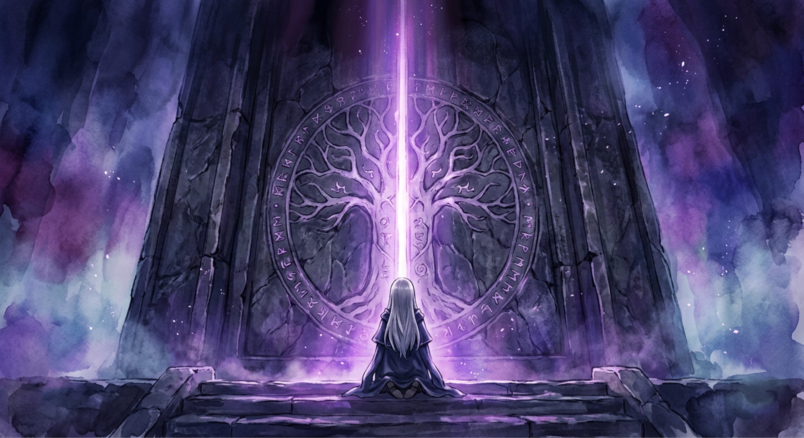
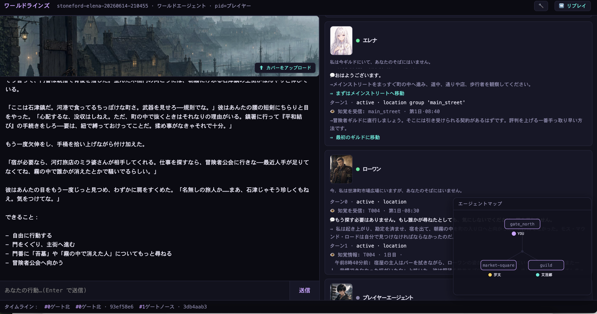
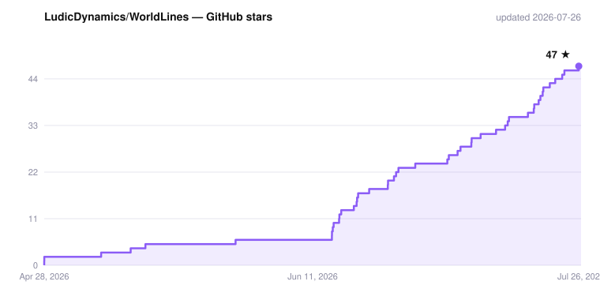

# WorldLines

**言語:** [English](./README.md) · [简体中文](./README.zh.md) · [日本語](./README.ja.md) · [한국어](./README.ko.md)

> **WorldLines — あなたの AI キャラクターと、果てしない世界で遊ぼう。**
> オープンソース:**NeonRP** エンジン(Apache-2.0)、**WorldLines** プロダクト(AGPL-3.0)、ドキュメントとベンチマーク(CC BY 4.0)。

<p align="center">
  
  
  
  <a href="https://doi.org/10.1145/3800965.3834285"></a>
  <a href="https://arxiv.org/abs/2606.16014"></a>
  
  
</p>

<p align="center">
  
</p>

## WorldLines とは

たいていの AI ロールプレイが用意してくれるのは、おしゃべりの相手になるキャラクターです。WorldLines が用意するのは、
**そのキャラクターが暮らしている世界**。場所があり、物価があり、勢力があり、それぞれの考えで動くほかのキャラクターがいて、
崩れないルールがあります。ただ話すだけではありません。どこかへ出かけ、取引をまとめ、喧嘩を売る。世界はそれに、
あとまで残る結果で応えます。

その下で動いているのが **NeonRP**。ひとつの考え方で作られた世界シミュレーションエンジンです ——
*物語はモデルが語り、ルールは世界が守る。*

- **先に相談、次に解決。** やりたいことを伝えるだけ。相談の拍ではその場のキャラクターが応じ、どうするかを話し合います。
  判定役が「まとまった」と判断すると(あるいはあなたが「決まり」/ `@dm` と言うと)、解決の拍で振るべきダイスを振り、
  物語を書き、検証済みの変更をひとつだけ世界に反映します。
- **三者それぞれ。** 世界、あなた、そして各キャラクターが、それぞれ自分の意思を持ちます。あなたの言葉は*試み*であって
  事実ではなく、キャラクターは自分で決めます。
- **世界はファイルでできている。** 読めて、diff が取れて、バージョン管理できるプレーンな JSON / Markdown。ターンのたびに
  コミットが積まれ、そこから巻き戻すことも、分岐させることもできます。

## ビジョン

- **シミュレーションから物語を。** NeonRP は、シミュレートされた世界と、それぞれの目的を持つキャラクター agent のせめぎ合いから物語を生み出します。
- **誰でも書けるオーケストレーション。** ターンの進め方は TRPG からマーダーミステリーまで、言葉だけで設計でき、コンテンツとして共有できます。
- **キャラクター・世界・遊び方を切り離す。** キャラクターの素材と設定、世界の素材と設定、遊びのルールはそれぞれ独立した部品で、自由に組み合わせられます。
- **速いエンジンに、どんなフロントエンドでも。** AI エンジンは速さ・堅牢さ・自由度に徹し、フロントエンドを載せればそのままゲームクライアントになります。
- **エンジンはオープン、プラットフォームはみんなに。** エンジンはオープンソースで、自分の API キーで動きます。[worldlines.gg](https://worldlines.gg) は一般のプレイヤー向けのプラットフォームです。コミュニティはその両方の上でつくります。

## このリポジトリの中身

| フォルダ | 内容 | ライセンス |
|---|---|---|
| [`neonrp/`](./neonrp) | エンジン:ターンループ、スキーマ、パック(`rpg`、`pct`、`werewolf`、`monopoly`、`economy`、`factions` …)、テンプレート、CLI、ターミナル UI、SDK | Apache-2.0 |
| [`worldlines/`](./worldlines) | プロダクト:Web UI(3.0)、ランチャーパッケージ、テンプレート、サンプルワールド、チュートリアル。NeonRP デスクトップアプリ(macOS) | AGPL-3.0 |
| [`documents/`](./documents) | 仕様(world · soul · template · contract · pack)と [docs.worldlines.gg](https://docs.worldlines.gg) のソース | CC BY 4.0 |
| [`benchmarks/`](./benchmarks) | エンジンの設計判断を裏づけるテストスイート | コード Apache-2.0 · データ CC BY 4.0 |
| `CLAUDE.md` · `AGENTS.md` · `.claude/` · `.agents/` | Claude Code / Codex 向けのキャラクター・ワールド制作ワークベンチ(後述) | AGPL-3.0 |

## このリポジトリと PyPI パッケージ

PyPI パッケージは同じコードから作られ、オープンソースではない部分を含みます([`neonrp/LICENSE-PROPRIETARY.md`](./neonrp/LICENSE-PROPRIETARY.md)):

| | このリポジトリ | PyPI `neonrp` / `worldlines` |
|---|---|---|
| ターン | 解決ビート | 相談ビート + 解決ビート、同梱のオーケストレーション |
| Web UI | ワークベンチ、テストベンチ、プレイ画面 | さらに Hub、標準フロントエンド、スマホのチャット画面 |
| 同梱の世界 | 灰橡宅、石津鎮 | 同じ。ほかの公式の世界は worldlines.gg にサインインして取得 |

このリポジトリだけで、自分の API キーを使って動かせます。

## クイックスタート

```bash
pip install worldlines          # または: uv tool install worldlines — プロダクト本体。neonrp エンジンも一緒に入ります
worldlines                      # ローカル Web UI → http://127.0.0.1:8787/local
neonrp                          # ターミナル:「Welcome to WorldLines」ランチャー
```

**デスクトップアプリ(macOS、Apple シリコン):**[NeonRP をダウンロード](https://worldlines.gg/downloads/NeonRP_aarch64.dmg)。公証されていないため、初回は「システム設定 › プライバシーとセキュリティ」で「このまま開く」を押してください。初回起動時にアプリがエンジンをインストールします。

ローカル版はここから入れます(PyPI パッケージ。このリポジトリがそのソースです)。[worldlines.gg](https://worldlines.gg) はインストール不要のオンラインプレイです。
どちらのコマンドも起動時に新しいリリースを確認して自動更新します(先に確認したい場合はゲーム内で `/update mode prompt`)。
リリースノート:[`neonrp/CHANGELOG.md`](./neonrp/CHANGELOG.md) · [GitHub Releases](https://github.com/LudicDynamics/WorldLines/releases)。ワンライナーのインストーラーも引き続き使えます:
`curl -LsSf https://worldlines.gg/install.sh | sh`(macOS / Linux)· `irm https://worldlines.gg/install.ps1 | iex`(Windows)。
Python 3.10 以上が必要です。初回起動時に、使うモデルの選択を案内します。Worldlines アカウントでログインする(`/login`:モデル中継と
Jev 判定役。自分のキーは不要)か、自分のキーを使います(OpenCode Zen、DeepSeek、OpenRouter、Anthropic、OpenAI、GLM、または任意の
OpenAI 互換サーバー)。API キーはあなたのマシンの中にだけ保存されます。

## 遊ぶ

ワールドを選ぶと、そのワールド固有のオープニングシーンから始まります。あとは、やりたいことをそのまま伝えるだけです:

```text
你:   艾琳娜，陪我去杂货铺买一瓶小治疗药水，价你来砍。
主持: 杂货铺在主街，你们走了十来分钟。艾琳娜在柜台前和老苇讲价，说好谈下来的差价一半归她……
      金 18 → 8 · 两人到杂货铺 · +小治疗药水
```

1 ターンは二拍です。**相談**の拍では進行役(「主持」= GM として表示)が場面を描き、その場のキャラクターが応じて、何をするかを話し合います。
話がまとまったら(判定するのは、Worldlines アカウントがあれば Jev、なければそのプレイ自身のモデル。「決まり」や `@dm` ですぐ進めることも
できます)、**解決**の拍で起きたことを語り、変化を世界に書き込みます。状態はまずすぐに書き込まれ、裏でもう一度確認されます。
確認で誤りが見つかれば修正され、何が変わったかを知らせます。

| テンプレート | 内容 |
|---|---|
| グレイオーク館 · 閉ざされた扉 | 霧の小路の突き当たりの古い館。三日前、館の主は扉をくぐったきり出てこない。一夜、口の堅い執事、百面ダイスの推理 |
| ストーンフォード · 霧の退く夜 | 霧が退くのは一年に一夜だけ。夜二つと昼一つで、北門を抜ける備えを町で揃える |

ローカル版に入っているのはこの二つの世界です。ほかの公式の世界は Hub にあり、ログインしなくても見られて、
[worldlines.gg](https://worldlines.gg)(またはローカル Web UI の「Hub ↗」)からそのままオンラインで遊べます。Worldlines アカウントで
ログインすると、ダウンロードしてローカルで遊べます。

<p align="center">
  
</p>

## 作る

このリポジトリを clone して **Claude Code** か **Codex** で開いてください。ワークベンチ(`CLAUDE.md` / `AGENTS.md` と
`.claude/skills/` · `.agents/skills/` のスキル)が、キャラクターひとり、ワールドひとつ、あるいはテンプレート一式の制作を
手伝い、エンジンでチェックまでしてくれます。

```bash
neonrp template lint  my/<id>.template          # 問題をすべて表示。block があると公開できません
neonrp template build my/<id>.template /tmp/try
cd /tmp/try && neonrp tui --play
```

仕様:[world](./documents/spec/world.en.md) · [soul](./documents/spec/soul.en.md) · [template](./documents/spec/template.en.md) · [contract](./documents/spec/contract.en.md) · [pack](./documents/spec/pack.en.md)
· チュートリアル(中国語):[`worldlines/tutorials/`](./worldlines/tutorials)。

## 研究と引用

WorldLines の主張は三本の論文にまとめています —— 世界を定義すること、それを多数のエージェントへ拡張すること、
そして世界が破綻せずに保たれるかどうかはアーキテクチャの性質だと示すこと。概要:[worldlines.gg/research](https://worldlines.gg/research/)。

> **[From Character Role-Play to Orchestrated Reality: LLM-Driven Game World Simulation as a Parameterized-Action POMDP](https://doi.org/10.1145/3800965.3834285)**
> Yuhang Huang, Chenmiao Li, Chaowei Fang. *CHI PLAY Companion '26*, ACM. DOI: 10.1145/3800965.3834285 · [arXiv:2606.16014](https://arxiv.org/abs/2606.16014)

> **Multi-Agent LLM Simulation for Living Game Worlds: Coordinating World, Soul, and Player Agents over a Pub/Sub Message Bus**
> *情報処理学会 エンタテインメントコンピューティング 2026*(京都、2026 年 9 月)。

三本目はワーキングペーパーとして準備中です。

```bibtex
@inproceedings{huang2026orchestrated,
  title     = {From Character Role-Play to Orchestrated Reality: LLM-Driven
               Game World Simulation as a Parameterized-Action POMDP},
  author    = {Huang, Yuhang and Li, Chenmiao and Fang, Chaowei},
  booktitle = {Companion Proceedings of the Annual Symposium on
               Computer-Human Interaction in Play (CHI PLAY Companion '26)},
  publisher = {Association for Computing Machinery},
  year      = {2026},
  doi       = {10.1145/3800965.3834285},
  url       = {https://doi.org/10.1145/3800965.3834285}
}
```

## コントリビュート

このリポジトリは WorldLines の公開リリース用です。開発は上流で行われ、リリースごとにひとつのコミットとしてここに反映されます。
Issue もプルリクエストも歓迎します。採用された PR はまずこのリポジトリにマージされ(あなたの作者情報はこの履歴に残ります)、
次のリリースに取り込まれます。詳しくは [CONTRIBUTING.ja.md](./CONTRIBUTING.ja.md) をご覧ください。

## ライセンス

- `neonrp/` — Apache License 2.0([`neonrp/LICENSE`](./neonrp/LICENSE)、[`neonrp/NOTICE`](./neonrp/NOTICE))
- `worldlines/` とワークベンチ — GNU AGPL v3.0([`worldlines/LICENSE`](./worldlines/LICENSE))
- `documents/`、ベンチマークデータ — CC BY 4.0([`documents/LICENSE`](./documents/LICENSE))
- `worldlines/templates/` と `worldlines/examples/` の設定コンテンツ — テキストは CC BY 4.0、画像と音声は CC BY-NC 4.0
  ([`worldlines/CONTENT-LICENSE.md`](./worldlines/CONTENT-LICENSE.md))

「NeonRP」「WorldLines」は Ludic Dynamics の名称です。各ライセンスはこれらの名称を使用する権利を付与するものではありません。

## コミュニティ

- [worldlines.gg](https://worldlines.gg) · [docs.worldlines.gg](https://docs.worldlines.gg) · [Discord](https://discord.gg/HJYWbdqWrE) · `info@worldlines.gg`

<p align="center">
  <picture>
    <source media="(prefers-color-scheme: dark)" srcset="./worldlines/assets/star-history-dark.svg" />
    
  </picture>
</p>

開発:**nikoloside** & **redoctober**。推進:[Ludic Dynamics](https://ludicdynamics.com)。
