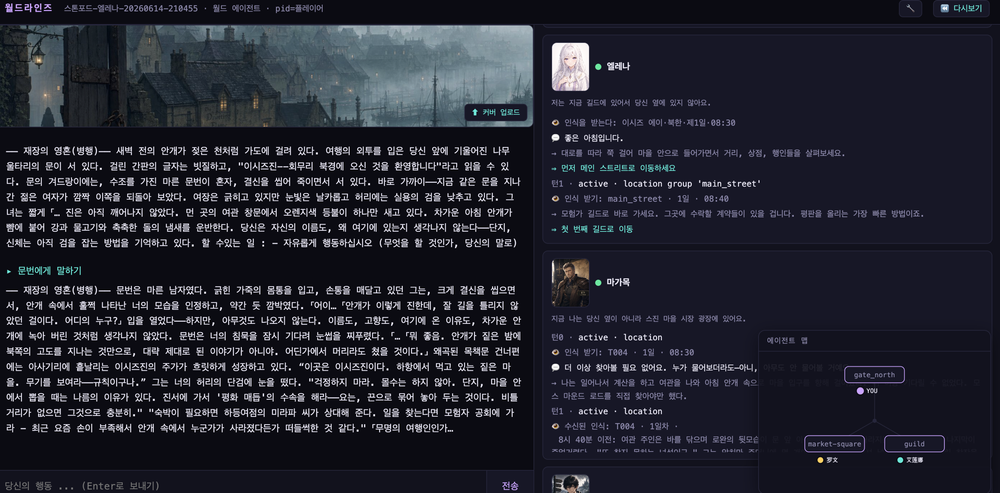

# WorldLines

**언어:** [English](./README.md) · [简体中文](./README.zh.md) · [日本語](./README.ja.md) · [한국어](./README.ko.md)

> **WorldLines — 당신의 AI 캐릭터와 함께, 끝없는 세계에서 놀아 보세요.**
> 오픈 소스: **NeonRP** 엔진(Apache-2.0), **WorldLines** 제품(AGPL-3.0), 문서와 벤치마크(CC BY 4.0).

<p align="center">
  
  
  
  <a href="https://doi.org/10.1145/3800965.3834285"></a>
  <a href="https://arxiv.org/abs/2606.16014"></a>
  
  
</p>

<p align="center">
  
</p>

## WorldLines는

대부분의 AI 롤플레이는 대화할 캐릭터 하나를 건네줍니다. WorldLines가 건네주는 것은 **그 캐릭터가 살아가는 세계**입니다.
장소가 있고, 물가가 있고, 세력이 있고, 저마다 생각을 가진 다른 캐릭터들이 있으며, 무너지지 않는 규칙이 있습니다.
그저 이야기만 나누는 게 아닙니다. 어딘가로 떠나고, 거래를 맺고, 싸움을 걸면 세계는 오래 남는 결과로 응답합니다.

그 밑에서 돌아가는 것이 **NeonRP**, 하나의 생각에서 출발한 세계 시뮬레이션 엔진입니다 —
*이야기는 모델이 들려주고, 규칙은 세계가 지킨다.*

- **먼저 상의, 다음에 해결.** 하고 싶은 일을 말하면 됩니다. 상의 박자에서는 그 자리의 캐릭터들이 대답하고 어떻게 할지
  이야기합니다. 판정자가 정리됐다고 보면(또는 당신이 「결정」/ `@dm`이라고 하면) 해결 박자에서 굴려야 할 주사위를 굴리고,
  이야기를 쓰고, 검증을 거친 변경 하나를 세계에 반영합니다.
- **세 주체.** 세계, 당신, 그리고 각 캐릭터가 저마다의 주체성을 가집니다. 당신의 말은 사실이 아니라 *시도*이며,
  캐릭터는 스스로 결정합니다.
- **세계는 파일이다.** 읽고, diff를 보고, 버전 관리할 수 있는 평범한 JSON / Markdown입니다. 턴마다 커밋이 하나씩
  쌓이고, 언제든 되돌리거나 거기서 갈라져 나갈 수 있습니다.

## 저장소 구성

| 폴더 | 내용 | 라이선스 |
|---|---|---|
| [`neonrp/`](./neonrp) | 엔진: 턴 루프, 스키마, 팩(`rpg`, `pct`, `werewolf`, `monopoly`, `economy`, `factions` …), 템플릿, CLI, 터미널 UI, SDK | Apache-2.0 |
| [`worldlines/`](./worldlines) | 제품: 웹 UI(3.0), 런처 패키지, 템플릿, 예제 월드, 튜토리얼. 데스크톱 셸(아직 출시 안 됨) | AGPL-3.0 |
| [`documents/`](./documents) | 사양(world · soul · template · contract · pack)과 [docs.worldlines.gg](https://docs.worldlines.gg)의 원문 | CC BY 4.0 |
| [`benchmarks/`](./benchmarks) | 엔진의 설계 결정을 뒷받침하는 테스트 스위트 | 코드 Apache-2.0 · 데이터 CC BY 4.0 |
| `CLAUDE.md` · `AGENTS.md` · `.claude/` · `.agents/` | Claude Code / Codex용 캐릭터·월드 제작 워크벤치(아래 참고) | AGPL-3.0 |

## 빠른 시작

```bash
pip install worldlines          # 또는: uv tool install worldlines — 제품 본체. neonrp 엔진도 함께 설치됩니다
worldlines                      # 로컬 웹 UI → http://127.0.0.1:8787/local
neonrp                          # 터미널: 「Welcome to WorldLines」 런처
```

로컬 버전은 여기서 설치합니다(PyPI 패키지. 이 저장소가 그 소스입니다). [worldlines.gg](https://worldlines.gg) 는 설치 없이 즐기는 온라인 플레이입니다.
두 명령 모두 실행 시 새 릴리스를 확인해 스스로 업데이트합니다(먼저 물어보게 하려면 게임 안에서 `/update mode prompt`).
릴리스 노트: [`neonrp/CHANGELOG.md`](./neonrp/CHANGELOG.md) · [GitHub Releases](https://github.com/LudicDynamics/WorldLines/releases). 한 줄 설치도 계속 쓸 수 있습니다:
`curl -LsSf https://worldlines.gg/install.sh | sh` (macOS / Linux) · `irm https://worldlines.gg/install.ps1 | iex` (Windows).
Python 3.10 이상이 필요합니다. 처음 실행하면 모델을 고르는 과정을 안내합니다. Worldlines 계정으로 로그인하거나(`/login`: 모델 중계와
Jev 판정자, 내 키 불필요) 내 키를 씁니다(OpenCode Zen, DeepSeek, OpenRouter, Anthropic, OpenAI, GLM, 또는 OpenAI 호환 서버).
API 키는 당신의 컴퓨터에만 저장됩니다.

## 플레이

월드를 고르면 그 월드만의 오프닝 장면으로 시작합니다. 그다음엔 하고 싶은 일을 그냥 말하면 됩니다:

```text
你:   艾琳娜，陪我去杂货铺买一瓶小治疗药水，价你来砍。
主持: 杂货铺在主街，你们走了十来分钟。艾琳娜在柜台前和老苇讲价，说好谈下来的差价一半归她……
      金 18 → 8 · 两人到杂货铺 · +小治疗药水
```

한 턴은 두 박자입니다. **상의** 박자에서는 진행자(「主持」= GM으로 표시)가 장면을 그리고 그 자리의 캐릭터들이 대답하며, 무엇을 할지
이야기합니다. 이야기가 정리되면(판정은 Worldlines 계정이 있으면 Jev, 없으면 그 판의 모델이 합니다. 「결정」이나 `@dm`으로 바로
넘어갈 수도 있습니다) **해결** 박자에서 일어난 일을 이야기하고 변화를 세계에 기록합니다. 상태는 먼저 바로 기록되고, 뒤에서 한 번 더
확인됩니다. 확인에서 잘못이 보이면 고치고, 무엇이 바뀌었는지 알려 줍니다.

| 템플릿 | 내용 |
|---|---|
| 그레이오크 저택 · 닫힌 문 | 안개 골목 끝의 낡은 저택, 사흘 전 주인이 문으로 들어간 뒤 나오지 않았다. 하룻밤, 입이 무거운 집사, 백분위 주사위 추리 |
| 스톤포드 · 안개가 물러나는 밤 | 일 년에 하룻밤만 안개가 물러난다. 이틀 밤과 하루 낮 동안 북문을 나설 채비를 마을에서 갖춘다 |

로컬판에는 이 두 세계가 들어 있습니다. 다른 공식 세계는 Hub에 있습니다. 로그인하지 않아도 볼 수 있고,
[worldlines.gg](https://worldlines.gg)(또는 로컬 웹 UI의 「Hub ↗」)에서 바로 온라인으로 플레이합니다. Worldlines 계정으로
로그인하면 내려받아 로컬에서 플레이할 수 있습니다.

<p align="center">
  
</p>

## 만들기

이 저장소를 clone해서 **Claude Code**나 **Codex**로 열어 보세요. 워크벤치(`CLAUDE.md` / `AGENTS.md`와
`.claude/skills/` · `.agents/skills/`의 스킬)가 캐릭터 하나, 월드 하나, 혹은 템플릿 한 벌을 만드는 일을 돕고,
엔진으로 검사까지 해 줍니다.

```bash
neonrp template lint  my/<id>.template          # 모든 문제를 표시. block이 있으면 공개할 수 없습니다
neonrp template build my/<id>.template /tmp/try
cd /tmp/try && neonrp tui --play
```

사양: [world](./documents/spec/world.en.md) · [soul](./documents/spec/soul.en.md) · [template](./documents/spec/template.en.md) · [contract](./documents/spec/contract.en.md) · [pack](./documents/spec/pack.en.md)
· 튜토리얼(중국어): [`worldlines/tutorials/`](./worldlines/tutorials).

## 연구와 인용

WorldLines의 주장은 세 편의 논문으로 정리되어 있습니다 — 세계를 정의하고, 이를 다수의 에이전트로 확장하고,
세계가 무너지지 않고 유지되는 것이 아키텍처의 성질임을 보입니다. 요약: [worldlines.gg/research](https://worldlines.gg/research/).

> **[From Character Role-Play to Orchestrated Reality: LLM-Driven Game World Simulation as a Parameterized-Action POMDP](https://doi.org/10.1145/3800965.3834285)**
> Yuhang Huang, Chenmiao Li, Chaowei Fang. *CHI PLAY Companion '26*, ACM. DOI: 10.1145/3800965.3834285 · [arXiv:2606.16014](https://arxiv.org/abs/2606.16014)

> **Multi-Agent LLM Simulation for Living Game Worlds: Coordinating World, Soul, and Player Agents over a Pub/Sub Message Bus**
> *IPSJ Entertainment Computing 2026* (교토, 2026년 9월).

세 번째 논문은 워킹 페이퍼로 준비 중입니다.

```bibtex
@inproceedings{huang2026orchestrated,
  title     = {From Character Role-Play to Orchestrated Reality: LLM-Driven
               Game World Simulation as a Parameterized-Action POMDP},
  author    = {Huang, Yuhang and Li, Chenmiao and Fang, Chaowei},
  booktitle = {Companion Proceedings of the Annual Symposium on
               Computer-Human Interaction in Play (CHI PLAY Companion '26)},
  publisher = {Association for Computing Machinery},
  year      = {2026},
  doi       = {10.1145/3800965.3834285},
  url       = {https://doi.org/10.1145/3800965.3834285}
}
```

## 기여하기

이 저장소는 WorldLines의 공개 릴리스 저장소입니다. 개발은 업스트림에서 이루어지며, 릴리스마다 커밋 하나로 이곳에 반영됩니다.
이슈와 풀 리퀘스트 모두 환영합니다. 채택된 PR은 먼저 이 저장소에 병합되고(작성자 정보는 이 이력에 그대로 남습니다),
다음 릴리스에 포함됩니다. 자세한 내용은 [CONTRIBUTING.ko.md](./CONTRIBUTING.ko.md)를 참고하세요.

## 라이선스

- `neonrp/` — Apache License 2.0 ([`neonrp/LICENSE`](./neonrp/LICENSE), [`neonrp/NOTICE`](./neonrp/NOTICE))
- `worldlines/`와 워크벤치 — GNU AGPL v3.0 ([`worldlines/LICENSE`](./worldlines/LICENSE))
- `documents/`, 벤치마크 데이터 — CC BY 4.0 ([`documents/LICENSE`](./documents/LICENSE))
- `worldlines/templates/`와 `worldlines/examples/`의 설정 콘텐츠 — 텍스트 CC BY 4.0, 이미지와 오디오 CC BY-NC 4.0
  ([`worldlines/CONTENT-LICENSE.md`](./worldlines/CONTENT-LICENSE.md))

"NeonRP"와 "WorldLines"는 Ludic Dynamics의 명칭이며, 각 라이선스는 이 명칭을 사용할 권리를 부여하지 않습니다.

## 커뮤니티

- [worldlines.gg](https://worldlines.gg) · [docs.worldlines.gg](https://docs.worldlines.gg) · [Discord](https://discord.gg/HJYWbdqWrE) · `info@worldlines.gg`

<p align="center">
  <picture>
    <source media="(prefers-color-scheme: dark)" srcset="./worldlines/assets/star-history-dark.svg" />
    
  </picture>
</p>

개발: **nikoloside** & **redoctober**, 추진: [Ludic Dynamics](https://ludicdynamics.com).
