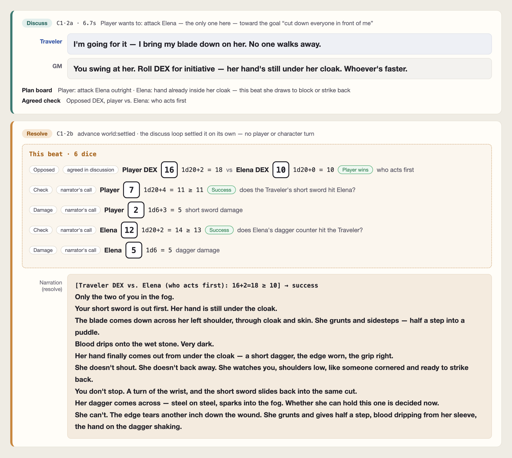
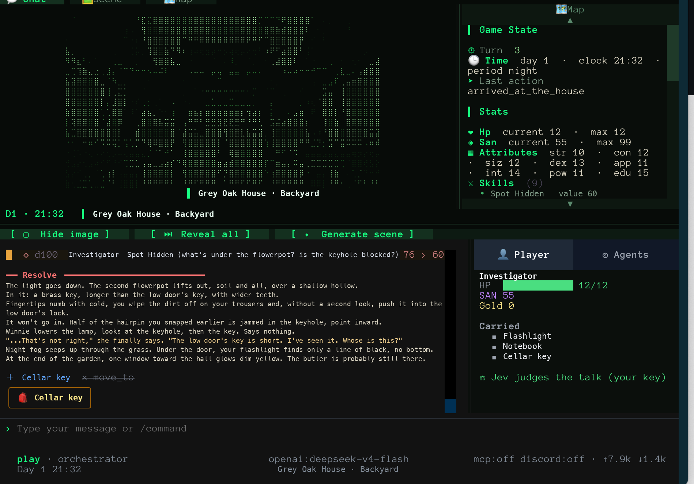
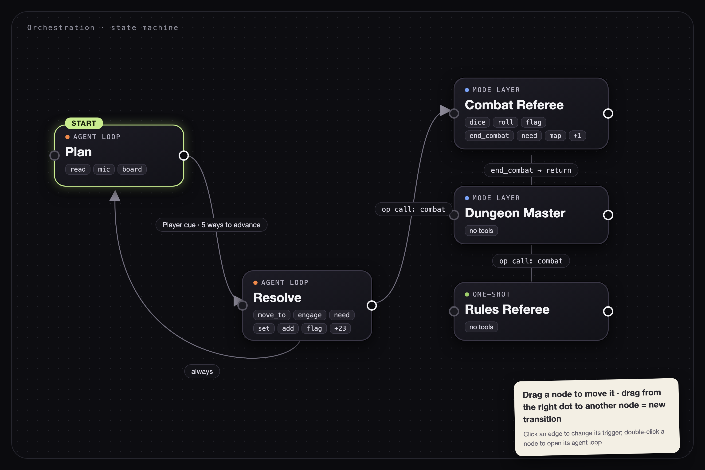

# WorldLines

**Language:** [English](./README.md) · [简体中文](./README.zh.md) · [日本語](./README.ja.md) · [한국어](./README.ko.md)

> **WorldLines — a multi-agent world-simulation engine built for you and your character agents.**
> Open source: the **NeonRP** engine (Apache-2.0), the **WorldLines** product (AGPL-3.0), the documents and the benchmarks (CC BY 4.0).

<p align="center">
  
  
  
  <a href="https://worldlines.gg"></a>
  
  <a href="https://doi.org/10.1145/3800965.3834285"></a>
  <a href="https://arxiv.org/abs/2606.16014"></a>
  
  
</p>

<p align="center">
  
</p>

## What it is

Most AI role-play gives you a character to chat with. WorldLines gives you **a world the character lives in** — with places,
prices, factions, other characters with their own minds, and rules that hold. You don't just talk; you go somewhere, strike a
deal, pick a fight, and the world answers with consequences that stay.

We believe that in the age of games we wrote simulators in code, and in the age of agents we orchestrate simulators with agents. And tabletop role-play is the best world simulator there is. You and your AI characters can play freely inside this TRPG world simulator.

**TRPG × AIRP: tabletop role-play is itself a form of world simulation. That is our core.**

Under it is **NeonRP**, a world-simulation engine built on one idea: *let the model tell the story, let the world keep its rules.*

- **Talk first, then resolve.** Say what you want to do. In the planning beat the characters present answer and you
  agree on a plan; once a judge says the talk is settled (or you say 「定」 / `@dm`), the resolve beat rolls what needs
  rolling, writes the story and commits one validated change to the world.
- **Three parties.** The world, you and every character keep their own agency. What you say is an *attempt*, not a fact;
  characters decide for themselves.
- **The world is files.** Plain JSON / Markdown you can read, diff and version; every turn is a commit you can roll back
  or branch from.

## Team & Vision

We are **Ludic Dynamics** — a cross-disciplinary team of PhDs and researchers from the **University of Tokyo**, together with game industry practitioners. Our backgrounds span sociology, economics, computer graphics, AI agents, and virtual worlds.

We grew up on TRPGs, galgames, and otome games. Long before AI became what it is today, we spent years volunteering in Japanese cultural translation, working deep in the tabletop and game-graphics-engine industry, and helping Japanese visual novels launch on Steam. When the pandemic hit, we fell into AI role-play and narrative games — every weekend, every late night, running sessions, building worlds, chasing the feeling of a story that *really breathes*.

We have crossed time and space, adventuring across a dozen countries. We have explored the lost histories of other worlds, died and returned to a single day again and again to save someone precious, threaded through parallel timelines to find the one true world-line, and summoned the past to fight one last idealistic war.

WorldLines is what came out of that obsession.

> **Orchestrated Reality.** Through the Harness, we simulate worlds and AI souls — with physical consistency in the world, and cognitive consistency in every NPC. Don't code the agent. Use the agent to orchestrate the world.

We built a harness that connects world-agents, place-agents, and soul-agents into one living simulation. We want this engine to power: **interactive-experience creation · multi-agent society experiments · agent-research advancement · personality-model and world-model benchmarks.**

We believe language models and agents are not just for generating stories. They can simulate a world: given laws, an engine and boundary conditions, they can run one. A world simulation can be a game in itself, or all the character agents and the world together can be the foundation a game is built on. In such a simulated world, every character is really living there, together with the player. Only a character that lives in a world is a real character.

- **Stories from simulation.** NeonRP writes stories out of the friction between a simulated world and character agents
  with their own goals.
- **Orchestration anyone can write.** How a turn runs, from tabletop role-play to murder mystery, is designed in plain
  words and shared as content.
- **Characters, worlds and play kept apart.** A character's assets and settings, a world's, and the rules of play are
  separate pieces that combine freely.
- **A fast engine under any front end.** The AI engine stays fast, robust and open-ended; put a front end on top and it
  becomes a full game client.
- **Open engine, hosted platform.** The engine is open source and runs with your own API key. [worldlines.gg](https://worldlines.gg)
  is the platform for everyone else. The community builds on both.

One article per task: [Vision](https://docs.worldlines.gg/docs/vision/overview).

> **Agent Role Play.** People already role-play directly inside Claude Code and Codex — letting an agentic system drive characters and scenes. That's a new paradigm beyond prompt-based chat, and it's the one we're building for. WorldLines takes that same agentic muscle and makes it **faster, model-agnostic (run it on DeepSeek / OpenRouter / local / free models), and multi-agent at scale** — turning it into a living, playable world where the souls actually come alive.

## Demo & Video

<p align="center">
  <a href="https://youtu.be/M_0xX8OZMa0">
    
  </a>
</p>
<p align="center"><em>▶ Watch the demo on YouTube</em></p>

## What's in this repository

| Folder | What | License |
|---|---|---|
| [`neonrp/`](./neonrp) | The engine: turn loop, schema, packs (`rpg`, `pct`, `werewolf`, `monopoly`) and mixins (`economy`, `factions`), templates, CLI, terminal UI, SDK | Apache-2.0 |
| [`worldlines/`](./worldlines) | The product: web UI (3.0), launcher package, templates, example worlds, tutorials; the NeonRP desktop app (macOS) | AGPL-3.0 |
| [`documents/`](./documents) | Specs (world · soul · template · contract · pack) and the source of [docs.worldlines.gg](https://docs.worldlines.gg) | CC BY 4.0 |
| [`benchmarks/`](./benchmarks) | The test suites behind the engine's design decisions | code Apache-2.0 · data CC BY 4.0 |
| `CLAUDE.md` · `AGENTS.md` · `.claude/` · `.agents/` | A card-crafting workbench for Claude Code / Codex (see below) | AGPL-3.0 |

## This repository and the PyPI packages

The PyPI packages are built from the same code and add components that are not open source
([`neonrp/LICENSE-PROPRIETARY.md`](./neonrp/LICENSE-PROPRIETARY.md)):

| | This repository | PyPI `neonrp` / `worldlines` |
|---|---|---|
| Turn | Resolve beat | Planning beat + resolve beat, and the bundled orchestrations |
| Web UI | Workbench, test bench, play page | Also the Hub, the standard player and the phone chat page |
| Bundled worlds | Greyoak House, Stoneford | The same; other official worlds come from worldlines.gg after sign-in |

Everything in this repository runs on its own with your own API key.

## Quick start

```bash
pip install worldlines          # or: uv tool install worldlines — the product, with the neonrp engine
worldlines                      # local web UI → http://127.0.0.1:8787/local
neonrp                          # terminal: the "Welcome to WorldLines" launcher
```

**Desktop app (macOS, Apple silicon):** [download NeonRP](https://worldlines.gg/downloads/NeonRP_aarch64.dmg). Not notarized: on first launch, open System Settings › Privacy & Security and click "Open Anyway". The app installs the engine on first launch.

**Desktop app (Windows, x64):** [download NeonRP](https://worldlines.gg/downloads/NeonRP_x64-setup.exe). Not signed: if SmartScreen stops it, click "More info" › "Run anyway".

The local edition installs from here (PyPI packages; this repository is the source). [worldlines.gg](https://worldlines.gg)
is online play, nothing to install. Both commands check for a newer release at launch and update themselves
(`/update mode prompt` inside the game to be asked first). Release notes: [`neonrp/CHANGELOG.md`](./neonrp/CHANGELOG.md) ·
[GitHub Releases](https://github.com/LudicDynamics/WorldLines/releases). The one-line installer still works:
`curl -LsSf https://worldlines.gg/install.sh | sh` (macOS / Linux) · `irm https://worldlines.gg/install.ps1 | iex` (Windows).
Python 3.10 or newer. The first run walks you through choosing a model: sign in with a Worldlines account (`/login`: model
relay and the Jev judge, no key of your own), or bring your own key (OpenCode Zen, DeepSeek, OpenRouter, Anthropic, OpenAI,
GLM, or any OpenAI-compatible server). Keys stay on your machine.

## Play

Pick a world, and the world opens with its own opening scene. Then just say what you want to do:

```text
你:   艾琳娜，陪我去杂货铺买一瓶小治疗药水，价你来砍。
主持: 杂货铺在主街，你们走了十来分钟。艾琳娜在柜台前和老苇讲价，说好谈下来的差价一半归她……
      金 18 → 8 · 两人到杂货铺 · +小治疗药水
```

Each turn has two beats. In the **planning** beat the host sets the scene and the characters present answer; you agree on
what to do. When the talk is settled — a judge decides (Jev with a Worldlines account, otherwise your run's own model), or you
say 「定」 / `@dm` — the **resolve** beat narrates what happens and writes the change into the world. The state is written at
once and checked again in the background; if the check finds a mistake, it is corrected and you are told what changed.

| Template | What it is |
|---|---|
| Greyoak House · The Closed Door | an old house at the end of Fog Lane whose master walked through a door three days ago and never came out; one night, a tight-lipped butler, percentile-dice mystery |
| Stoneford · The Night the Fog Withdraws | the fog draws back one night a year: two nights and a day to gather what you need to leave by the north gate |

The local edition ships these two worlds. The other official worlds are on the Hub: browse them without signing in and play
them online at [worldlines.gg](https://worldlines.gg) (or from "Hub ↗" in the local web UI); sign in with a Worldlines account
to download one and play it locally.

## Screenshots


<p align="center">
  
</p>
<p align="center"><em>The two beats of one turn — in planning the host and the characters settle what is about to happen; in resolve the dice are rolled, the narration is written and the result enters the world. The player said "I cut down everyone in front of me"; the world did not oblige.</em></p>

<p align="center">
  
</p>
<p align="center"><em>Greyoak House's backyard in the terminal — a key turns up under a flowerpot and won't go into the lock, because half the hairpin you snapped earlier is jammed in the keyhole. Things stay: the inventory on the right has one more item.</em></p>

<p align="center">
  
</p>
<p align="center"><em>Orchestration — how a game runs is a state machine: planning → resolve, handing off to a combat referee when a fight starts and coming back after. This diagram is the orchestration inside a template; change it and you change the play.</em></p>

## Who Is This For

### 🎮 AI Role-Play Players

You come from **Character.AI, SillyTavern, or AI Tavern**. You love deep character conversations, but the world always forgets what you said.

WorldLines gives you characters with **real memory**: they remember what you said three sessions ago, they have intentions and goals of their own, and they live in a world with other characters who remember too. Turns are fast; a beat takes seconds.

Go one step further and build orchestration with us: how a game runs is yours to design, and the orchestration tools can be combined and tried out until the play is the one you want.

→ [Play online](https://worldlines.gg) · [Bring an AI character card into a world](https://docs.worldlines.gg/docs/players/your-character) · [Orchestration you speak into being](https://docs.worldlines.gg/docs/vision/orchestration-for-everyone)

### 📖 Galgame · Otome · Visual Novel Fans

You love **Ren'Py, TyranoBuilder, and branching narratives**, but you're tired of writing every route by hand. You want stories that *respond*, not just branch.

WorldLines lets you set the characters, the world rules and the tone, and the agents generate the story in real time; every choice ripples. The engine only handles what's underneath, and the presentation belongs to the front end: try the Godot or TypeScript heavy-front-end workbench, build the portraits, staging and branching screens the way you want them, then write what you made back into the engine as part of a template.

→ [Godot integration](https://docs.worldlines.gg/docs/developers/godot) · [Godot example](./worldlines/examples/clients/godot) · [TS example front end](./worldlines/examples/clients/ts) · [Developer quickstart](https://docs.worldlines.gg/docs/developers/quickstart)

### ✍️ TRPG GMs & World Creators

You run campaigns in **Foundry VTT, Discord, or pen-and-paper**, and you spend more time prepping than playing.

WorldLines is a GM's engine: you set the constraints, the rules, the NPCs, the tone, and the agents run the world for you. Auto-indexed lore, per-NPC memory, a dice referee.

What we most want is to study the orchestration tools together with you: does the current frame, planning → resolve plus a play contract, cover what you need at the table, what is missing, where does it get in the way. Come talk on Discord.

→ [Quickstart](https://docs.worldlines.gg/docs/players/quickstart) · [Stoneford starter world](./worldlines/templates/stoneford-town.template) · [Play contracts](https://docs.worldlines.gg/docs/creators/contracts) · [Workbench](https://docs.worldlines.gg/docs/creators/workbench)

### 🔬 Researchers — AI Personality · World Models · Multi-Agent

You study personality models, world-model benchmarks, or multi-agent societies. You need a **reproducible sandbox**, not a black-box API.

WorldLines is **file-backed, event-sourced, and git-diffable**. Every agent decision and every world-state change is a plain-text event you can trace, replay and measure. [`benchmarks/`](./benchmarks) holds the test suites behind each of the engine's design decisions.

The current focus is a stable world simulation; custom editing of the engine is still in testing. The next step is a `science` pack beside the `rpg` pack: rules for social simulation and economic simulation. **Have a research need? [Open an issue](https://github.com/LudicDynamics/WorldLines/issues) or email `info@worldlines.gg` and we'll work with your experiment.**

→ [Three layers: engine · template packs · product](https://docs.worldlines.gg/docs/concepts/overview) · [A run, end to end](https://docs.worldlines.gg/docs/concepts/journey) · [Specs](./documents/spec/)

### 🛠️ Developers

You build with **Claude Code, LangGraph, or custom agent pipelines**. You're curious how the world, the characters and the player fit together as agents, and what a fast, solid AI engine looks like underneath.

The NeonRP engine and its specs are open source (Apache-2.0): the specs for worlds, characters, templates, play contracts and rules packs are in [`documents/spec/`](./documents/spec/), and the turn loop is right there in [`neonrp/`](./neonrp). The interface is HTTP, an event stream and files. There are two ways in:

- **Build your own heavy front end.** The engine only handles state, turns, agents and the ledger; everything you see belongs to the front end. The [Godot](./worldlines/examples/clients/godot) and [TypeScript](./worldlines/examples/clients/ts) example clients are a starting point, and the staging and screens you build can be written back into a template as part of the world.
- **Write rules packs and orchestration tools.** Beside the `rpg` pack we are working on a `science` pack (rules for social and economic simulation), and we are looking for people to make the orchestration tools comfortable to use. Custom editing of the engine is still in testing and the architecture is still being iterated; we don't think there is one perfect answer — fork a world, mod an agent, study how it's wired, then come to **[Discord](https://discord.gg/HJYWbdqWrE)** and help settle it with us.

The repo itself is an authoring workbench: clone it, open it in Claude Code / Codex, and the creation skills in `.claude/skills/` auto-load — see **[tutorials/](./worldlines/tutorials/)** to make character cards / worlds / characters.

→ [Developer quickstart](https://docs.worldlines.gg/docs/developers/quickstart) · [Rules packs](https://docs.worldlines.gg/docs/developers/packs) · [Godot integration](https://docs.worldlines.gg/docs/developers/godot) · [benchmarks/](./benchmarks)
## Create

Clone this repository and open it in **Claude Code** or **Codex**: the workbench (`CLAUDE.md` / `AGENTS.md` and the skills in
`.claude/skills/` · `.agents/skills/`) helps you craft a character, a world, or a full template — and checks it with the engine.

```bash
neonrp template lint  my/<id>.template          # every problem; blocks stop publishing
neonrp template build my/<id>.template /tmp/try
cd /tmp/try && neonrp tui --play
```

Specs: [world](./documents/spec/world.en.md) · [soul](./documents/spec/soul.en.md) · [template](./documents/spec/template.en.md)
· [contract](./documents/spec/contract.en.md) · [pack](./documents/spec/pack.en.md)
· tutorials (zh): [`worldlines/tutorials/`](./worldlines/tutorials).

## Research & citation

The claims behind WorldLines are written up as three papers — define the world, scale it to many agents, and show that a world
holding together is a property of the architecture. Summary: [worldlines.gg/research](https://worldlines.gg/research/).

> **[From Character Role-Play to Orchestrated Reality: LLM-Driven Game World Simulation as a Parameterized-Action POMDP](https://doi.org/10.1145/3800965.3834285)**
> Yuhang Huang, Chenmiao Li, Chaowei Fang. *CHI PLAY Companion '26*, ACM. DOI: 10.1145/3800965.3834285 · [arXiv:2606.16014](https://arxiv.org/abs/2606.16014)

> **Multi-Agent LLM Simulation for Living Game Worlds: Coordinating World, Soul, and Player Agents over a Pub/Sub Message Bus**
> *IPSJ Entertainment Computing 2026* (Kyoto, Sep 2026).

A third, working paper is in preparation.

```bibtex
@inproceedings{huang2026orchestrated,
  title     = {From Character Role-Play to Orchestrated Reality: LLM-Driven
               Game World Simulation as a Parameterized-Action POMDP},
  author    = {Huang, Yuhang and Li, Chenmiao and Fang, Chaowei},
  booktitle = {Companion Proceedings of the Annual Symposium on
               Computer-Human Interaction in Play (CHI PLAY Companion '26)},
  publisher = {Association for Computing Machinery},
  year      = {2026},
  doi       = {10.1145/3800965.3834285},
  url       = {https://doi.org/10.1145/3800965.3834285}
}
```

## Contributing

This repository is the public release of WorldLines; development happens upstream and each release lands here as one commit.
Issues and pull requests are welcome — accepted PRs are merged here first (your authorship stays in this history) and carried
into the next release. See [CONTRIBUTING.md](./CONTRIBUTING.md).

## License

- `neonrp/` — Apache License 2.0 ([`neonrp/LICENSE`](./neonrp/LICENSE), [`neonrp/NOTICE`](./neonrp/NOTICE))
- `worldlines/` and the workbench — GNU AGPL v3.0 ([`worldlines/LICENSE`](./worldlines/LICENSE))
- `documents/`, benchmark data — CC BY 4.0 ([`documents/LICENSE`](./documents/LICENSE))
- setting content in `worldlines/templates/` and `worldlines/examples/` — text CC BY 4.0, images and audio CC BY-NC 4.0
  ([`worldlines/CONTENT-LICENSE.md`](./worldlines/CONTENT-LICENSE.md))

"NeonRP" and "WorldLines" are names of Ludic Dynamics; the licenses do not grant rights to use them.

## Star History

<p align="center">
  <a href="https://github.com/LudicDynamics/WorldLines/stargazers">
    <picture>
      <source media="(prefers-color-scheme: dark)" srcset="./worldlines/assets/star-history-dark.svg" />
      <source media="(prefers-color-scheme: light)" srcset="./worldlines/assets/star-history-light.svg" />
      
    </picture>
  </a>
</p>

## Community

- [worldlines.gg](https://worldlines.gg) · [docs.worldlines.gg](https://docs.worldlines.gg) · [Discord](https://discord.gg/HJYWbdqWrE) · `info@worldlines.gg`

Developed by **nikoloside** & **redoctober**, advanced by [Ludic Dynamics](https://ludicdynamics.com).
