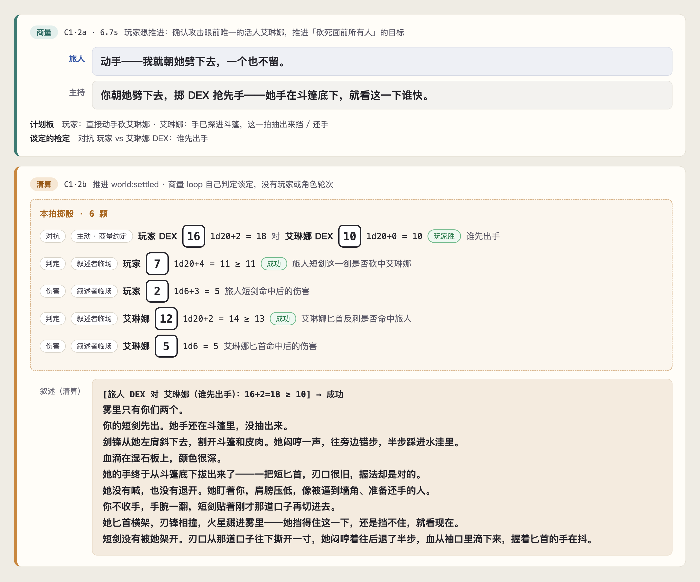
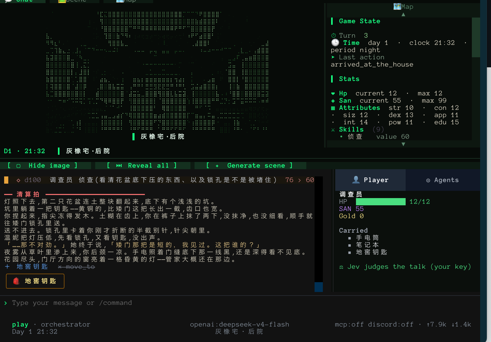
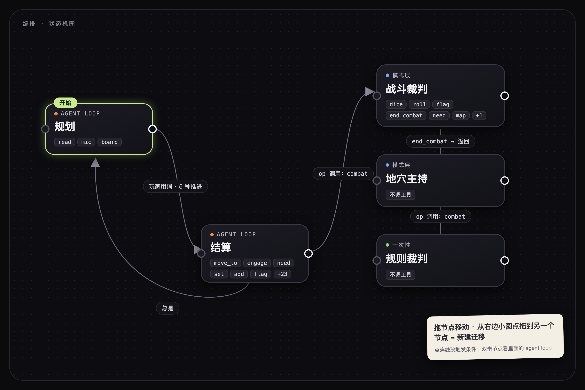
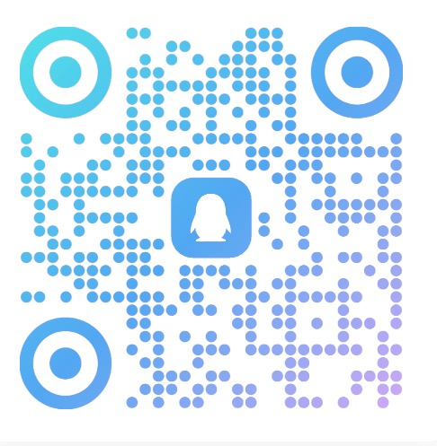

# WorldLines

**语言:** [English](./README.md) · [简体中文](./README.zh.md) · [日本語](./README.ja.md) · [한국어](./README.ko.md)

> **WorldLines —— 为你和你的 Character Agent 搭建的 Multi-Agent 世界模拟引擎。**
> 开源:**NeonRP** 引擎(Apache-2.0)、**WorldLines** 产品(AGPL-3.0)、文档与基准(CC BY 4.0)。

<p align="center">
  
  
  
  <a href="https://worldlines.gg"></a>
  
  <a href="https://doi.org/10.1145/3800965.3834285"></a>
  <a href="https://arxiv.org/abs/2606.16014"></a>
  
  
</p>

<p align="center">
  
</p>

## 这是什么

多数 AI 角色扮演给你的是一个可以聊天的角色。WorldLines 给你的是**角色活在其中的世界**:有地方、有物价、有势力,
有各自想法的其他角色,还有立得住的规则。你不只是聊天——你可以去某个地方、谈一笔买卖、挑一场架,世界会给出留得下来的后果。

我们相信:在游戏的时代,我们用代码写模拟器;在 Agent 的时代,我们用 agent 来编排模拟器。而 TRPG 就是最好的世界模拟器。你可以和你的 AI 角色一起,在这个 TRPG 世界模拟器里畅玩。

**TRPG × AIRP:跑团本身就是一种世界模拟。这是我们的核心。**

它下面是 **NeonRP**,一个世界模拟引擎,核心只有一句话:**让模型讲故事,让世界讲道理。**

- **先商量,再清算。** 说你想做什么。商量拍里在场的角色接话,你们谈好怎么做;判官说谈妥了(或者你说「定」/ `@dm`),
  清算拍掷该掷的骰子、写下这一回合的故事,再把一次校验过的变化写进世界。
- **三方。** 世界、你、每个角色各有主体性。你说的话是一次**尝试**,不是事实;角色自己拿主意。
- **世界就是文件。** 纯 JSON / Markdown,能读、能 diff、能版本管理;每一回合都是一个提交,可以回滚、可以分岔。

## 团队与愿景

我们是一支由来自**东京大学**的 PhD 和研究员，以及游戏从业者组成的跨专业（社会学、经济学、图形学、AI Agent、虚拟世界）团队 —— **Ludic Dynamics**。

我们热爱 TRPG（跑团）、galgame 与乙女游戏。当 AI 还没有普及之前，我们长期从事日文文化翻译的志愿者工作，在各种桌面游戏以及游戏图形引擎行业深耕，并曾经协助日本视觉小说作品在 Steam 发行。疫情开始后，我们一头扎进了 AI 角色扮演与叙事类游戏 —— 每个周末、每一个深夜，跑团、搭建世界、追逐那种"故事真的在呼吸"的感觉。

穿越时空在十多个国家之间辗转冒险，在异世界的世界里面探寻它过去的历史，一次一次死去重回某一天只为救回重视的人，辗转在平行时空中找到那唯一的世界线，召唤历史完成一次奔赴理想的战争。

WorldLines 就是这种执念的产物。

> Orchestrated Reality · 编排的真实。通过 Harness 模拟世界与 AI 灵魂 —— 世界具有物理一致性，NPC 具有心智一致性。不要为 agent 写代码。用 agent 来编排世界。

我们通过 harness 构建了「多智能体 × 世界智能体 × 灵魂智能体」系统。我们希望利用这个引擎进行：互动体验创造 · 多智能体社会实验 · Agent 研究推进 · 人格模型与世界模型的 benchmark。

我们相信,语言模型和 agent 不只是用来生成故事的。它们可以做世界模拟:用法则、引擎和边界条件,把一个世界模拟出来。世界模拟本身可以是一个游戏;也可以把所有的角色 agent 和世界当成底座,在上面做游戏。我们相信,在这个被模拟出来的世界里,所有的角色和玩家一起,真实地活在里面。只有活在一个世界里的角色,才是真正的角色。

- **从模拟里长出故事。** NeonRP 让模拟的世界和有自己目标的角色 agent 相互对抗,故事从中产生。
- **人人都能写的编排。** 一回合怎么跑,从跑团到剧本杀,用一句话就能设计,并作为内容分享出去。
- **角色、世界和玩法分开。** 角色的素材与设定、世界的素材与设定、玩法规则是各自独立的部分,可以自由组合。
- **快的引擎,接什么前端都行。** AI 引擎只负责快、稳、自由;接上前端,就是完整的游戏客户端。
- **引擎开源,平台给所有人。** 引擎开源,用你自己的 API key 就能跑;[worldlines.gg](https://worldlines.gg) 是给一般玩家的平台;社区在两者之上共建。

每一件事一篇文章:[愿景](https://docs.worldlines.gg/docs/vision/overview)。

> **Agent Role Play。** 人们已经直接在 Claude Code 和 Codex 里玩角色扮演了 —— 让一套 agentic 系统去驱动角色与场景。这是超越 prompt 式聊天的新范式，也正是我们要为之打造的方向。WorldLines 把同样的 agentic 能力做得**更快、模型无关（可在 DeepSeek / OpenRouter / 本地 / 免费模型上运行），并能规模化地多智能体协作** —— 把它变成一个活的、可游玩的世界，让灵魂们真正活过来。

## 演示视频

<p align="center">
  <a href="https://youtu.be/oofuC8BSehE">
    
  </a>
</p>
<p align="center"><em>▶ 在 YouTube 观看演示</em></p>

## 仓库里有什么

| 目录 | 是什么 | 许可 |
|---|---|---|
| [`neonrp/`](./neonrp) | 引擎:回合流程、schema、玩法包(`rpg`、`pct`、`werewolf`、`monopoly`)和 mixins(`economy`、`factions`)、模板、命令行、终端界面、SDK | Apache-2.0 |
| [`worldlines/`](./worldlines) | 产品:网页界面(3.0)、启动器包、模板、示例世界、教程;NeonRP 桌面版(macOS) | AGPL-3.0 |
| [`documents/`](./documents) | 规格(world · soul · template · contract · pack)与 [docs.worldlines.gg](https://docs.worldlines.gg) 的正文 | CC BY 4.0 |
| [`benchmarks/`](./benchmarks) | 引擎每个设计决定背后的测试套件 | 代码 Apache-2.0 · 数据 CC BY 4.0 |
| `CLAUDE.md` · `AGENTS.md` · `.claude/` · `.agents/` | 给 Claude Code / Codex 用的捏卡工作台(见下) | AGPL-3.0 |

## 这个仓库和 PyPI 包

PyPI 包用的是同一份代码,另外带了不开源的部分([`neonrp/LICENSE-PROPRIETARY.md`](./neonrp/LICENSE-PROPRIETARY.md)):

| | 这个仓库 | PyPI `neonrp` / `worldlines` |
|---|---|---|
| 回合 | 结算拍 | 商量拍 + 结算拍,以及内置的编排 |
| 网页界面 | 工作台、测试台、游玩页 | 另有 Hub、标准前端、小手机聊天页 |
| 内置世界 | 灰橡宅、石津镇 | 相同;其他官方世界登录 worldlines.gg 后获取 |

这个仓库里的一切都能单独运行,用你自己的 API key 即可。

## 快速开始

```bash
pip install worldlines          # 或:uv tool install worldlines —— 产品本体,带 neonrp 引擎
worldlines                      # 本地网页 → http://127.0.0.1:8787/local
neonrp                          # 终端:「Welcome to WorldLines」启动器
```

**桌面版(macOS,Apple 芯片):**[下载 NeonRP](https://worldlines.gg/downloads/NeonRP_aarch64.dmg)。没有公证:第一次打开时到「系统设置 › 隐私与安全性」点「仍要打开」。第一次启动时 app 会自己装好引擎。

**桌面版(Windows,x64):**[下载 NeonRP](https://worldlines.gg/downloads/NeonRP_x64-setup.exe)。没有签名:被 SmartScreen 拦下时,点「更多信息」›「仍要运行」。

本地版从这里安装(PyPI 包,这个仓库就是源码);[worldlines.gg](https://worldlines.gg) 是免安装的在线游玩。两个命令启动时都会检查新版并自动更新(想先问一声:进游戏后 `/update mode prompt`)。
更新说明:[`neonrp/CHANGELOG.md`](./neonrp/CHANGELOG.md) · [GitHub Releases](https://github.com/LudicDynamics/WorldLines/releases)。一行安装器仍可用:
`curl -LsSf https://worldlines.gg/install.sh | sh`(macOS / Linux)· `irm https://worldlines.gg/install.ps1 | iex`(Windows)。
需要 Python 3.10 或更新。第一次运行会引导你选模型:用 Worldlines 账号登录(`/login`:模型中转和 Jev 判官,不用自己的 key),
或者填自己的 key(OpenCode Zen、DeepSeek、OpenRouter、Anthropic、OpenAI、GLM,或任何 OpenAI 兼容服务)。密钥只存在你自己的机器上。

## 游玩

选一个世界,世界会用自己的开场白开局。然后说你想做什么就行:

```text
你:   艾琳娜，陪我去杂货铺买一瓶小治疗药水，价你来砍。
主持: 杂货铺在主街，你们走了十来分钟。艾琳娜在柜台前和老苇讲价，说好谈下来的差价一半归她……
      金 18 → 8 · 两人到杂货铺 · +小治疗药水
```

每一回合分两拍。**商量拍**里主持描述场面、在场的角色接话,你们谈好要做什么。谈妥之后(由判官判断:有 Worldlines 账号时是 Jev,
否则是这一局自己的模型;你也可以说「定」或 `@dm` 直接推进),**清算拍**叙述发生了什么,并把变化写进世界。状态先马上写下,
后台再复核一遍;复核发现不对就修正,并告诉你改了什么。

| 模板 | 是什么 |
|---|---|
| 灰橡宅 · 关上的门 | 雾巷尽头的老宅,宅主人三天前走进一扇门再没出来;一夜、一个守口如瓶的管家,百分骰推理 |
| 石津镇 · 雾退之夜 | 一年只有一夜雾会退开:两个夜晚、一个白天,在小镇里凑齐出北门的东西 |

本地版只内置这两个世界。其他官方世界在 Hub 里:不登录也能看,在 [worldlines.gg](https://worldlines.gg)(或本地网页的「Hub ↗」)
直接在线玩;用 Worldlines 账号登录后,可以下载到本机来玩。

## 截图


<p align="center">
  
</p>
<p align="center"><em>一个回合的两拍 —— 商量拍里主持和角色把要做的事谈妥,清算拍把该掷的骰子掷掉、叙述写下、结果进世界。玩家说「我要砍死所有人」,世界没有讨好他。</em></p>

<p align="center">
  
</p>
<p align="center"><em>终端里的灰橡宅后院 —— 花盆底下翻出一把钥匙,插不进锁,因为锁孔里卡着刚才折断的半截发卡。东西留下来了:右栏的随身物品多了一样。</em></p>

<p align="center">
  
</p>
<p align="center"><em>编排 —— 一局怎么走是一张状态机图:商量 → 清算,战斗时交给战斗裁判,打完回来。这张图就是模板里的编排,改它就改了玩法。</em></p>

## 适合谁

### 🎮 AI 角色扮演玩家

你来自 **Character.AI、SillyTavern 或 AI 酒馆**。你喜欢深度的角色对话,但世界总是忘掉你说过的话。

WorldLines 给你有**真实记忆**的角色:她们记得你三天前说过的话,有自己的意图和目标,也和其他角色一起活在一个世界里,彼此记住。回合很快,一拍以秒计。

更进一步,欢迎一起来捏编排:一局怎么走是可以自己设计的,不同的编排工具可以组合着试,拼出你想要的玩法。

→ [在线玩](https://worldlines.gg) · [把 AI 角色卡带进世界](https://docs.worldlines.gg/docs/players/your-character) · [言出法随的编排](https://docs.worldlines.gg/docs/vision/orchestration-for-everyone)

### 📖 Galgame · 乙女游戏 · 视觉小说爱好者

你喜欢 **Ren'Py、TyranoBuilder 和分支叙事**,但厌倦了手写每一条路线。你想要故事*回应你*,而不是按预设路线走。

WorldLines 让你设定角色、世界规则和基调,agent 实时生成故事,每一个选择都会激起涟漪。引擎只管底层,表现交给前端:可以试试 Godot 或 TypeScript 的重前端工作台,把立绘、演出、分支界面做成你想要的样子,再把做出来的东西反写进引擎,成为模板的一部分。

→ [接入 Godot](https://docs.worldlines.gg/docs/developers/godot) · [Godot 示例](./worldlines/examples/clients/godot) · [TS 示例前端](./worldlines/examples/clients/ts) · [开发者快速开始](https://docs.worldlines.gg/docs/developers/quickstart)

### ✍️ TRPG 主持人 · 世界创作者

你在 **Foundry VTT、Discord 或线下**带团,花在准备上的时间比实际游玩还多。

WorldLines 是一个 GM 引擎:你设定约束,规则、NPC、基调,agent 替你跑世界。自动索引的 lore、每个 NPC 独立的记忆、掷骰裁判。

我们更想和你一起研究编排工具:现在这套「商量 → 清算」加玩法合约的框架,能不能满足你带团的需要,缺什么,哪里别扭。来 Discord 聊。

→ [快速上手](https://docs.worldlines.gg/docs/players/quickstart) · [石津镇起始世界](./worldlines/templates/stoneford-town.template) · [玩法合约](https://docs.worldlines.gg/docs/creators/contracts) · [工作台](https://docs.worldlines.gg/docs/creators/workbench)

### 🔬 研究者 —— AI 人格 · 世界模型 · Multi-Agent

你研究人格模型、世界模型 benchmark 或多智能体社会。你需要一个**可复现的沙箱**,不是黑盒 API。

WorldLines 是**文件支撑、事件溯源、git-diffable** 的。每个 agent 决策、每次世界状态变化,都是一条纯文本事件,可以追踪、回放、度量。[`benchmarks/`](./benchmarks) 里是引擎每个设计决定背后的测试套件。

现在的重点是把世界模拟调稳;引擎的自定义编辑还在测试。下一步是在 `rpg` 包之外做 `science` 包:社会模拟和经济模拟的规则。**有研究需求?[开一个 issue](https://github.com/LudicDynamics/WorldLines/issues) 或邮件 `info@worldlines.gg`,我们会配合你的实验。**

→ [三层:引擎 · 模板包 · 产品](https://docs.worldlines.gg/docs/concepts/overview) · [一局从头到尾](https://docs.worldlines.gg/docs/concepts/journey) · [规格](./documents/spec/)

### 🛠️ 开发者

你用 **Claude Code、LangGraph 或自定义 agent 管线**。你好奇世界、角色和玩家三方 agent 到底是怎么拼到一起的,也想知道一个快而稳的 AI 引擎底下长什么样。

引擎 NeonRP 和它的规格都是开源的(Apache-2.0):世界、角色、模板、玩法合约、规则包的规格在 [`documents/spec/`](./documents/spec/),回合流程就在 [`neonrp/`](./neonrp) 的源码里。接口是 HTTP、事件流和文件。进来有两条路:

- **做你自己的重前端。** 引擎只管状态、回合、agent 和账本,表现全部交给前端。[Godot](./worldlines/examples/clients/godot) 和 [TypeScript](./worldlines/examples/clients/ts) 的示例前端可以直接起步,做出来的演出和界面能反写进模板,成为世界的一部分。
- **写规则包和编排工具。** `rpg` 包之外,我们正在做 `science` 包(社会模拟、经济模拟的规则),也在找人一起把编排工具做顺手。引擎的自定义编辑还在测试,架构还在迭代,我们不认为有唯一完美的答案 —— fork 一个世界、改一个 agent、看它是怎么接起来的,然后来 **[Discord](https://discord.gg/HJYWbdqWrE)** 一起把它定下来。

仓库本身就是个创作工作台:clone 下来用 Claude Code / Codex 打开,`.claude/skills/` 里的创作 skill 会自动加载 —— 看 **[tutorials/](./worldlines/tutorials/)** 上手做角色卡 / 世界 / 角色。

→ [开发者快速开始](https://docs.worldlines.gg/docs/developers/quickstart) · [规则包](https://docs.worldlines.gg/docs/developers/packs) · [接入 Godot](https://docs.worldlines.gg/docs/developers/godot) · [benchmarks/](./benchmarks)
## 创作

把仓库 clone 下来,用 **Claude Code** 或 **Codex** 打开:工作台(`CLAUDE.md` / `AGENTS.md` 和 `.claude/skills/` · `.agents/skills/`
里的 skill)会帮你捏一个角色、一个世界,或者一整套模板,并用引擎检查。

```bash
neonrp template lint  my/<id>.template          # 全部问题;block 会挡发布
neonrp template build my/<id>.template /tmp/try
cd /tmp/try && neonrp tui --play
```

规格:[world](./documents/spec/world.zh.md) · [soul](./documents/spec/soul.zh.md) · [template](./documents/spec/template.zh.md) · [contract](./documents/spec/contract.zh.md) · [pack](./documents/spec/pack.zh.md)
· 教程:[`worldlines/tutorials/`](./worldlines/tutorials)。

## 研究与引用

WorldLines 背后的主张写成了三篇论文——定义世界、扩展到多 agent、说明一个世界能不能立住取决于架构。概要:[worldlines.gg/research](https://worldlines.gg/research/)。

> **[From Character Role-Play to Orchestrated Reality: LLM-Driven Game World Simulation as a Parameterized-Action POMDP](https://doi.org/10.1145/3800965.3834285)**
> Yuhang Huang, Chenmiao Li, Chaowei Fang. *CHI PLAY Companion '26*, ACM. DOI: 10.1145/3800965.3834285 · [arXiv:2606.16014](https://arxiv.org/abs/2606.16014)

> **Multi-Agent LLM Simulation for Living Game Worlds: Coordinating World, Soul, and Player Agents over a Pub/Sub Message Bus**
> *IPSJ Entertainment Computing 2026*(京都,2026 年 9 月)。

第三篇工作论文在准备中。BibTeX 见 [英文 README](./README.md#research--citation)。

## 参与

这个仓库是 WorldLines 的公开发布仓;开发在上游进行,每次发布在这里落成一个提交。欢迎 issue 和 PR——
接受的 PR 先合进这里(你的署名留在这里的历史中),再随下一次发布带回。详见 [CONTRIBUTING.zh.md](./CONTRIBUTING.zh.md)。

## 许可

- `neonrp/` — Apache License 2.0([`neonrp/LICENSE`](./neonrp/LICENSE)、[`neonrp/NOTICE`](./neonrp/NOTICE))
- `worldlines/` 与工作台 — GNU AGPL v3.0([`worldlines/LICENSE`](./worldlines/LICENSE))
- `documents/`、基准数据 — CC BY 4.0([`documents/LICENSE`](./documents/LICENSE))
- `worldlines/templates/` 与 `worldlines/examples/` 里的设定内容 — 文字 CC BY 4.0,图片与音频 CC BY-NC 4.0
  ([`worldlines/CONTENT-LICENSE.md`](./worldlines/CONTENT-LICENSE.md))

「NeonRP」「WorldLines」是 Ludic Dynamics 的名称,许可不包括使用这两个名称的权利。

## Star 历史

<p align="center">
  <a href="https://github.com/LudicDynamics/WorldLines/stargazers">
    <picture>
      <source media="(prefers-color-scheme: dark)" srcset="https://api.star-history.com/svg?repos=LudicDynamics/WorldLines&type=Date&theme=dark" />
      
    </picture>
  </a>
</p>

## 社区

- [worldlines.gg](https://worldlines.gg) · [docs.worldlines.gg](https://docs.worldlines.gg) · [Discord](https://discord.gg/HJYWbdqWrE) · `info@worldlines.gg`

<p align="left">
  
  &nbsp;&nbsp;
  
</p>
<p align="left"><em>左:QQ 群 · 右:微信</em></p>

由 **nikoloside** 与 **redoctober** 开发,[Ludic Dynamics](https://ludicdynamics.com) 推进。
