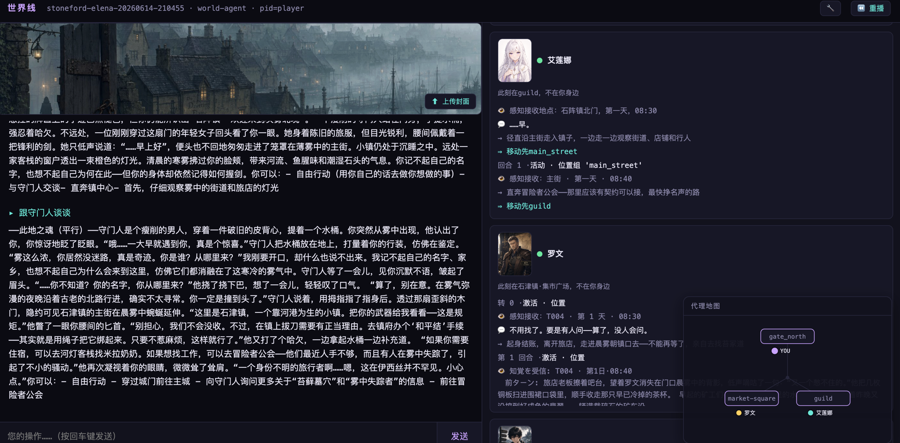

# WorldLines

**语言:** [English](./README.md) · [简体中文](./README.zh.md) · [日本語](./README.ja.md) · [한국어](./README.ko.md)

> **WorldLines — 和你的 AI 角色,在一个无限的世界里玩。**
> 开源:**NeonRP** 引擎(Apache-2.0)、**WorldLines** 产品(AGPL-3.0)、文档与基准(CC BY 4.0)。

<p align="center">
  
  
  
  <a href="https://doi.org/10.1145/3800965.3834285"></a>
  <a href="https://arxiv.org/abs/2606.16014"></a>
  
  
</p>

<p align="center">
  
</p>

## 这是什么

多数 AI 角色扮演给你的是一个可以聊天的角色。WorldLines 给你的是**角色活在其中的世界**:有地方、有物价、有势力,
有各自想法的其他角色,还有立得住的规则。你不只是聊天——你可以去某个地方、谈一笔买卖、挑一场架,世界会给出留得下来的后果。

它下面是 **NeonRP**,一个世界模拟引擎,核心只有一句话:**让模型讲故事,让世界讲道理。**

- **一句话,一回合。** 说你想做什么。世界掷该掷的骰子,在场的角色轮流行动,写下这一回合的故事,
  再把一次校验过的变化写进世界。
- **三方。** 世界、你、每个角色各有主体性。你说的话是一次**尝试**,不是事实;角色自己拿主意。
- **世界就是文件。** 纯 JSON / Markdown,能读、能 diff、能版本管理;每一回合都是一个提交,可以回滚、可以分岔。

## 仓库里有什么

| 目录 | 是什么 | 许可 |
|---|---|---|
| [`neonrp/`](./neonrp) | 引擎:回合流程、schema、玩法包(`rpg`、`pct`、`werewolf`、`monopoly`、`economy`、`factions` …)、模板、命令行、终端界面、SDK | Apache-2.0 |
| [`worldlines/`](./worldlines) | 产品:网页界面(3.0)、桌面壳、启动器包、模板、示例世界、教程 | AGPL-3.0 |
| [`documents/`](./documents) | 规格(world · soul · template · contract · pack)与 [docs.worldlines.gg](https://docs.worldlines.gg) 的正文 | CC BY 4.0 |
| [`benchmarks/`](./benchmarks) | 引擎每个设计决定背后的测试套件 | 代码 Apache-2.0 · 数据 CC BY 4.0 |
| `CLAUDE.md` · `AGENTS.md` · `.claude/` · `.agents/` | 给 Claude Code / Codex 用的捏卡工作台(见下) | AGPL-3.0 |

## 快速开始

```bash
pip install worldlines          # 或:uv tool install worldlines —— 产品本体,带 neonrp 引擎
worldlines                      # 本地网页 → http://127.0.0.1:8787/local
neonrp                          # 终端:「Welcome to WorldLines」启动器
```

本地版从这里安装(PyPI 包,这个仓库就是源码);[worldlines.gg](https://worldlines.gg) 是免安装的在线游玩。两个命令启动时都会检查新版并自动更新(想先问一声:进游戏后 `/update mode prompt`)。
更新说明:[`neonrp/CHANGELOG.md`](./neonrp/CHANGELOG.md) · [GitHub Releases](https://github.com/LudicDynamics/WorldLines/releases)。一行安装器仍可用:
`curl -LsSf https://worldlines.gg/install.sh | sh`(macOS / Linux)· `irm https://worldlines.gg/install.ps1 | iex`(Windows)。
第一次运行会引导你选模型(DeepSeek、OpenRouter、本地 OpenAI 兼容服务……),密钥只存在你自己的机器上。

## 游玩

选一个世界,世界会用自己的开场白开局。然后说你想做什么就行:

```text
你:   艾琳娜，陪我去杂货铺买一瓶小治疗药水，价你来砍。
主持: 杂货铺在主街，你们走了十来分钟。艾琳娜在柜台前和老苇讲价，说好谈下来的差价一半归她……
      金 18 → 8 · 两人到杂货铺 · +小治疗药水
```

你说的每一句话就是一回合:世界(显示为「主持」)叙述发生了什么,并把变化写进世界。

| 模板 | 是什么 |
|---|---|
| 灰橡宅 · 关上的门 | 雾巷尽头的老宅,宅主人三天前走进一扇门再没出来;一夜、一个守口如瓶的管家,百分骰推理 |
| 石津镇 · 雾退之夜 | 一年只有一夜雾会退开:两个夜晚、一个白天,在小镇里凑齐出北门的东西 |

本地版只内置这两个世界。其他官方世界:在本地 Hub 里用 Worldlines 账号登录,就能看到并获取(下载到本机来玩)。

<p align="center">
  
</p>

## 创作

把仓库 clone 下来,用 **Claude Code** 或 **Codex** 打开:工作台(`CLAUDE.md` / `AGENTS.md` 和 `.claude/skills/` · `.agents/skills/`
里的 skill)会帮你捏一个角色、一个世界,或者一整套模板,并用引擎检查。

```bash
neonrp template lint  my/<id>.template          # 全部问题;block 会挡发布
neonrp template build my/<id>.template /tmp/try
cd /tmp/try && neonrp tui --play
```

规格:[world](./documents/spec/world.zh.md) · [soul](./documents/spec/soul.zh.md) · [template](./documents/spec/template.zh.md) · [contract](./documents/spec/contract.zh.md) · [pack](./documents/spec/pack.zh.md)
· 教程:[`worldlines/tutorials/`](./worldlines/tutorials)。

## 研究与引用

WorldLines 背后的主张写成了三篇论文——定义世界、扩展到多 agent、说明一个世界能不能立住取决于架构。概要:[worldlines.gg/research](https://worldlines.gg/research/)。

> **[From Character Role-Play to Orchestrated Reality: LLM-Driven Game World Simulation as a Parameterized-Action POMDP](https://doi.org/10.1145/3800965.3834285)**
> Yuhang Huang, Chenmiao Li, Chaowei Fang. *CHI PLAY Companion '26*, ACM. DOI: 10.1145/3800965.3834285 · [arXiv:2606.16014](https://arxiv.org/abs/2606.16014)

> **Multi-Agent LLM Simulation for Living Game Worlds: Coordinating World, Soul, and Player Agents over a Pub/Sub Message Bus**
> *IPSJ Entertainment Computing 2026*(京都,2026 年 9 月)。

第三篇工作论文在准备中。BibTeX 见 [英文 README](./README.md#research--citation)。

## 参与

这个仓库是 WorldLines 的公开发布仓;开发在上游进行,每次发布在这里落成一个提交。欢迎 issue 和 PR——
接受的 PR 先合进这里(你的署名留在这里的历史中),再随下一次发布带回。详见 [CONTRIBUTING.zh.md](./CONTRIBUTING.zh.md)。

## 许可

- `neonrp/` — Apache License 2.0([`neonrp/LICENSE`](./neonrp/LICENSE)、[`neonrp/NOTICE`](./neonrp/NOTICE))
- `worldlines/` 与工作台 — GNU AGPL v3.0([`worldlines/LICENSE`](./worldlines/LICENSE))
- `documents/`、基准数据 — CC BY 4.0([`documents/LICENSE`](./documents/LICENSE))
- `worldlines/templates/` 与 `worldlines/examples/` 里的设定内容 — 文字 CC BY 4.0,图片与音频 CC BY-NC 4.0
  ([`worldlines/CONTENT-LICENSE.md`](./worldlines/CONTENT-LICENSE.md))

「NeonRP」「WorldLines」是 Ludic Dynamics 的名称,许可不包括使用这两个名称的权利。

## 社区

- [worldlines.gg](https://worldlines.gg) · [docs.worldlines.gg](https://docs.worldlines.gg) · [Discord](https://discord.gg/HJYWbdqWrE) · `info@worldlines.gg`

由 **nikoloside** 与 **redoctober** 开发,[Ludic Dynamics](https://ludicdynamics.com) 推进。
