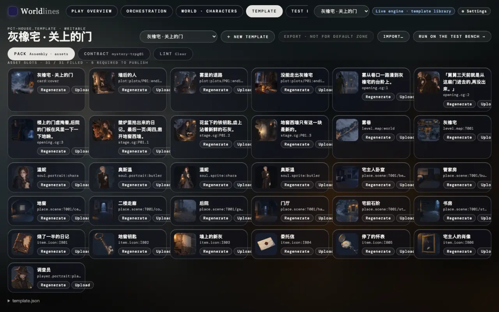

<!-- section: list -->
## 1. See which pictures are needed

> **Status: ships with 1.0**

Every picture a template needs is a slot (see [Assets: slots · recipes · views](/docs/creators/assets)). Two places show them:

- the asset slots on the workbench's Template page: one picture per cell, with its slot id, "Upload" and "Regenerate";
- the command line:

```bash
neonrp template slots my-house
# ok       place.scene:T001/hall      门厅
# -        place.scene:T001/study     书房      ← no picture yet
```



Built-in templates are read-only: copy one into your own first ("Copy to edit" on the Template page, or `neonrp template fork pct-house my-house --store ~/.worldlines/templates`).

<!-- section: size -->
## 2. Sizes and formats

Formats: PNG, JPEG, WebP, at most 8 MB each. A transparent background needs PNG or WebP.

| Slot | Ratio | Reference size | Notes |
|---|---|---|---|
| `card:cover` cover | 16:9 | 1920×1080 | the card and the title screen |
| `level.map:<level>` map | 3:2 | 1536×1024 | places are pinned on it by the world's coordinates |
| `place.scene:<address>` scene | 16:9 | 1344×768 or larger | a place's background |
| `soul.portrait:<character>` portrait | 3:4 | 896×1152 or larger | character cards, dialogue avatars |
| `soul.sprite:<character>` sprite | portrait orientation | 1024×1536 | **transparent background**, full body |
| `item.icon:<id>` icon | 1:1 | 1024×1024 | items, clues |
| `player.portrait:player` player portrait | 1:1 | 1024×1024 | |
| opening / plot-stage / ending CG | landscape | 1536×1024 | cut-scenes and ending cards |

Front ends crop to their own layout: keep the subject in the middle with a little room at the edges. The ratio is what the slot declares (`ratio`); a picture with another ratio is not refused, but it is cropped on screen.

<!-- section: make -->
## 3. Make them in an outside tool

Any tool works. The general flow:

1. **Start from the prompt.** Every slot carries a prompt written from the place's or character's description: see it in the Template page's asset slots. Use it as the starting point in your tool and add your style words.
2. **Keep one style.** Use the same style words and the same reference picture for every picture of a world; change the scene, not the look.
3. **Match the ratio.** Pick the ratio from the table; larger is better than smaller. Compress to under 8 MB before export.
4. **Give sprites a transparent background.** Use the tool's transparent output if it has one; otherwise render on a flat color, cut it out and save as PNG or WebP. Portraits (`portrait`) can keep a background. When the portrait is already full-body, the sprite can simply use it (see [Assets](/docs/creators/assets#slots)).
5. **Line the map up with the places.** The places are pinned on the map by the world's coordinates. On a map drawn elsewhere, the buildings need to sit roughly under those pins: after uploading, open World · Characters → Map and switch to the "Map" view to check.

<!-- section: put -->
## 4. Put them into the template

**Recommended: upload on the workbench.** Find the slot on the Template page, click "Upload", pick the file. The engine checks the format, names the file after the slot, puts it in the right place and records where it came from.

You can also put files straight into the template folder (`~/.worldlines/templates/<id>.template/`), named like this:

| Slot | Goes to |
|---|---|
| `place.scene:T001/hall` | `world-overlay/assets/places/T001__hall.png` (`/` in the address becomes `__`) |
| `level.map:T001` | `world-overlay/assets/maps/T001.png` |
| `soul.portrait:<character>` · `soul.sprite:<character>` | `world-overlay/souls/<character folder>/assets/portrait.png` · `…/sprite.png` |
| `player.portrait:player` | `world-overlay/game/player/assets/portrait.png` |
| `card:cover` · CG · ending art | the path written in `template.json` / `plot.json` |

Keep one file per slot (switching to `.webp` means deleting the old `.png`). Then run `neonrp template slots <id>`: the line turns `ok`. Maps are better uploaded: an upload also records the place layout the picture was made for.

<!-- section: check -->
## 5. Check the result

- **Template page**: the slot's thumbnail shows the new picture;
- **World · Characters**: the map page's nodes and map picture;
- **Test bench**: start a new run and walk to that place, meet that character. A run copies the template's pictures when it starts, so a run already open keeps the old ones;
- **your front end**: one that fetches this run's pictures by address (`/api/v1/play/place-image` and so on, see [Pictures](/docs/tutorials/frontend-data#slots)) shows them in a new run; one with its own art pack needs its own pack changed.

Run Lint before publishing: with `lint.level: publish`, an empty `required: publish` slot blocks publishing (see [Lint](/docs/creators/lint)).

<!-- section: rights -->
## Notes

- **Rights.** Use only pictures you may use: your own work, generated pictures whose tool terms allow commercial use, stock whose license allows redistribution. Works published to the Hub are downloaded by others, and the pictures travel with the template.
- **Keep out of pictures.** Likenesses of real people without permission, other people's trademarks and characters, watermarked images, screenshots with personal information.
- **Text.** Do not bake lines or captions into pictures: front ends lay their own text on top, in each language.
- **Size.** At most 8 MB each; bigger pictures make a bigger package and slower loading.
