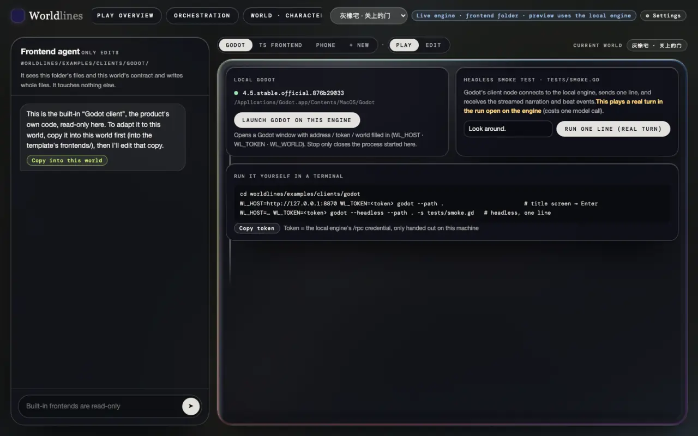

<!-- section: prep -->
## Before you start

> **Status: the examples ship in the open-source repo**

Both examples live in the open-source repo; the `worldlines` package from PyPI does not include their source:

```bash
git clone https://github.com/LudicDynamics/WorldLines
cd WorldLines/worldlines/examples/clients      # godot/ · ts/ · art/
```

You also need a running engine and its token (see [One template, many front ends](/docs/tutorials/frontend-data#host)):

- the local workbench: run `worldlines` and start a Greyoak House run from Play overview; the token is behind "Copy token" on the Frontend page;
- or one world folder: `neonrp serve --project <folder> --port 8788` prints a token at start.

The examples are drawn for Greyoak House (`pct-house`). Other worlds play too, with placeholders for missing pictures. The commands below use the workbench's default address `http://127.0.0.1:8787`; with `neonrp serve`, use the address it prints.

<!-- section: godot -->
## Godot: run it

You need Godot 4.5.

```bash
cd godot
WL_HOST=http://127.0.0.1:8787 WL_TOKEN=<token> godot --path .
```

The title screen comes up with the address and token filled in; click "进入" (enter). Without the environment variables, type them on the title screen.

When the workbench runs from the open-source source tree, the Godot desk on the Frontend page can "Launch Godot on this engine" with the address, token and current world filled in; "Run one line (real turn)" on the right plays one line in the run with a headless Godot.




The whole protocol is one node, `addons/worldlines/client.gd`; copy it into your project. Signals and calls: [Godot](/docs/developers/godot).

<!-- section: godot-edit -->
## Godot: change one thing

Show a notice when the player discovers a new place. Add two lines at the top of `_on_beat` in `main.gd`:

```gdscript
func _on_beat(event: String, data: Dictionary) -> void:
	if event == "place.discovered":
		_toast("New place", str(data.get("name", "")))
	…
```

Restart the game and walk somewhere new:


The event name and fields come from the engine (see [Live event stream](/docs/developers/events)), not from the world: with another template, the same two lines still work.

<!-- section: godot-check -->
## Godot: checks

```bash
godot --headless --path . -s tests/scene_check.gd                                       # it compiles
WL_HOST=http://127.0.0.1:8787 WL_TOKEN=<token> godot --headless --path . -s tests/smoke.gd   # one line through the client node
```

`smoke.gd` plays one real turn in the run and prints the time, the beat events and the prose it received:

```text
turn 1.3 s · success true
beat events: node.enter → plan.beat → node.leave → node.enter → resolve.beat → soul.mind → state.changed → …
```

<!-- section: ts -->
## TS: run it

You need Node.js 22.6 or later.

```bash
cd ts
npm install
WL_HOST=http://127.0.0.1:8787 npm run dev       # → http://localhost:5180
```

Open the page, paste the token, click "进入" (enter). The dev server forwards `/rpc`, `/api` and `/state` to the engine: the page and the engine share an origin, so there is no CORS to handle and the token rides in a header.


One line from Node, without a page:

```bash
WL_HOST=http://127.0.0.1:8787 WL_TOKEN=<token> npm run smoke -- "Look around."
```

```text
connected · world … · beats: plan, resolve
turn 3.2 s · success true
beat events: node.enter → plan.beat → node.leave → node.enter → resolve.beat → … → state.changed → …
```

The open engine declares no beat styles, so this line reads `beats: (one plain turn)`.

The protocol is one file, `src/client.ts`; copy it into your project.

<!-- section: ts-edit -->
## TS: change one thing

The example takes scene pictures from its own art pack; a place the pack lacks shows the title picture. Change it to use the art pack first and this run's scene picture otherwise (`/api/v1/play/place-image`, see [Pictures](/docs/tutorials/frontend-data#slots)).

`src/art.ts`: use an address that starts with `/` as it is.

```ts
url(rel?: string): string | null { return rel ? (rel.startsWith('/') ? rel : this.root + rel) : null }
```

At the top of `setScene()` in `src/game.ts`:

```ts
let own = art.scene(place), hasOwn = await art.has(own)
if (!hasOwn && place) { own = `/api/v1/play/place-image?addr=${encodeURIComponent(place)}`; hasOwn = await art.has(own) }
```

Reload the page and enter again: the background is now the template's scene picture.


When the template's pictures change (see [Make assets with outside tools](/docs/tutorials/external-assets)), the front end needs no change: start a new run, enter again, and the new picture is there.

<!-- section: ts-build -->
## TS: build

```bash
npm run typecheck
npm run build            # → dist/
```

When the workbench runs from the source tree, open "TS frontend → Protocol sample" on the Frontend page and click "Build"; the build then plays inside the page.

<!-- section: own -->
## Write your own

The minimum:

1. copy `client.ts` or `client.gd`, handshake with `session.hello`, start reading `/rpc/events`;
2. read `beat-kinds` and show each beat's name and style from it;
3. draw the `engine/stream` prose as it arrives, and update the screen on `engine/beat` events following [the table](/docs/tutorials/frontend-data#events);
4. send the input box with `turn.send`.

Typed variables: `neonrp template contract <template> --ts` / `--gd` (see [Code generation](/docs/developers/codegen)). A finished front end can go into the template's `frontends/` (see [Put a front end inside the template](/docs/tutorials/frontend-data#own)).
