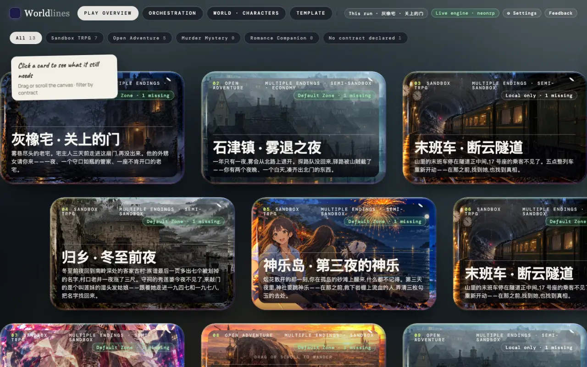
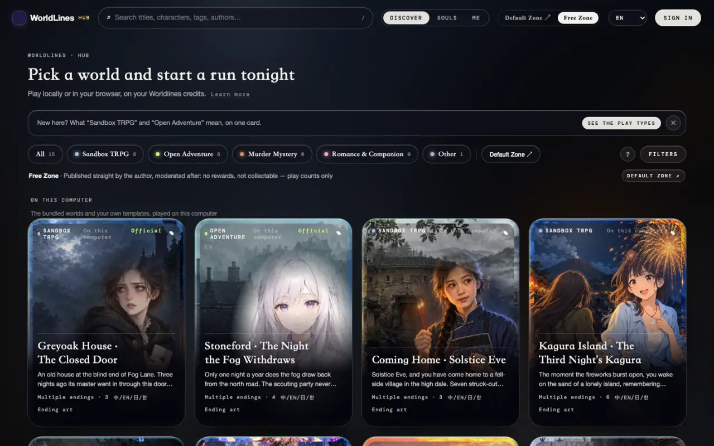
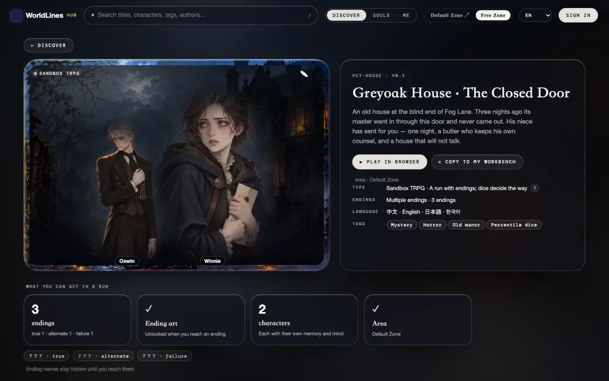
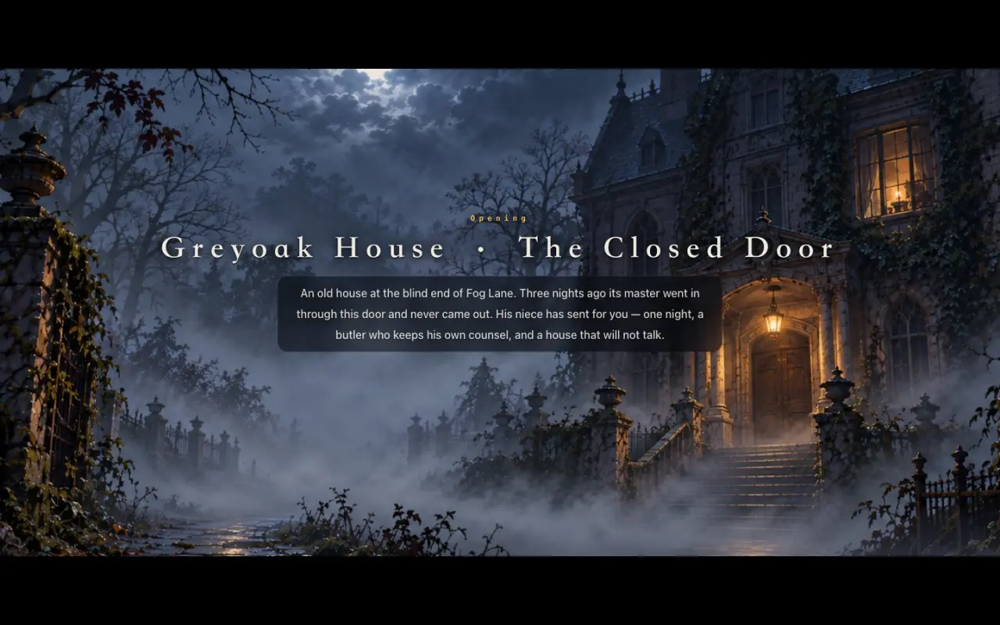
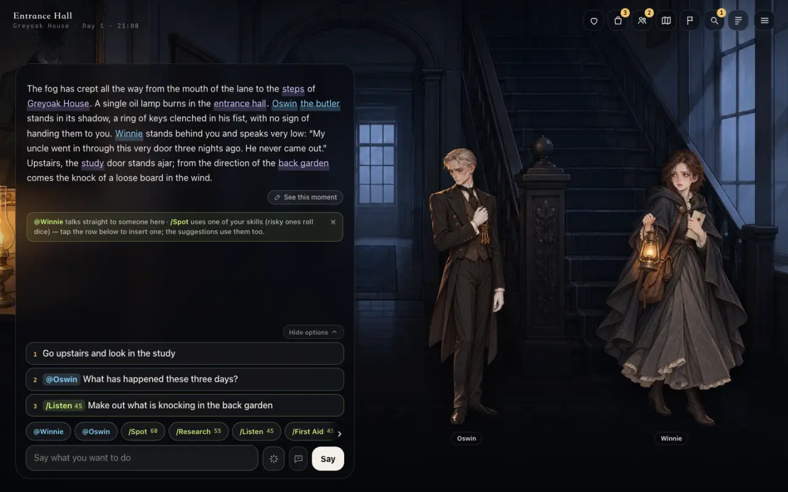
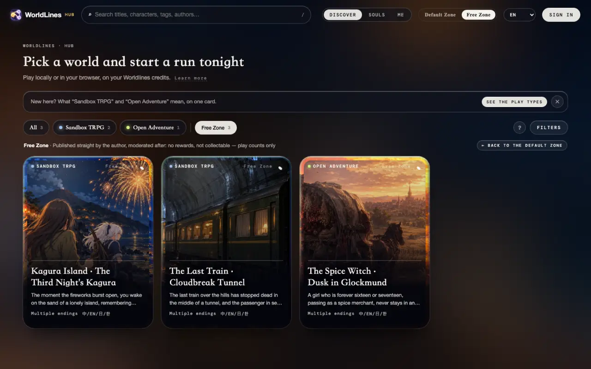
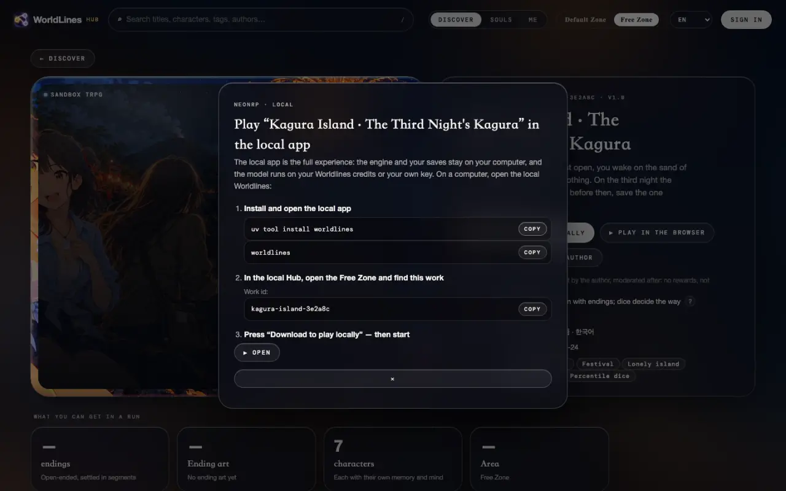
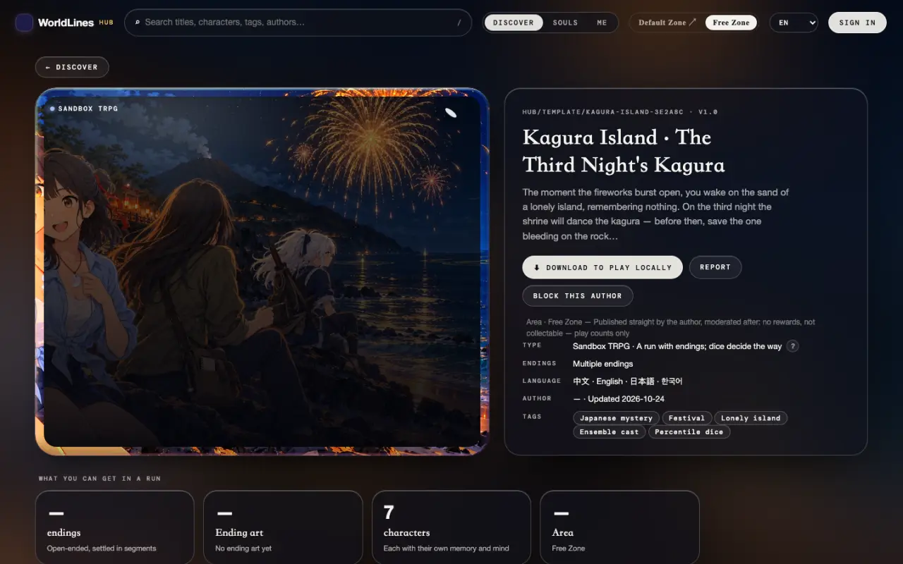
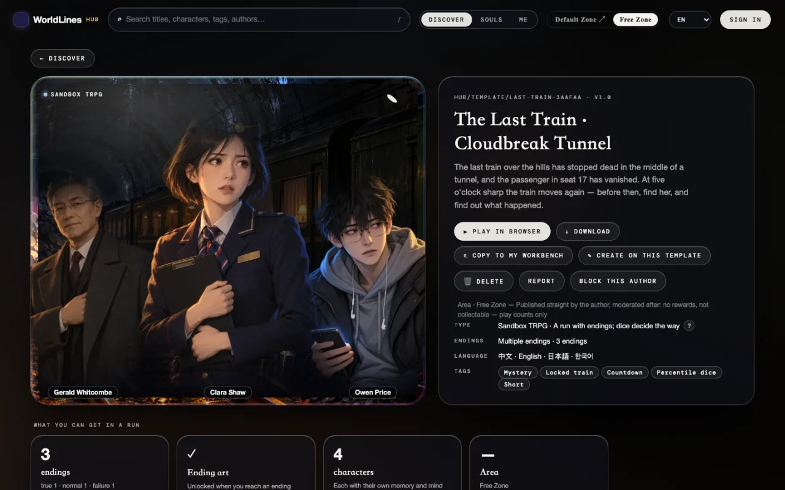

<!-- section: what -->
## What the heavy front end is

> **Status: ships with 1.0**

The heavy front end is the screen players play a run in: scene art, portraits, the opening, options, panels. It is what players see on the Hub and on iOS. With `worldlines` installed, it lives at `http://127.0.0.1:8787/player.html`.

The test bench is a tool for building templates. It is a different screen.

This page has two routes:

- **A** pick an official world in the local Hub and play it in the heavy front end;
- **B** pick a work in the online Hub's Free Zone, download it, and play it in the heavy front end.

<!-- section: a -->
## A. Pick an official world in the local Hub, play in the heavy front end

### 1. Open the local Hub

```bash
pip install worldlines
worldlines        # opens http://127.0.0.1:8787/local in your browser
```

This is the workbench. Click "Hub ↗" at the right of the top bar to open the local Hub (`http://127.0.0.1:8787/hub.html`).



The opening beat is written in the template, so it needs no model. To keep talking, connect a model under "⚙ Settings" in the workbench first (see [Connect a model](/docs/players/providers)).

### 2. Pick an official world

The local Hub opens on the Free Zone page. The first row, "On this computer", holds the built-in worlds and your own templates; the built-in ones are marked "Official".



Click a card to open its page. The work id is at the top left, for example `PCT-HOUSE` (Greyoak House).



"▶ Play in browser" on the detail page starts a run and opens it in the workbench.

### 3. Open the heavy front end

Open this address:

```text
http://127.0.0.1:8787/player.html?tpl=pct-house
```

`tpl` is the work id in lower case. The heavy front end starts a run itself, and `&save=<save>` is added to the address.

If you already started a run from the detail page, open `http://127.0.0.1:8787/player.html` without `tpl`: the heavy front end joins the run open on the engine.

The interface language follows `lang` in the address: `&lang=zh` · `en` · `ja` · `ko`.

### 4. Play

The title card comes first. Click "Open".



The opening plays a passage at a time: "Tap to continue". The first time, a short guide follows.



- Write what you want to do in the box at the bottom and click "Say".
- The 1 · 2 · 3 lines above the box are suggestions; click one to fill it in.
- `@name` talks to someone directly; `/skill` uses a skill (risky ones roll dice).
- The icons at the top right open the panels: Status, Items, People, Map, Goals, Clues, Log.

After a turn, the prose continues below and new suggestions appear above the box.

### 5. Saves

Every run saves itself. `save=` in the address is this run: open that address again to continue.

The run also shows under "Saves" when you click the template card on the workbench's Play overview (see [Test a template on the test bench](/docs/tutorials/test-template#saves)).

<!-- section: b -->
## B. Download a work from the Free Zone, play in the heavy front end

### 1. Pick a work in the Free Zone

The Free Zone is on the online Hub: `https://neonrp.worldlines.gg/free/`. Works their authors published directly are listed here.



Click a work to open its page. The main button is "⬇ Download to play locally".


Click it for three steps:

1. Install and open the local app;
2. In the local Hub, open the Free Zone and find this work (the dialog shows its work id);
3. Press "Download to play locally", then start.



### 2. Download it to your computer

On the local Hub's Free Zone page, the works from the online Free Zone are listed below the "On this computer" row, with "Free Zone" on the card. Open the work's page and click "⬇ Download to play locally".



When it finishes, the detail page shows "▶ Play in browser", "↓ Download", "⎘ Copy to my workbench" and more. The work is stored in `~/.worldlines/templates/<work id>.template/`.



Downloading needs no sign-in.

### 3. Play the downloaded work

As in A, step 3, with this work's id as `tpl`:

```text
http://127.0.0.1:8787/player.html?tpl=last-train-3aafaa
```

<!-- section: notes -->
## Notes

- The heavy front end talks to the engine on your computer. When `worldlines` is closed, it stops; your saves stay on your computer.
- Free Zone works are published by their authors directly and moderated afterwards. To flag a problem, click "Report" on the detail page.
- To change a work, click "⎘ Copy to my workbench" on the detail page and edit it in the workbench (see [Test a template on the test bench](/docs/tutorials/test-template)).
