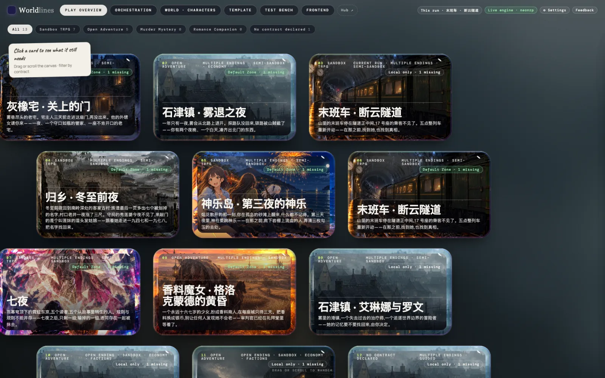
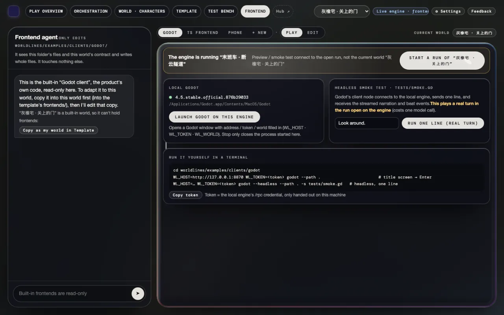
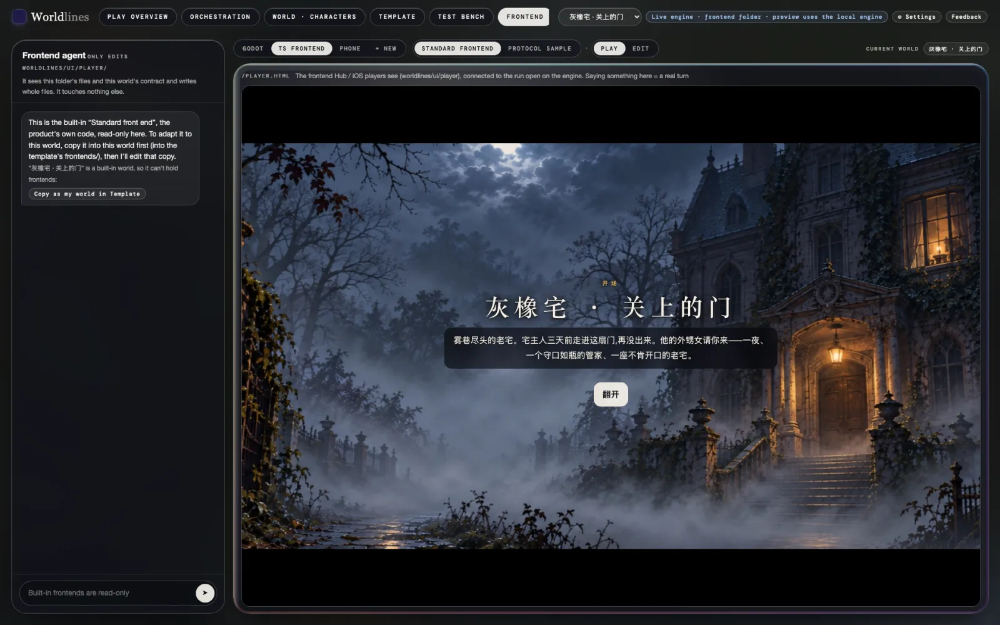
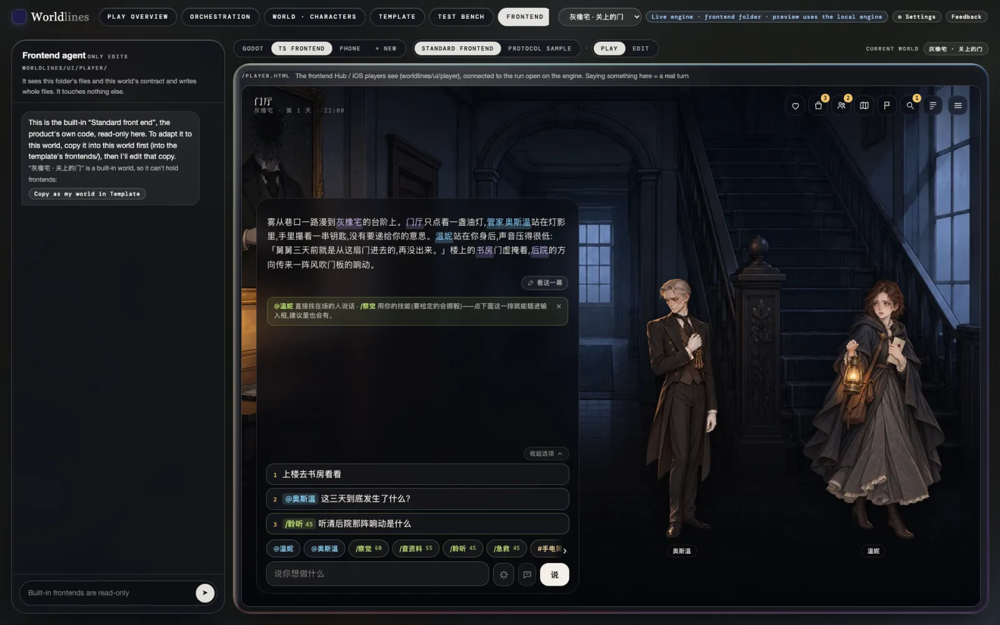
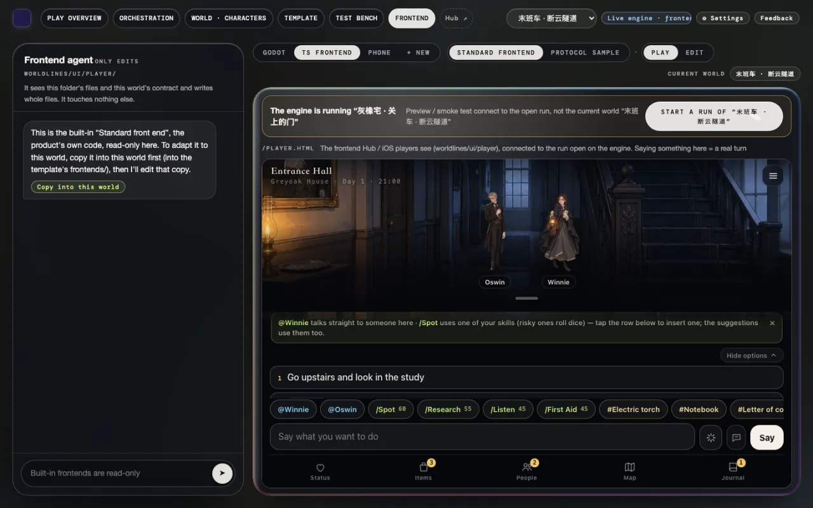
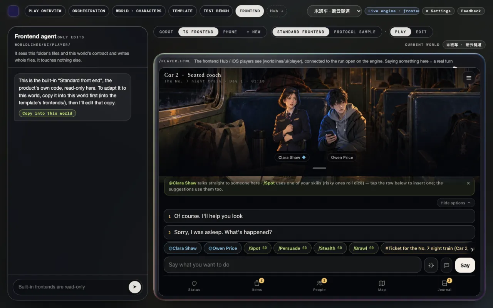

<!-- section: what -->
## What the heavy front end is

> **Status: ships with 1.0**

The heavy front end is the screen players play a run in: scene art, portraits, the opening, options, panels. It is what players see on the Hub and on iOS. With `worldlines` installed, it is under "Frontend" in the workbench.

The test bench is a tool for building templates. It is a different screen.

This page has two routes:

- **A** pick a world in the workbench and play it in the heavy front end;
- **B** download a work from the Free Zone, then play it in the heavy front end.

<!-- section: a -->
## A. Play in the heavy front end from the workbench

### 1. Open the workbench

```bash
pip install worldlines
worldlines        # opens http://127.0.0.1:8787/local in your browser
```

This page is the workbench.



The opening beat is written in the template, so it needs no model. To keep talking, connect a model under "⚙ Settings" in the workbench first (see [Connect a model](/docs/players/providers)).

### 2. Click "Frontend" in the top bar

The top bar, left to right: Play overview · Orchestration · World · Characters · Template · Test bench · Frontend. Click "Frontend". If the window is narrow, scroll the top bar sideways to reach it.



### 3. Pick a world

The drop-down at the right of the top bar is the current world. Pick one.

If the engine has a different world open, a bar at the top says "The engine is running “…”". Click "Start a run of “…”" on its right and confirm. The previous run stays in your saves.

### 4. Click "TS frontend"

The row at the top of the page is Godot · TS frontend · Phone · + New. Click "TS frontend". Next to it, keep "Standard frontend" and "Play" (the defaults).

Below is the heavy front end, joined to the run open on the engine. The title card comes first.



### 5. Play

Click "Open". The opening plays a passage at a time: "Tap to continue". The first time, a short guide follows.



- Write what you want to do in the box at the bottom and click "Say".
- The 1 · 2 · 3 lines above the box are suggestions; click one to fill it in.
- `@name` talks to someone directly; `/skill` uses a skill (risky ones roll dice).
- The bottom row opens the panels: Status, Items, People, Map, Journal. Goals, Clues and Log are inside Journal.

Each line you say here is a real turn. The prose continues below, and new suggestions appear above the box.

### 6. Saves

Every run saves itself. When you start a run of another world, the previous run stays in your saves.

On "Play overview", click the template card: the run is listed under "Saves" and can be continued (see [Test a template on the test bench](/docs/tutorials/test-template#saves)).

<!-- section: b -->
## B. Download a world from the Free Zone, then play it in the heavy front end

### 1. Pick a work in the Free Zone

The Free Zone is on the online Hub: `https://neonrp.worldlines.gg/free/`. Works their authors published directly are listed here.


Click a work to open its page. The main button is "⬇ Download to play locally".


Click it for three steps:

1. Install and open the local app;
2. In the local Hub, open the Free Zone and find this work (the dialog shows its work id);
3. Press "Download to play locally", then start.


### 2. Download it to your computer

In the workbench, click "Hub ↗" in the top bar to open the local Hub. It opens on the Free Zone page: the works from the online Free Zone are listed below the "On this computer" row, with "Free Zone" on the card. Open the work's page and click "⬇ Download to play locally".


When it finishes, the work is stored in `~/.worldlines/templates/<work id>.template/`, and the detail page shows "⎘ Copy to my workbench", "🗑 Delete" and more.


Downloading needs no sign-in.

### 3. Back to "Frontend" in the workbench → pick this world → "TS frontend"

Go back to the workbench and reload the page. The work is now in the top bar's drop-down. As in A:

1. Click "Frontend" in the top bar;
2. Pick this work in the drop-down;
3. Click "TS frontend";
4. On the bar, click "Start a run of “…”" and confirm.



The heavy front end then joins this run. Play as in A, step 5.



<!-- section: notes -->
## Notes

- Runs started from the workbench are in Chinese for now, so the heavy front end shows Chinese too.
- After you switch worlds and start a new run, if the heavy front end still shows the previous run, reload the page.
- The heavy front end talks to the engine on your computer. When `worldlines` is closed, it stops; your saves stay on your computer.
- The heavy front end also opens on its own at `http://127.0.0.1:8787/player.html`, joined to the run open on the engine.
- Free Zone works are published by their authors directly and moderated afterwards. To flag a problem, click "Report" on the local Hub's detail page.
- To change a work, click "⎘ Copy to my workbench" on the local Hub's detail page and edit it in the workbench (see [Test a template on the test bench](/docs/tutorials/test-template)).
