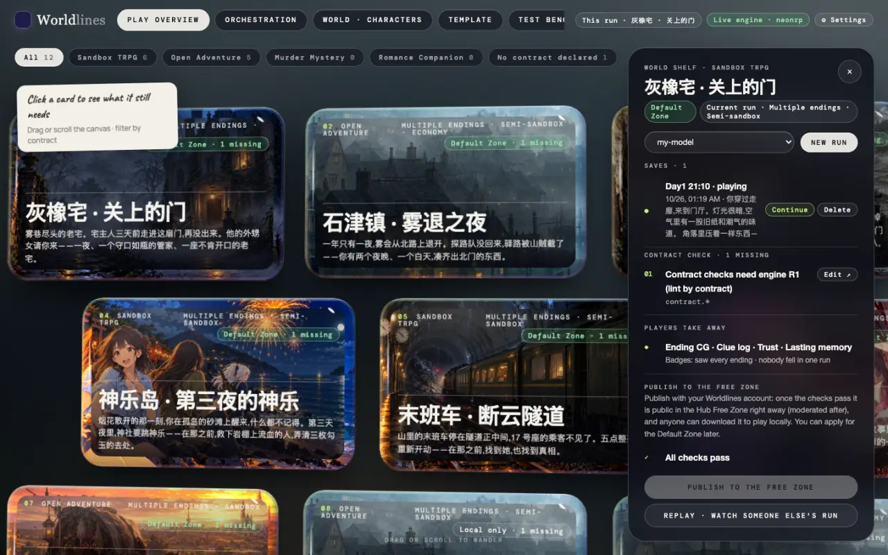
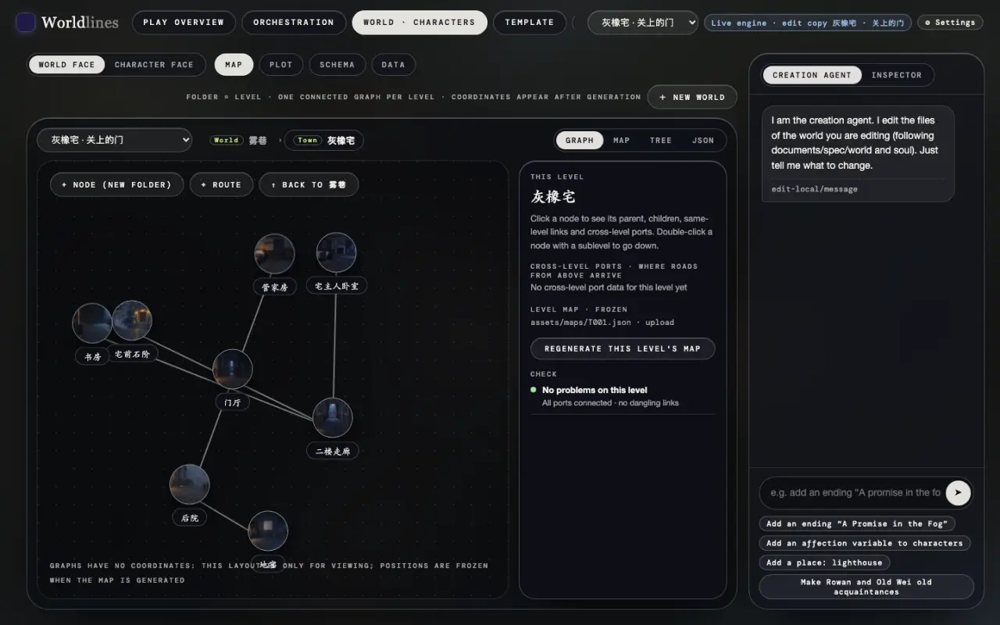
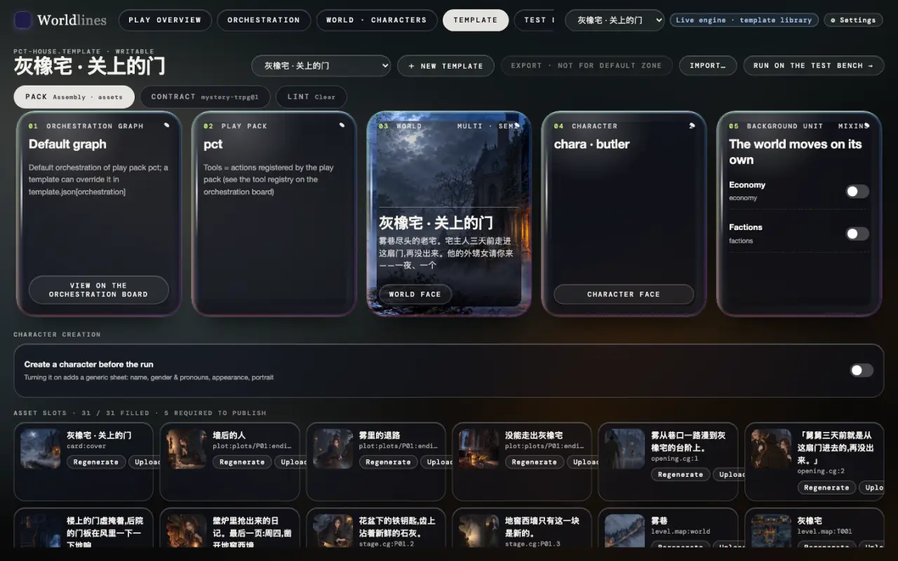
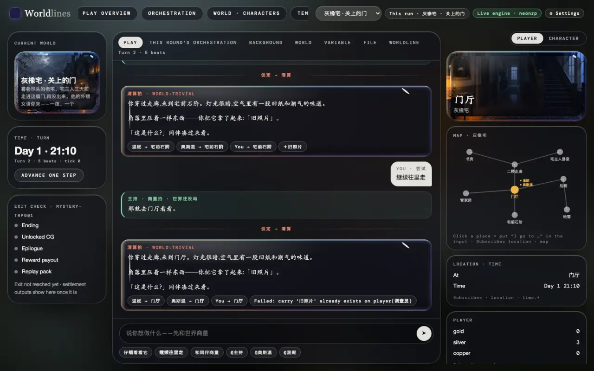
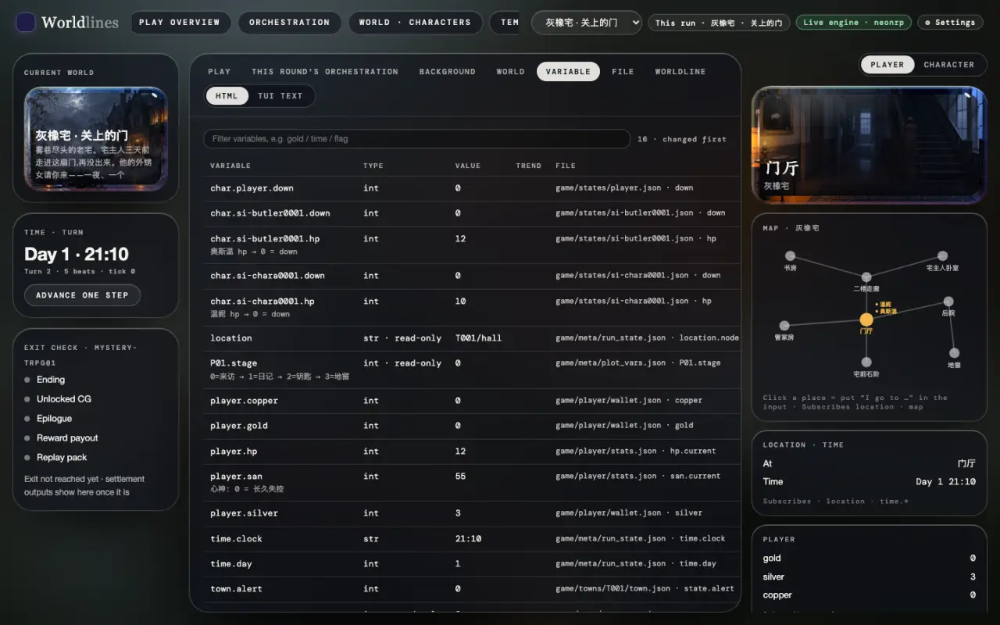
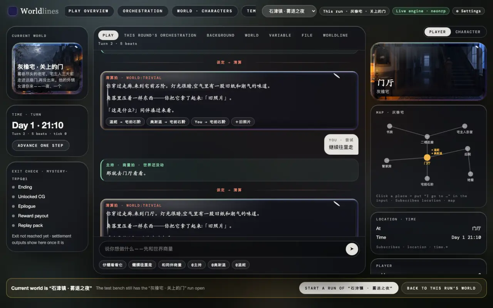
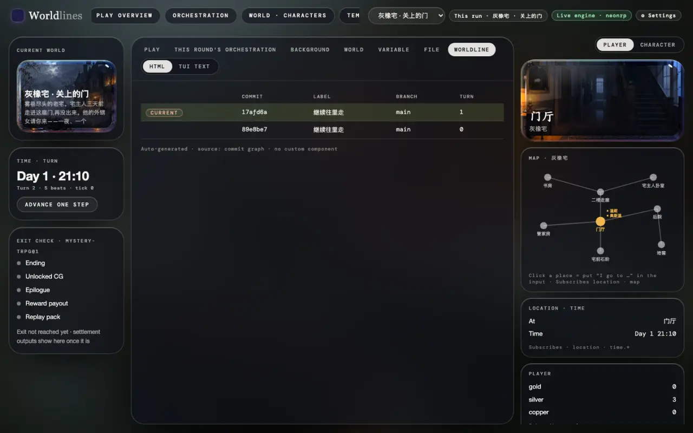

<!-- section: open -->
## Open the workbench

> **Status: ships with 1.0**

```bash
pip install worldlines
worldlines        # opens http://127.0.0.1:8787/local in your browser
```

The top bar has six benches (see [Workbenches](/docs/creators/workbench)). This page uses four: Play overview, World · Characters, Template and Test bench.

The test bench is a tool for building templates and front ends: the run in the middle, state on both sides, the engine's raw data in the tabs.

The opening beat is written in the template, so it needs no model. To keep talking, connect a model under "⚙ Settings" first (see [Connect a model](/docs/players/providers)).

<!-- section: pick -->
## 1. Pick a template, start a run

On Play overview, click a template card. Its panel slides out on the right:

- choose the model for this run in the drop-down, then click "New run";
- under "Saves", click "Continue" to pick up an earlier run;
- "Contract check" lists what is still missing before publishing.



Once the run starts, "Test bench" in the top bar is that run.

<!-- section: world -->
## 2. Look at the world and the template

World · Characters edits the template, not a run. The world face has four pages: Map · Plot · Schema · Data. The map is layered by level: click a place to see its level, the ports to other levels, this level's map picture and the check results.



The Template page is the unit of assembly: the orchestration graph, play pack, world, characters and mixins, with the asset slots below. Switch to "Contract" or "Lint" at the top for the contract and the checks.



Built-in templates are read-only. To change one, click "Copy to edit" first, or:

```bash
neonrp template fork pct-house my-house --store ~/.worldlines/templates
```

<!-- section: bench -->
## 3. Play on the test bench

The "Play" tab is the run.



- Each beat is a card: planning beats in green, resolve beats in red (the open engine has resolve beats only).
- The chips under a card are what the beat changed in the world: who went where, what was gained; a refused change says why.
- Left column: the current world, time and turn, and the exit check (whether the ending, CG, epilogue and so on that this contract asks for have been reached). "Advance one step" lets the world move one beat on its own, with no model call.
- Right column: "Player" shows your state, the map and where you are; "Character" shows what the people present think and intend.

<!-- section: tabs -->
## 4. Read the engine's data

Every tab other than "Play" is generated from the engine's data:

| Tab | Shows |
|---|---|
| This round's orchestration | the nodes this beat went through, tools called, changes landed and refused, dice |
| Background | what each background unit (mixin ticks, triggers) changed in each beat |
| World | the schema's classes and instances |
| Variable | closed-schema variables: type, current value, trend, the file they live in |
| File | which files this beat wrote, and what |
| Worldline | the run's commit graph: one commit per turn, branches |

Switch between "HTML" and "TUI text" at the top right; TUI text is what the terminal shows.



The same data can be read directly: `GET /api/v1/play/schema` (variables), `GET /api/v1/play/engine/commits` (the commit graph), `GET /traces` (the record of every line). See [Protocol](/docs/developers/protocol).

<!-- section: switch -->
## 5. Switch templates

The drop-down in the top bar is the "Current world". Orchestration, World · Characters, Template, Test bench and Frontend all follow it.

Change the current world on another bench and come back to the test bench: a banner appears.

- "Start a run of “…”": after you confirm, a new run starts; the old one stays in your saves.
- "Back to this run’s world": the current world goes back to the run the test bench has open.

Switching on the test bench itself asks once before starting the run.



<!-- section: saves -->
## 6. Switch saves

Each run is a folder under `~/.worldlines/plays/`, saved after every beat lands.

- Switch to another save: Play overview → click the template card → "Continue" under "Saves".
- See this run's branches: the "Worldline" tab on the test bench.
- Go back to a turn and start a new line: `/undo <turn>` in the terminal, or `neonrp commit log` / `neonrp commit checkout` in the run's folder. See [Save · branch · undo](/docs/players/saves).



<!-- section: next -->
## Next

- Write your own front end for this run: [One template, many front ends](/docs/tutorials/frontend-data)
- Replace a template's pictures: [Make assets with outside tools](/docs/tutorials/external-assets)
