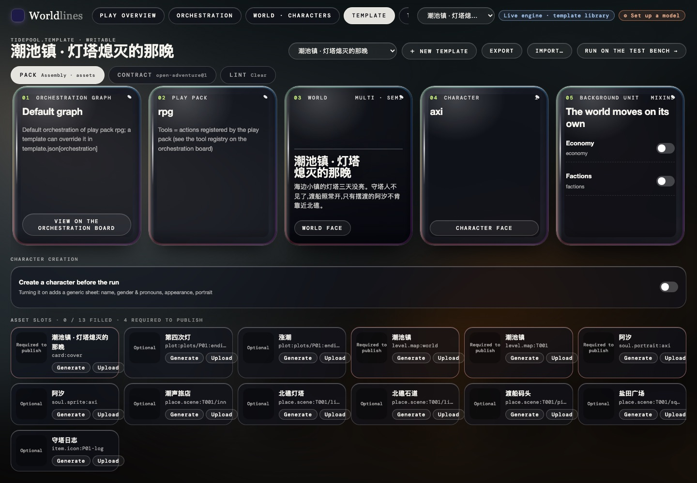
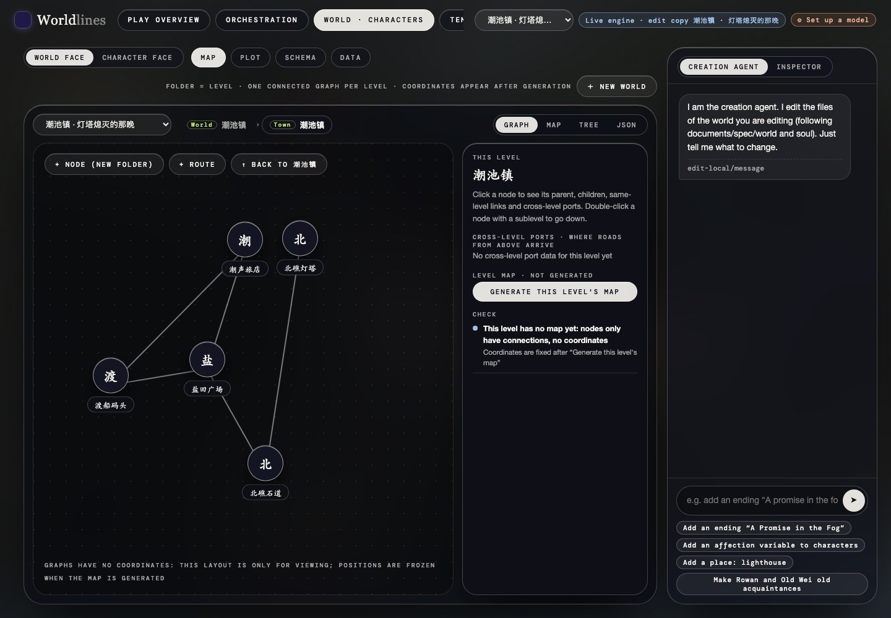

<!-- section: what -->
## このページの内容

Claude Code や Codex のような coding agent を使い、ターミナルで世界を作る。あなたが設定書を書き、agent がそれをテンプレートのフォルダにする。結果の確認と画像の追加は、ローカルの Web ワークベンチで行う。

先に四つのことを説明する。WorldLines が世界をどう捉えるか、一局がどう進むか、agent が何を書き換えるか、エンジンが動くことをどう確かめるか。そのあとに手順。

<!-- section: ideas -->
## 四つの基本

| 考え方 | 意味 | agent にとって |
|---|---|---|
| **三者** | 世界・キャラクター・プレイヤーはそれぞれ主体で、互いに隔てられている。プレイヤーの発言は「試み」で、結果は世界が決める。キャラクターの考えはキャラクター自身が決める | キャラクターの結末をファイルに書き込まない。キャラクターの日記や状態を先に埋めない |
| **ファイルシステムがインターフェース** | 世界・キャラクター・テンプレートはすべてフォルダ。フォルダが唯一の真実で、Web 画面と TUI はそれを描画するだけ | ファイルを書き換えれば足りる。Web に出ているのはディスク上のファイルそのもの |
| **効果はエンジン、カスタマイズは制御だけ** | 強盗が囲まれる、変なものを食べて体を壊す、といった効果はエンジンの仕組みが出し、設定ゼロでも成り立つ。作者の表やルールは結果を**変える**ためだけに使う | エンジンに演じ方を「教える」長いプロンプトは書かない。データを書く:値段、道のり、誰がどこにいるか、何に同意するか |
| **テンプレート = 世界 + キャラクター + ルールパック + 契約** | テンプレートは一つの世界、キャスト、ルールパック(`rpg` / `pct` / `werewolf` / `monopoly`)、プレイ契約を束ね、オーケストレーションを一つ選ぶ。遊ばれ、書き出され、公開される単位 | agent の成果物は `<id>.template/` フォルダ一つ |

キャラクターはキャラクターライブラリに住み、テンプレートにはリンクだけを置く。地名・状態名・勢力名はテンプレートのデータに書き、エンジンのコードには書かない。

<!-- section: orchestration -->
## オーケストレーション:一局の進み方

オーケストレーションは状態機械のグラフ。ノードは「このビートで何をするか」、エッジは「いつ次のノードへ移るか」。テンプレートは `template.json` の `uses` でオーケストレーションのテンプレートを指名する。ルールパックも契約も含まないので、多くの世界で使い回せる。

| オーケストレーション | 1 ターン |
|---|---|
| `one_beat` | 清算ビートだけ:世界が語りを書き、その場のキャラクターが動き、エンジンが状態を書いて検証し、確定する |
| `two_beat` | 相談ビートのあとに清算ビート。相談ではホストがその場のキャラクターに話を回し、費用・判定・時間を並べる。世界は動かない。まとまったら清算ビートへ |

PyPI の `worldlines` / `neonrp` は 2 ビートを含む。オープンソースのリポジトリからソースで入れたエンジンは 1 ビートだけ。テンプレートが指名したオーケストレーションがエンジンにない場合は 1 ビートに戻り、世界はそのまま遊べる。

テンプレートが使っているグラフを見る:

```bash
neonrp engine graph --template <テンプレートのフォルダ>
```

グラフの編集(エッジの追加、条件の変更)はローカルのオーケストレーション画面で行い、既定のグラフへの差分としてテンプレートに保存される。agent が手でグラフを書く必要はない。

<!-- section: ops -->
## ツール呼び出し:agent はファイルを書き、エンジンは op を実行する

二つは別のこと:

- **創作中**、agent が書き換えるのはファイル:`template.json`、`world/` の地図とデータ、キャラクターのフォルダ、プロットパック。
- **プレイ中**、世界は毎ビート変化を「提案」するだけで、その形が op(移動、変数の変更、インスタンスの作成……)。エンジンが検証してから確定する。op はルールパックが登録する。

語りの中のツールは括弧で書く。形が「待つかどうか」を表す:

| 書き方 | 意味 |
|---|---|
| `[op 引数]` | 同期ツール:ここで止まり、エンジンの答えを受けて続きを書く。例:`[dice 1d20+2 vs 12]` · `[ask エレナ]` · `[player.gold -12]` |
| `[~op 引数]` | 待たないツール:エンジンが実行し、語りはそのまま続く。例:`[~map]` |
| `<…>` | エンジンからモデルへのメッセージ。モデルは書かない |

だから agent はファイルに op を書かないし、実行時の状態を作り込まない。書くのは op が読むデータ:変数の範囲、場所どうしのつながり、価格表、プロットのトリガー条件。詳しくは [Propose → verify → apply](/docs/concepts/ops) と [How a turn runs](/docs/concepts/turn-flow)。

<!-- section: install -->
## スキルを入れる

スキルはオープンソースのリポジトリ [WorldLines](https://github.com/LudicDynamics/WorldLines) のルートにある:

| agent | 置き場所 | 説明ファイル |
|---|---|---|
| Claude Code | `.claude/skills/world-creation/`(このリポジトリの中だけ)または `~/.claude/skills/world-creation/`(どのフォルダでも) | `CLAUDE.md` |
| Codex | `.agents/skills/world-creation/` | `AGENTS.md` |

いちばん簡単なのは、リポジトリを clone してルートで Claude Code か Codex を開くこと。ルートの `CLAUDE.md` / `AGENTS.md` にこのスキルが載っている。

自分のテンプレートライブラリで直接使うなら、`.claude/skills/world-creation/` を `~/.claude/skills/` にコピーする。

エンジン:

```bash
uv tool install worldlines      # worldlines と neonrp が両方入る
```

<!-- section: flow -->
## 手順

**1. 設定書を書く。** スキルの `references/world-spec-template.md` に沿って埋める:id、言語、ルールパック、契約、場所、人物、オープニング、プロットとエンディング、世界のデータ。内容は目的の言語でそのまま書き、id は ASCII。例:`examples/tidepool/world-spec.md`。

**2. agent に渡す。** 「この設定書からテンプレートを作って」。agent はこう実行する:

```bash
neonrp template new tidepool --title "潮だまりの町" --lang ja --pack rpg --contract open-adventure@1 --store ~/.worldlines/templates
```

内蔵テンプレートに近いときは `neonrp template fork pct-house <id>` か `fork stoneford-town <id>` を使う。設定書はテンプレートのフォルダにコピーし、作業の元にする。

**3. ローカルの Web ワークベンチを開く。**

```bash
worldlines --no-browser         # http://127.0.0.1:8787。ポートが使われていれば --port を付ける
```

| アドレス | 見るもの |
|---|---|
| `/local?screen=tpl&edit=<id>` | Template:カード、契約、Lint、素材スロット(ここで画像をアップロード・生成) |
| `/local?screen=duo&edit=<id>` | 世界・キャラクター:地図、プロット、スキーマ、データ |

画面はディスク上のファイルを読む。agent が一段落書くたびに、再読み込みすれば反映される。





**4. agent は段階ごとに書く。** カードとモード → 地図 → 伝承とデータ → 人物 → オープニング → プロットとエンディング → 画像のプロンプト。段階ごとに lint を走らせ、何を変えたかを伝える。画像は Template 画面であなたがアップロードか生成をする。

**5. 試しに遊ぶ。** 設定したモデルを使う。Web:Template 画面の「テストベンチで実行 →」。ターミナル:`neonrp` を実行し、ランチャーでこのテンプレートを選ぶ。

<!-- section: lint -->
## lint でエンジンが動くことを保証する

lint はまずテンプレートを一局に組み立て、それから参照・素材・プロンプト・プロット・契約・言語を調べる。各項目は **block**(公開を止める)か **warn**(注意だけ)。

```bash
neonrp template lint <テンプレートのフォルダ>      # 最終行:publishable / NOT publishable
(cd <テンプレートのフォルダ>/world && neonrp validate)
neonrp template build <テンプレートのフォルダ> /tmp/try-<id>
```

agent のルール:**block がゼロになるまで直す。** block の原文と直し方は作者に伝える。warn も一つずつ読み、直せるものは直す。

公開時にもう一段の確認がある。Template 画面で公開を押すと、エンジンがまず五つを確かめ、一つでも通らなければ何も送らない:

| 確認 | 通らないとき |
|---|---|
| リンクしたキャラクターがローカルのライブラリにある | `{"lib": …}` の先が見つからない |
| 秘密情報がない | API キーのような文字列がファイルにある |
| Lint に block がない | 直すべき問題が残っている |
| 4 言語のカード | 中 / 英 / 日 / 韓のどれかにタイトルか紹介文がない |
| カバー画像 | `card.cover` がテンプレート内の画像を指していない |

プラットフォームは受け取ったあと、自前の自動チェックをもう一度行う。詳しくは [Lint](/docs/creators/lint) と [Publish to the Hub](/docs/creators/publish)。公開ボタンは作者が押す。

<!-- section: skill -->
## スキルの場所

| ファイル | 内容 |
|---|---|
| `.claude/skills/world-creation/SKILL.md` | 手順:準備 → 設定書を読む → テンプレートを作る → Web を開く → 段階ごとに書く → モデルを使わない確認 → 試しに遊ぶ → 引き渡し |
| `.claude/skills/world-creation/references/world-spec-template.md` | 設定書の書式と、四つの契約の早見表 |
| `.claude/skills/world-creation/references/spec-to-files.md` | 設定書の各段がどのファイルになるか(実測した例つき) |
| `.claude/skills/world-creation/examples/tidepool/world-spec.md` | 小さな設定書の完全な例 |

Codex 用の同じものは `.agents/skills/world-creation/` にある。各テンプレートのフォルダにも `AGENTS.md` と `spec/` があり、agent は書き換える前にそれを読む。[For agents](/docs/agents/overview) を参照。

エンジンのパッケージにも同じものが入っている:`neonrp spec skill` で手元のフォルダを、`neonrp spec skill world-creation` で `SKILL.md` を表示する。エンジンはどの agent にもインストールしない。使うときは上の「スキルを入れる」のとおり agent の skills フォルダに置く。
