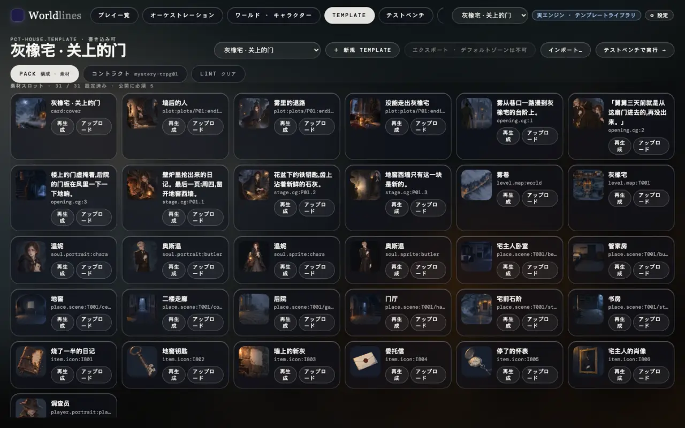

<!-- section: list -->
## 1. 要る画像を見る

> **状態:1.0 で公開**

テンプレートが要る画像は、1 枚ずつがスロットです(英語版:[Assets](/docs/creators/assets))。見る場所は 2 つあります。

- ワークベンチの Template ページの素材スロット:1 枡に 1 枚、スロット id が書かれ、「アップロード」「再生成」ができます;
- コマンド:

```bash
neonrp template slots my-house
# ok       place.scene:T001/hall      门厅
# -        place.scene:T001/study     书房      ← まだ画像がない
```



内蔵テンプレートは読み取り専用です。先に自分のものに複製します(Template ページの「複製して編集」、または `neonrp template fork pct-house my-house --store ~/.worldlines/templates`)。

<!-- section: size -->
## 2. サイズと形式

形式:PNG、JPEG、WebP、1 枚 8 MB まで。透過背景は PNG か WebP だけです。

| スロット | 比率 | 目安のサイズ | 説明 |
|---|---|---|---|
| `card:cover` カバー | 16:9 | 1920×1080 | カードとタイトル画面 |
| `level.map:<レベル>` マップ | 3:2 | 1536×1024 | 場所の点はワールドの座標で重なります |
| `place.scene:<アドレス>` 背景 | 16:9 | 1344×768 以上 | 場所の背景 |
| `soul.portrait:<キャラクター>` 立ち絵 | 3:4 | 896×1152 以上 | キャラクターカード、会話のアイコン |
| `soul.sprite:<キャラクター>` 立ち姿 | 縦長 | 1024×1536 | **透過背景**、全身 |
| `item.icon:<id>` アイコン | 1:1 | 1024×1024 | アイテム、手がかり |
| `player.portrait:player` プレイヤー | 1:1 | 1024×1024 | |
| オープニング / プロット段階 / エンディングの CG | 横長 | 1536×1024 | 演出とエンディングカード |

フロントエンドは自分のレイアウトに合わせて切り抜きます。主題は中央に置き、四辺に少し余白を残します。比率はスロットが宣言しているもの(`ratio`)で、違っていても拒否はされませんが、表示では切られます。

<!-- section: make -->
## 3. 外部ツールで作る

ツールは問いません。一般的な流れ:

1. **プロンプトから始める。** どのスロットにも、場所やキャラクターの設定から書いたプロンプトが付いています。Template ページの素材スロットで見られます。これを外部ツールの出発点にし、自分のスタイルの言葉を足します。
2. **スタイルを揃える。** 同じワールドの画像は、同じスタイルの言葉、同じ参照画像で作ります。場面は変えても画風は変えません。
3. **比率に合わせる。** 上の表の比率で出します。サイズは小さいより大きいほうがよく、書き出し前に 8 MB 以内に収めます。
4. **立ち姿は透過背景に。** ツールが透過で出せるならそれを使います。出せなければ単色の背景で出してから切り抜き、PNG か WebP で保存します。立ち絵(`portrait`)は背景があってもかまいません。立ち絵がもともと全身なら、立ち姿は立ち絵をそのまま使えます(英語版:[Assets](/docs/creators/assets#slots))。
5. **マップを場所に合わせる。** マップ上の点はワールドの座標で重ねられます。外で描いたマップは、建物の位置がその点とだいたい合うようにします。アップロード後、「ワールド · キャラクター」→ マップで「マップ」表示に切り替えて確かめます。

<!-- section: put -->
## 4. テンプレートに入れる

**おすすめ:ワークベンチでアップロード。** Template ページでスロットを見つけ、「アップロード」を押してファイルを選びます。エンジンが形式を確かめ、スロットに合わせた名前で正しい場所に置き、出どころを記録します。

テンプレートのフォルダ(`~/.worldlines/templates/<id>.template/`)に直接置くこともできます。名前は次のとおりです。

| スロット | 置き場所 |
|---|---|
| `place.scene:T001/hall` | `world-overlay/assets/places/T001__hall.png`(アドレスの `/` は `__` に) |
| `level.map:T001` | `world-overlay/assets/maps/T001.png` |
| `soul.portrait:<キャラクター>` · `soul.sprite:<キャラクター>` | `world-overlay/souls/<キャラクターのフォルダ>/assets/portrait.png` · `…/sprite.png` |
| `player.portrait:player` | `world-overlay/game/player/assets/portrait.png` |
| `card:cover` · CG · エンディングの画像 | `template.json` / `plot.json` に書かれたパス |

1 つのスロットにファイルは 1 つだけにします(`.webp` に替えたら古い `.png` は消します)。置いたら `neonrp template slots <id>` を実行し、その行が `ok` になれば完了です。マップはアップロードをおすすめします。アップロード時に、その画像に対応する場所の配置もエンジンが記録します。

<!-- section: check -->
## 5. 結果を見る

- **Template ページ**:素材スロットのサムネイルが新しい画像になります;
- **ワールド · キャラクター**:マップページのノードとマップ画像;
- **テストベンチ**:新しく始め、その場所へ行き、そのキャラクターに会います。プレイは開始時にテンプレートの画像をコピーするので、開いているプレイは古い画像のままです;
- **あなたのフロントエンド**:アドレスでこのプレイの画像を取る(`/api/v1/play/place-image` など、[画像](/docs/tutorials/frontend-data#slots))なら、新しく始めたプレイで新しい画像になります。自前のアートパックを使うフロントエンドは、そのパックを差し替えます。

公開前に Lint を実行します。`lint.level: publish` のとき、`required: publish` のスロットが空だと公開が止まります(英語版:[Lint](/docs/creators/lint))。

<!-- section: rights -->
## 注意

- **権利。** 使ってよい画像だけを使います。自分で描いたもの、ツールの規約が商用利用を認める生成画像、ライセンスが再配布を認める素材。Hub に公開した作品は他の人にダウンロードされ、画像もテンプレートと一緒に渡ります。
- **画像に入れないもの。** 許可のない実在の人物の肖像、他人の商標やキャラクター、透かし入りの画像、個人情報が写ったスクリーンショット。
- **文字。** 台詞や説明を画像に焼き込みません。フロントエンドが自分の文字を重ね、言語ごとに表示します。
- **大きさ。** 1 枚 8 MB まで。画像が大きいほど、テンプレートのパッケージが大きくなり、読み込みが遅くなります。
