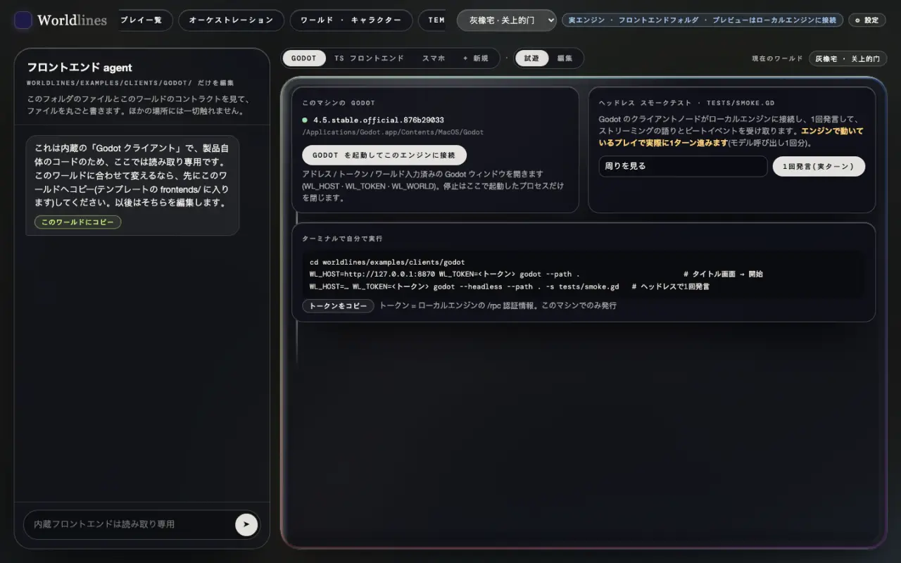
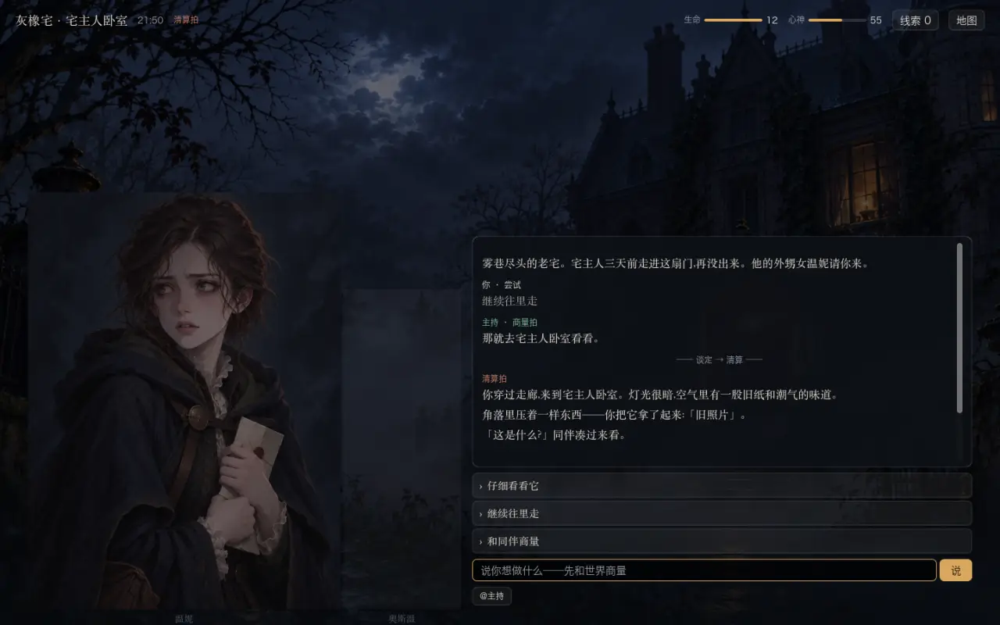
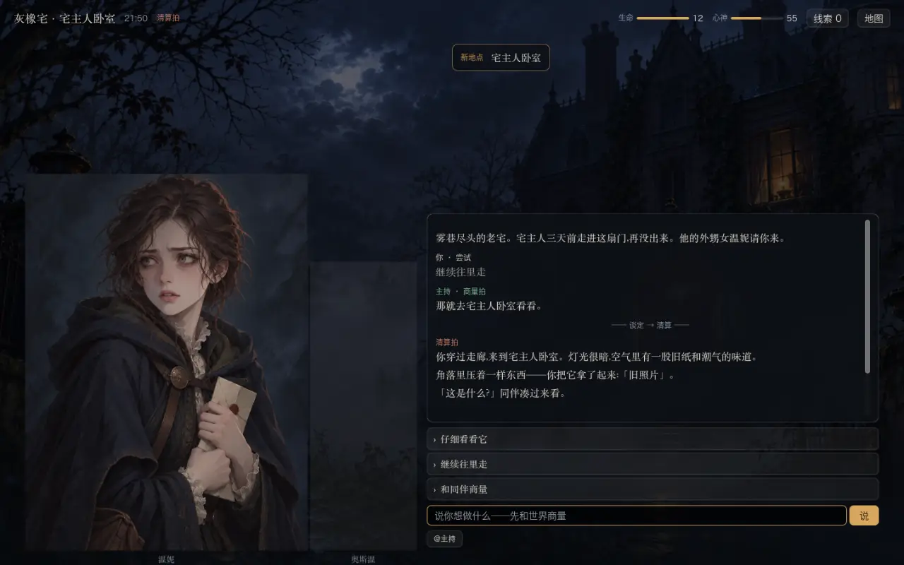
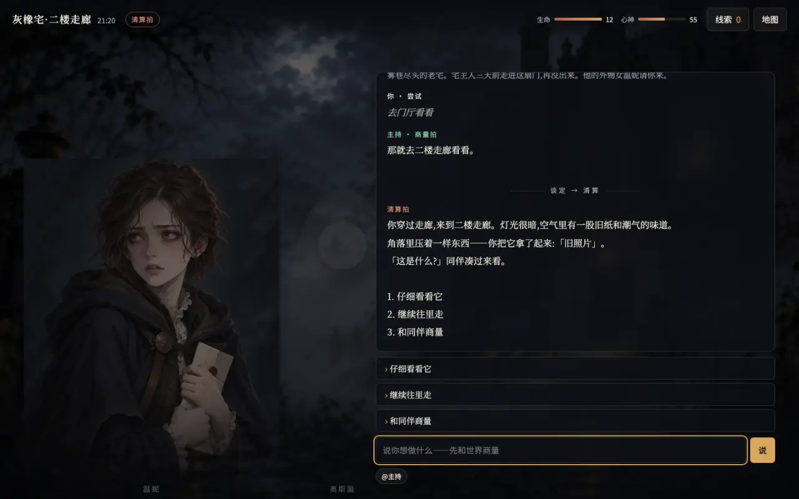
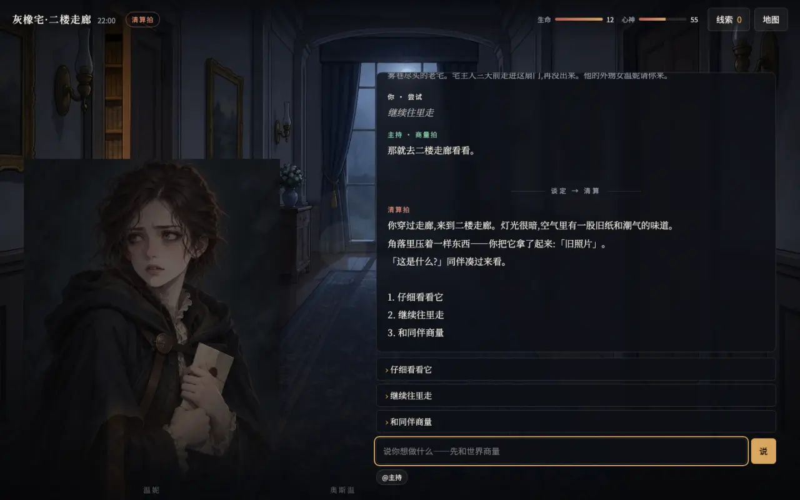

<!-- section: prep -->
## 準備

> **状態:例はオープンソースのリポジトリで公開**

2 つの例はオープンソースのリポジトリにあります。PyPI の `worldlines` にはソースが入っていません。

```bash
git clone https://github.com/LudicDynamics/WorldLines
cd WorldLines/worldlines/examples/clients      # godot/ · ts/ · art/
```

動いているエンジンとそのトークンも要ります([1 つのテンプレート、複数のフロントエンド](/docs/tutorials/frontend-data#host)):

- ローカルのワークベンチ:`worldlines` を起動し、プレイ一覧でグレイオーク館を始めます。トークンは「フロントエンド」ページの「トークンをコピー」;
- またはワールドのフォルダ 1 つ:`neonrp serve --project <フォルダ> --port 8788` が起動時にトークンを表示します。

例の画面はグレイオーク館(`pct-house`)に合わせて描かれています。他のワールドも遊べますが、ない画像はプレースホルダーです。以下のコマンドはワークベンチの既定アドレス `http://127.0.0.1:8787` で書いています。`neonrp serve` のときは、表示されたアドレスに替えます。

<!-- section: godot -->
## Godot:動かす

Godot 4.5 が要ります。

```bash
cd godot
WL_HOST=http://127.0.0.1:8787 WL_TOKEN=<トークン> godot --path .
```

タイトル画面にアドレスとトークンが入っているので、「进入」(入る)を押します。環境変数を使わない場合は、タイトル画面で入力します。

オープンソースのリポジトリのソースからワークベンチを動かしているときは、「フロントエンド」ページの Godot の台で「Godot を起動してこのエンジンに接続」を押せます。アドレス、トークン、現在のワールドが入った状態で開きます。右の「1回発言(実ターン)」は、ヘッドレスの Godot でこのプレイを一言進めます。





プロトコルはノード 1 つ、`addons/worldlines/client.gd` に収まっています。自分のプロジェクトにコピーして使えます。シグナルと呼び出し:英語版 [Godot](/docs/developers/godot)。

<!-- section: godot-edit -->
## Godot:1 か所変える

新しい場所を見つけたら通知を出します。`main.gd` の `_on_beat` の先頭に 2 行足します。

```gdscript
func _on_beat(event: String, data: Dictionary) -> void:
	if event == "place.discovered":
		_toast("新しい場所", str(data.get("name", "")))
	…
```

ゲームを再起動し、まだ行っていない場所へ歩きます。



イベント名とフィールドはエンジンから来ます(英語版:[Live event stream](/docs/developers/events))。ワールドには依存しないので、別のテンプレートでもこの 2 行はそのまま効きます。

<!-- section: godot-check -->
## Godot:チェック

```bash
godot --headless --path . -s tests/scene_check.gd                                          # コンパイルできる
WL_HOST=http://127.0.0.1:8787 WL_TOKEN=<トークン> godot --headless --path . -s tests/smoke.gd   # クライアントノード経由で一言
```

`smoke.gd` はこのプレイで実際に 1 ターン進め、時間、拍イベント、受け取った物語を表示します。

```text
turn 1.3 s · success true
beat events: node.enter → plan.beat → node.leave → node.enter → resolve.beat → soul.mind → state.changed → …
```

<!-- section: ts -->
## TS:動かす

Node.js 22.6 以上が要ります。

```bash
cd ts
npm install
WL_HOST=http://127.0.0.1:8787 npm run dev       # → http://localhost:5180
```

ページを開き、トークンを貼って「进入」(入る)を押します。開発サーバーが `/rpc`、`/api`、`/state` をエンジンに転送するので、ページとエンジンは同一オリジンです。CORS の処理は要らず、トークンはヘッダーに載ります。



ページを開かず、Node で一言:

```bash
WL_HOST=http://127.0.0.1:8787 WL_TOKEN=<トークン> npm run smoke -- "周りを見る"
```

```text
connected · world … · beats: plan, resolve
turn 3.2 s · success true
beat events: node.enter → plan.beat → node.leave → node.enter → resolve.beat → … → state.changed → …
```

オープンソースのエンジンは拍の見た目を宣言しないので、この行は `beats: (one plain turn)` になります。

プロトコルはファイル 1 つ、`src/client.ts` に収まっています。自分のプロジェクトにコピーして使えます。

<!-- section: ts-edit -->
## TS:1 か所変える

例の背景は自前のアートパックから来ます。パックにない場所はタイトル画像だけになります。これを、アートパックを先に使い、なければこのプレイの背景画像(`/api/v1/play/place-image`、[画像](/docs/tutorials/frontend-data#slots))を使うように変えます。

`src/art.ts`:`/` で始まるアドレスはそのまま使います。

```ts
url(rel?: string): string | null { return rel ? (rel.startsWith('/') ? rel : this.root + rel) : null }
```

`src/game.ts` の `setScene()` の先頭:

```ts
let own = art.scene(place), hasOwn = await art.has(own)
if (!hasOwn && place) { own = `/api/v1/play/place-image?addr=${encodeURIComponent(place)}`; hasOwn = await art.has(own) }
```

ページを再読み込みして入り直すと、場所の背景がテンプレートの背景画像になります。



テンプレートの画像を差し替えても([外部ツールで素材を作る](/docs/tutorials/external-assets))、フロントエンドは変えなくてかまいません。新しく始めて入り直せば新しい画像です。

<!-- section: ts-build -->
## TS:ビルド

```bash
npm run typecheck
npm run build            # → dist/
```

ソースからワークベンチを動かしているときは、「フロントエンド」ページの「TS フロントエンド → プロトコルサンプル」で「ビルド」を押すと、ビルドしたものをページの中で試せます。

<!-- section: own -->
## 自分のフロントエンドを書く

最低限やること:

1. `client.ts` か `client.gd` をコピーし、`session.hello` で握手して `/rpc/events` を受け始める;
2. `beat-kinds` を読み、各拍の名前と見た目をそれに合わせる;
3. `engine/stream` の物語を届いた順に描き、`engine/beat` の拍イベントで[表](/docs/tutorials/frontend-data#events)のとおり画面を更新する;
4. 入力欄から `turn.send` を呼ぶ。

変数の型が欲しいとき:`neonrp template contract <テンプレート> --ts` / `--gd`(英語版:[Code generation](/docs/developers/codegen))。できたフロントエンドはテンプレートの `frontends/` に入れられます([フロントエンドをテンプレートに入れる](/docs/tutorials/frontend-data#own))。
