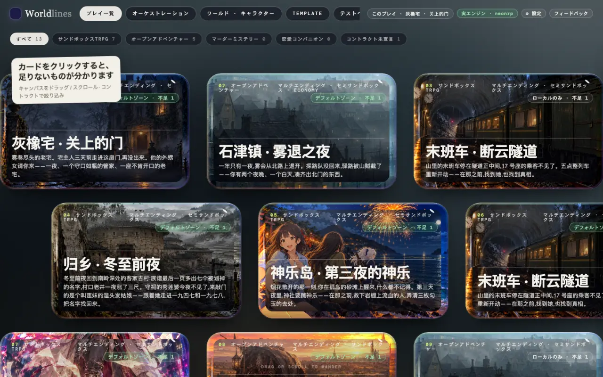
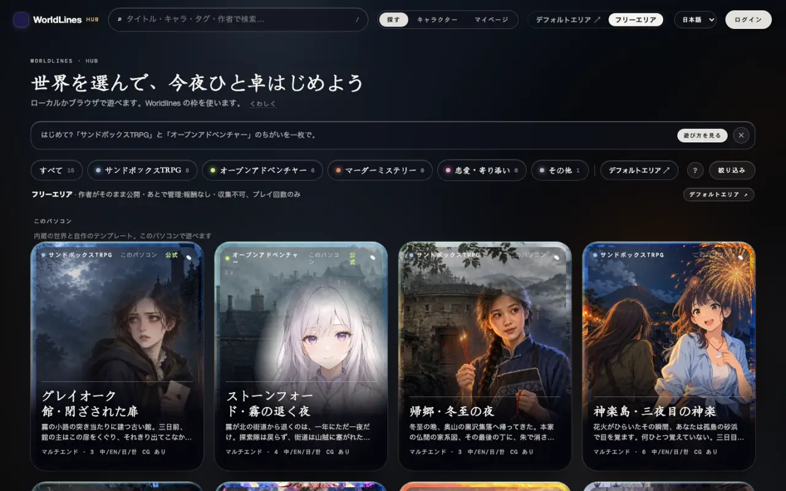
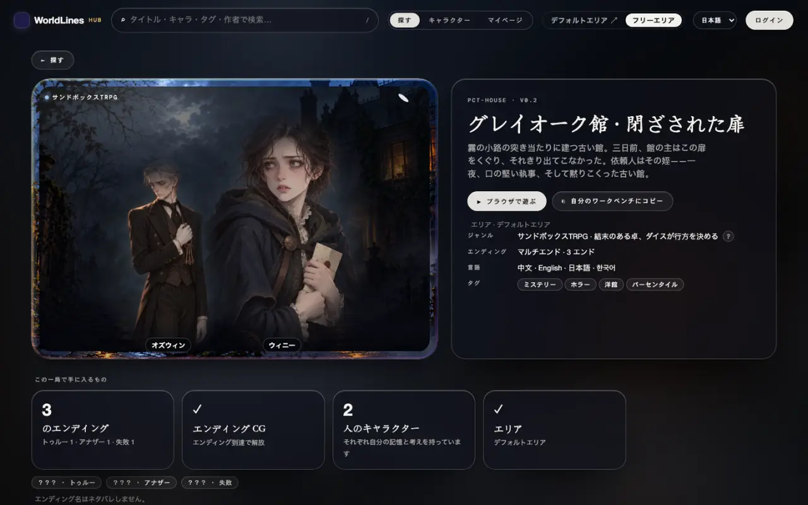
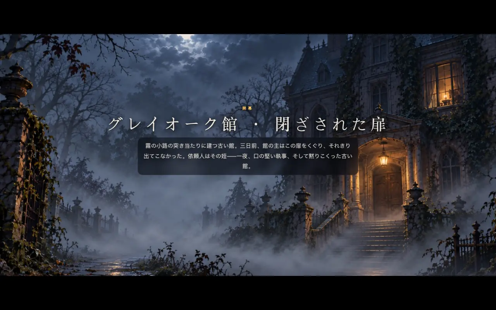
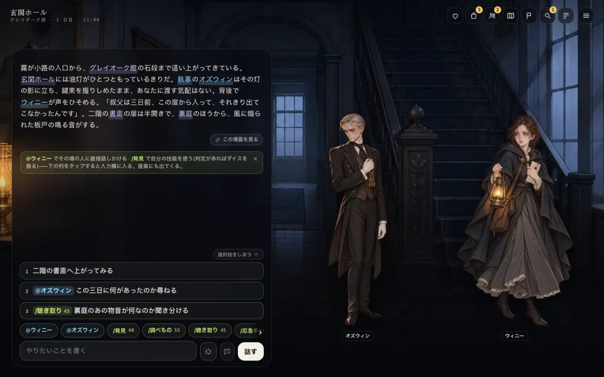

<!-- section: what -->
## プレイ用フロントエンドとは

> **状態:1.0 で公開**

プレイ用フロントエンドは、プレイヤーが一局を遊ぶ画面です。背景、立ち絵、オープニング演出、選択肢、パネル。Hub と iOS でプレイヤーが見る画面と同じです。`worldlines` をインストールすると、`http://127.0.0.1:8787/player.html` で開けます。

テストベンチはテンプレートを作るときの開発ツールで、別の画面です。

このページの道は 2 つです。

- **A** ローカルの Hub で公式ワールドを選び、プレイ用フロントエンドで遊ぶ;
- **B** オンライン Hub のフリーエリアで作品を選び、ダウンロードして、プレイ用フロントエンドで遊ぶ。

<!-- section: a -->
## A. ローカルの Hub で公式ワールドを選び、プレイ用フロントエンドで遊ぶ

### 1. ローカルの Hub を開く

```bash
pip install worldlines
worldlines        # ブラウザで http://127.0.0.1:8787/local が開きます
```

開くのはワークベンチです。上のバーの右にある「Hub ↗」で、ローカルの Hub(`http://127.0.0.1:8787/hub.html`)に入ります。



オープニングの一拍はテンプレートに書かれているので、モデルを呼びません。続けて話すには、先にワークベンチの「⚙ 設定」でモデルをつなぎます([モデルをつなぐ](/docs/players/providers))。

### 2. 公式ワールドを選ぶ

ローカルの Hub は「フリーエリア」のページで開きます。いちばん上の「このパソコン」の列が、内蔵ワールドと自分のテンプレートです。内蔵のものには「公式」と付いています。



カードを押すと詳細ページに入ります。左上が作品 ID です。例:`PCT-HOUSE`(グレイオーク館)。



詳細ページの「▶ ブラウザで遊ぶ」は一局を始め、ワークベンチでそのプレイを開きます。

### 3. プレイ用フロントエンドに入る

アドレスバーで開きます。

```text
http://127.0.0.1:8787/player.html?tpl=pct-house
```

`tpl` は作品 ID(小文字)です。プレイ用フロントエンドが自分で一局を始め、アドレスに `&save=<セーブ>` が付きます。

詳細ページからすでに一局を始めているときは、`tpl` なしで `http://127.0.0.1:8787/player.html` を開きます。エンジンで開いているプレイにつながります。

画面の言語はアドレスの `lang` に従います:`&lang=zh` · `en` · `ja` · `ko`。

### 4. 遊ぶ

最初はタイトルカードです。「開く」を押します。



オープニングは一段ずつ流れます。「タップで次へ」。初めてのときは操作説明が続きます。



- 下の入力欄にやりたいことを書き、「話す」を押します。
- 入力欄の上の 1 · 2 · 3 は候補です。押すと入力欄に入ります。
- `@名前` はその人に直接話しかけ、`/スキル` はスキルを使います(リスクのあるものはダイスを振ります)。
- 右上のアイコンでパネルが開きます:ステータス、持ち物、人物、地図、目的、手がかり、記録。

1 ターンのあと、物語が下に続き、入力欄の上に新しい候補が出ます。

### 5. セーブ

どの一局も自動で保存されます。アドレスの `save=` がこのプレイです。同じアドレスを開けば続きから遊べます。

ワークベンチの「プレイ一覧」でテンプレートのカードを押すと、「セーブ」にもこのプレイが出ます([テストベンチでテンプレートを試す](/docs/tutorials/test-template#saves))。

<!-- section: b -->
## B. フリーエリアからダウンロードし、プレイ用フロントエンドで遊ぶ

### 1. フリーエリアで作品を選ぶ

フリーエリアはオンラインの Hub にあります:`https://neonrp.worldlines.gg/free/`。作者がそのまま公開した作品が並びます。


作品を押すと詳細ページに入ります。メインのボタンは「⬇ ダウンロードしてローカルで遊ぶ」です。


押すと 3 つの手順が出ます。

1. ローカル版をインストールして開く;
2. ローカル版の Hub で「フリーエリア」を開き、この作品を探す(作品 ID はダイアログにあります);
3. 「ダウンロードしてローカルで遊ぶ」を押せば、すぐ始められます。


### 2. ローカルにダウンロードする

ローカルの Hub の「フリーエリア」ページでは、「このパソコン」の列の下に、オンラインのフリーエリアの作品が並びます。カードには「フリーエリア」と付いています。詳細ページで「⬇ ダウンロードしてローカルで遊ぶ」を押します。


終わると、詳細ページのボタンが「▶ ブラウザで遊ぶ」「↓ ダウンロード」「⎘ 自分のワークベンチにコピー」などに変わります。作品は `~/.worldlines/templates/<作品 ID>.template/` に入ります。


ダウンロードにログインは要りません。

### 3. ダウンロードした作品を遊ぶ

A の手順 3 と同じで、`tpl` をこの作品の ID にします。

```text
http://127.0.0.1:8787/player.html?tpl=last-train-3aafaa
```

<!-- section: notes -->
## 注意

- プレイ用フロントエンドはローカルのエンジンにつながっています。`worldlines` を閉じると止まります。セーブはパソコンに残ります。
- フリーエリアの作品は作者がそのまま公開し、あとで管理されます。問題があれば詳細ページの「通報」を押します。
- 作品を変えたいときは、詳細ページの「⎘ 自分のワークベンチにコピー」でコピーし、ワークベンチで編集します([テストベンチでテンプレートを試す](/docs/tutorials/test-template))。
