<!-- section: what -->
## プレイ用フロントエンドとは

> **状態:1.0 で公開**

プレイ用フロントエンドは、プレイヤーが一局を遊ぶ画面です。背景、立ち絵、オープニング演出、選択肢、パネル。Hub と iOS でプレイヤーが見る画面と同じです。`worldlines` をインストールすると、ワークベンチの「フロントエンド」にあります。

テストベンチはテンプレートを作るときの開発ツールで、別の画面です。

このページの道は 2 つです。

- **A** ワークベンチでワールドを選び、プレイ用フロントエンドで遊ぶ;
- **B** フリーエリアから作品をダウンロードし、プレイ用フロントエンドで遊ぶ。

<!-- section: a -->
## A. ワークベンチでプレイ用フロントエンドを遊ぶ

### 1. ワークベンチを開く

```bash
pip install worldlines
worldlines        # ブラウザで http://127.0.0.1:8787/local が開きます
```

開くのがワークベンチです。

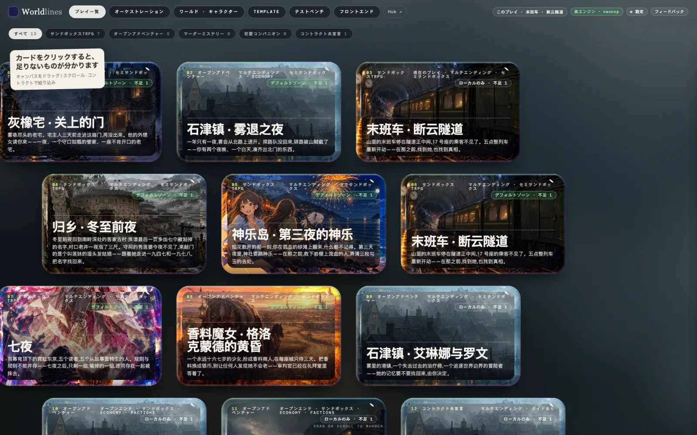

オープニングの一拍はテンプレートに書かれているので、モデルを呼びません。続けて話すには、先にワークベンチの「⚙ 設定」でモデルをつなぎます([モデルをつなぐ](/docs/players/providers))。

### 2. 上のバーの「フロントエンド」を押す

上のバーは左から:プレイ一覧 · オーケストレーション · ワールド · キャラクター · Template · テストベンチ · フロントエンド。「フロントエンド」を押します。ウィンドウが狭いときは、上のバーを横にスクロールすると出てきます。

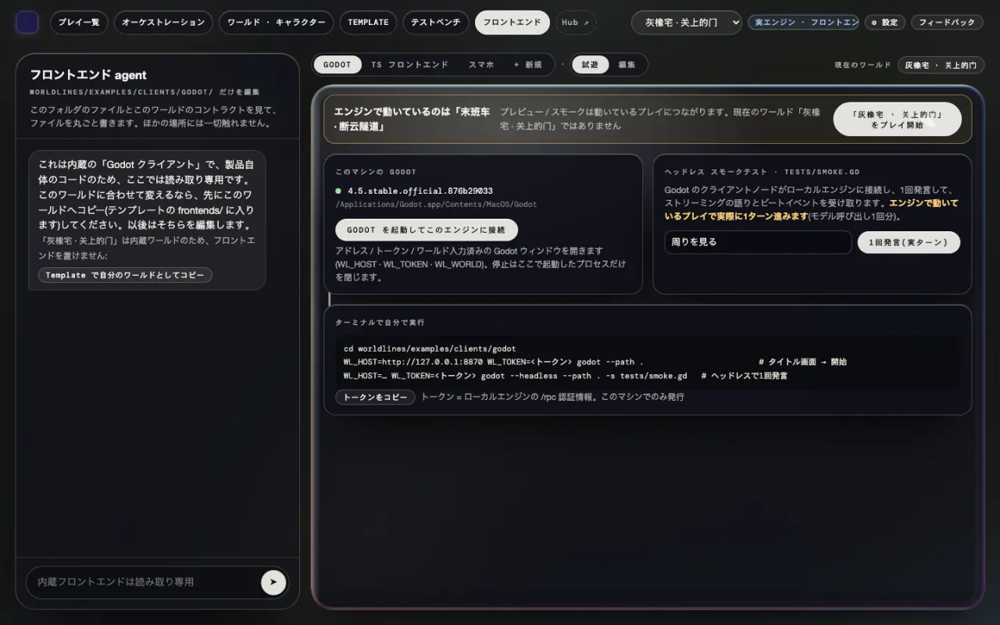

### 3. ワールドを選ぶ

上のバーの右のプルダウンが現在のワールドです。1 つ選びます。

エンジンで動いているのが別のワールドのときは、上に「エンジンで動いているのは「…」」というバーが出ます。右の「「…」をプレイ開始」を押し、確認します。それまでのプレイはセーブに残ります。

### 4. 「TS フロントエンド」を押す

ページ上の列は Godot · TS フロントエンド · スマホ · + 新規 です。「TS フロントエンド」を押します。隣は「標準フロントエンド」と「試遊」のまま(初期値)にします。

下に出るのがプレイ用フロントエンドで、エンジンで動いているプレイにつながっています。最初はタイトルカードです。

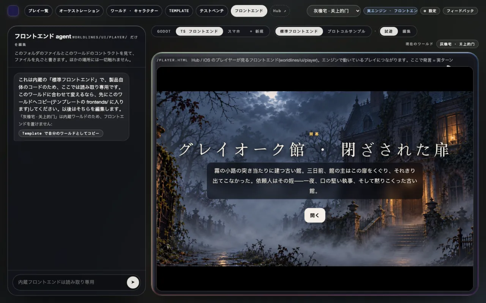

### 5. 遊ぶ

「開く」を押します。オープニングは一段ずつ流れます。「タップで次へ」。初めてのときは操作説明が続きます。

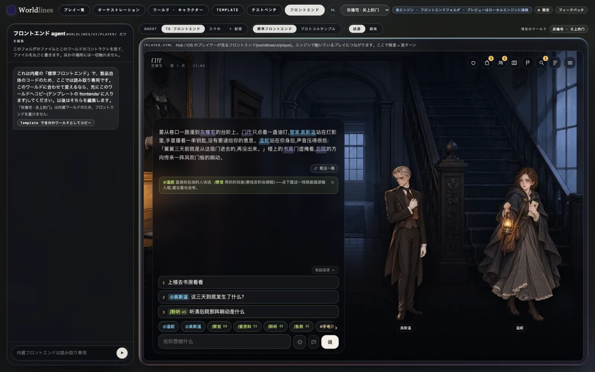

- 下の入力欄にやりたいことを書き、「話す」を押します。
- 入力欄の上の 1 · 2 · 3 は候補です。押すと入力欄に入ります。
- `@名前` はその人に直接話しかけ、`/スキル` はスキルを使います(リスクのあるものはダイスを振ります)。
- いちばん下の列でパネルが開きます:ステータス、持ち物、人物、地図、手帳。目的、手がかり、記録は手帳の中です。

ここで話す一言は本当の 1 ターンです。物語が下に続き、入力欄の上に新しい候補が出ます。

### 6. セーブ

どの一局も自動で保存されます。別のワールドで一局を始めても、それまでのプレイはセーブに残ります。

「プレイ一覧」でテンプレートのカードを押すと、「セーブ」にこのプレイが出て、続きから遊べます([テストベンチでテンプレートを試す](/docs/tutorials/test-template#saves))。

<!-- section: b -->
## B. フリーエリアからワールドをダウンロードし、プレイ用フロントエンドで遊ぶ

### 1. フリーエリアで作品を選ぶ

フリーエリアはオンラインの Hub にあります:`https://neonrp.worldlines.gg/free/`。作者がそのまま公開した作品が並びます。

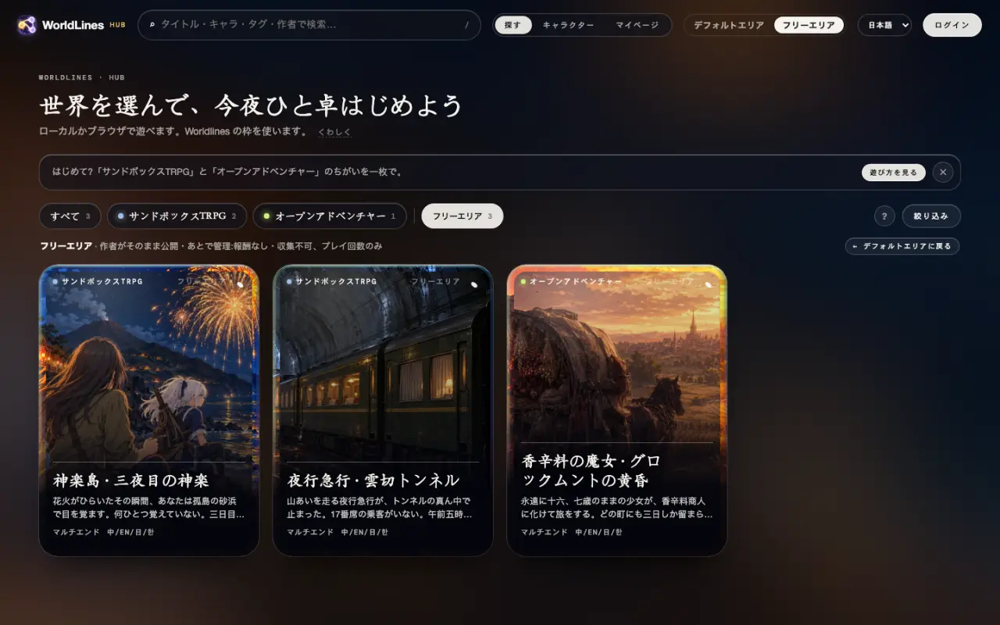

作品を押すと詳細ページに入ります。メインのボタンは「⬇ ダウンロードしてローカルで遊ぶ」です。

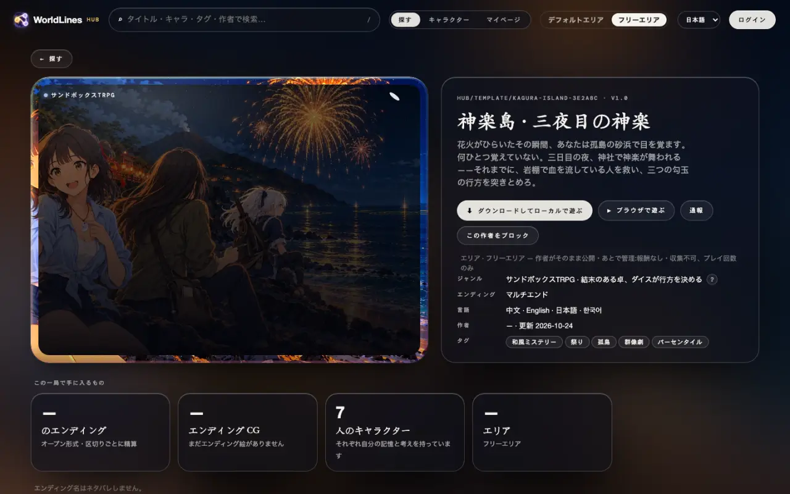

押すと 3 つの手順が出ます。

1. ローカル版をインストールして開く;
2. ローカル版の Hub で「フリーエリア」を開き、この作品を探す(作品 ID はダイアログにあります);
3. 「ダウンロードしてローカルで遊ぶ」を押せば、すぐ始められます。

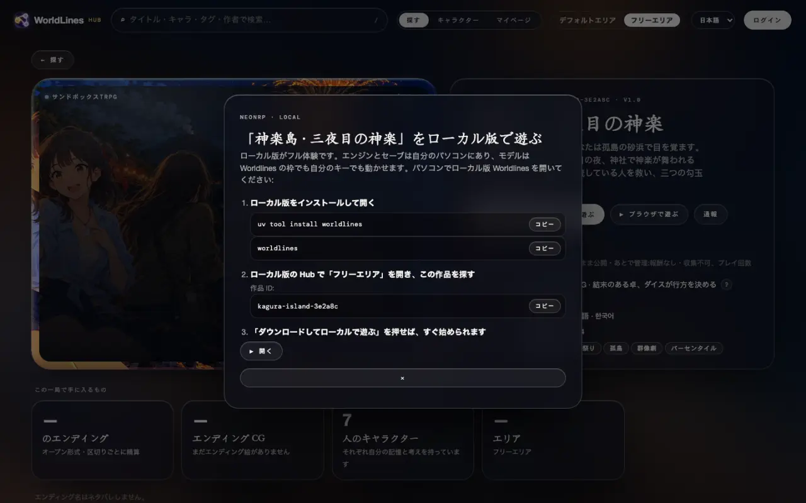

### 2. ローカルにダウンロードする

ワークベンチの上のバーの「Hub ↗」で、ローカルの Hub を開きます。「フリーエリア」のページで開き、「このパソコン」の列の下に、オンラインのフリーエリアの作品が並びます。カードには「フリーエリア」と付いています。詳細ページで「⬇ ダウンロードしてローカルで遊ぶ」を押します。

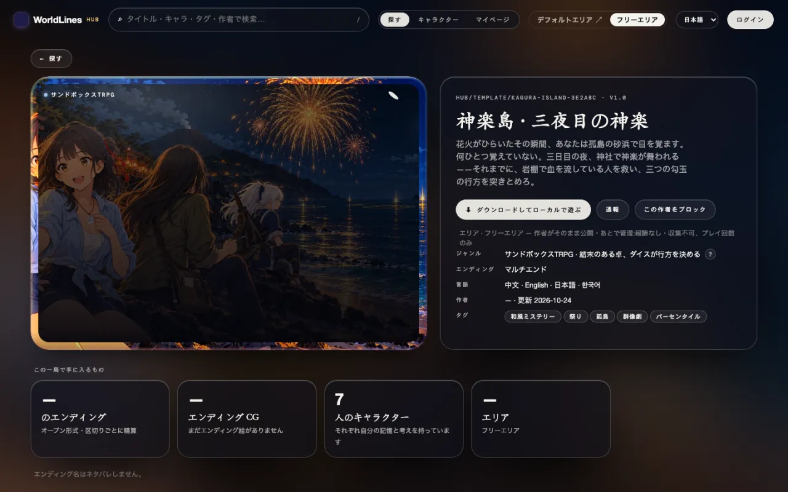

終わると、作品は `~/.worldlines/templates/<作品 ID>.template/` に入り、詳細ページに「⎘ 自分のワークベンチにコピー」「🗑 削除」などが出ます。

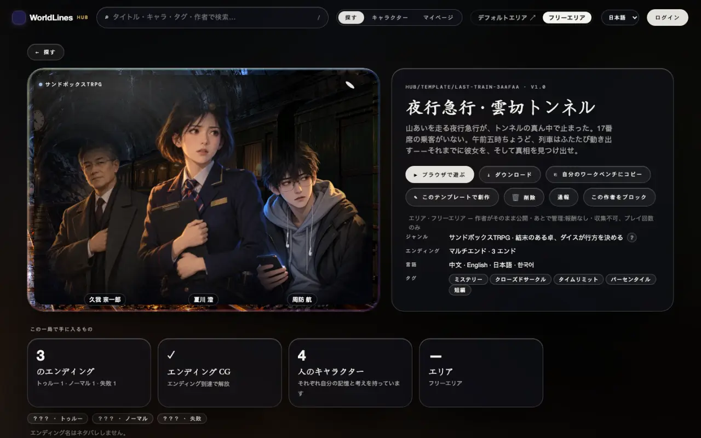

ダウンロードにログインは要りません。

### 3. ワークベンチの「フロントエンド」→ このワールドを選ぶ →「TS フロントエンド」

ワークベンチに戻り、ページを再読み込みします。上のバーのプルダウンにこの作品が増えています。A と同じです。

1. 上のバーの「フロントエンド」を押す;
2. プルダウンでこの作品を選ぶ;
3. 「TS フロントエンド」を押す;
4. バーの「「…」をプレイ開始」を押し、確認する。

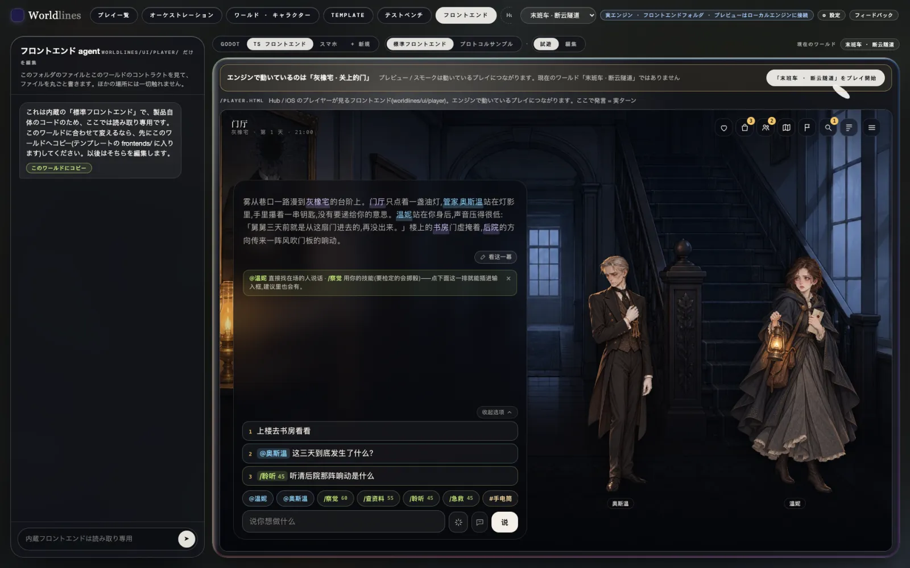

始まると、プレイ用フロントエンドがこのプレイにつながります。遊び方は A の手順 5 と同じです。

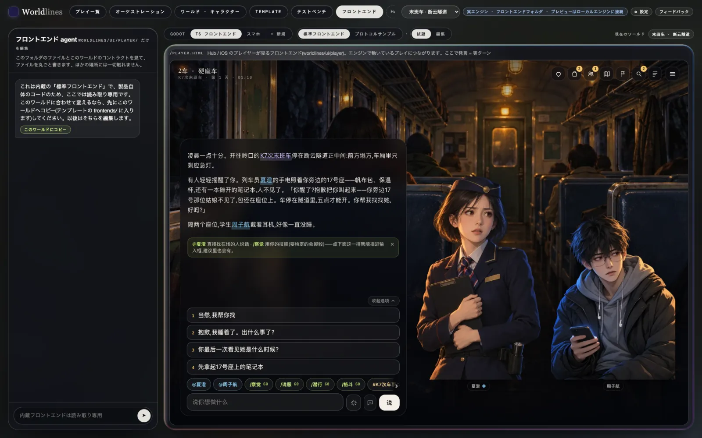

<!-- section: notes -->
## 注意

- ワークベンチで始めたプレイは、今のところ中国語固定です。プレイ用フロントエンドも中国語で表示されます。
- 世界を切り替えて新しいプレイを始めたあと、前のプレイの画面のままなら、ページを再読み込みします。
- プレイ用フロントエンドはローカルのエンジンにつながっています。`worldlines` を閉じると止まります。セーブはパソコンに残ります。
- プレイ用フロントエンドは `http://127.0.0.1:8787/player.html` で単独でも開けます。エンジンで動いているプレイにつながります。
- フリーエリアの作品は作者がそのまま公開し、あとで管理されます。問題があればローカルの Hub の詳細ページで「通報」を押します。
- 作品を変えたいときは、ローカルの Hub の詳細ページの「⎘ 自分のワークベンチにコピー」でコピーし、ワークベンチで編集します([テストベンチでテンプレートを試す](/docs/tutorials/test-template))。
