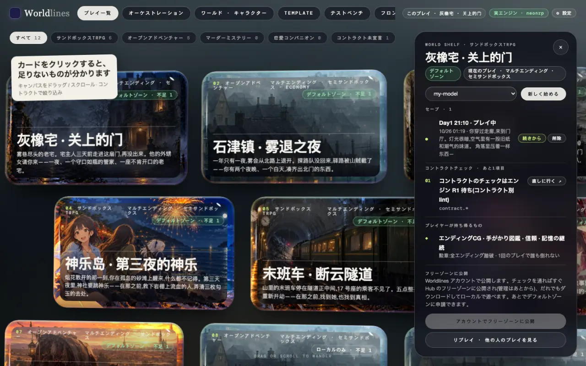
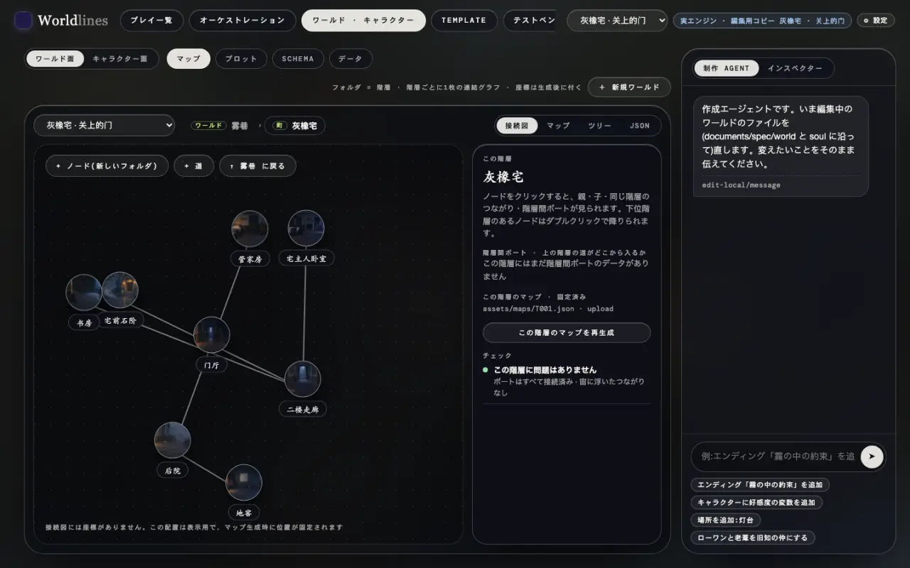
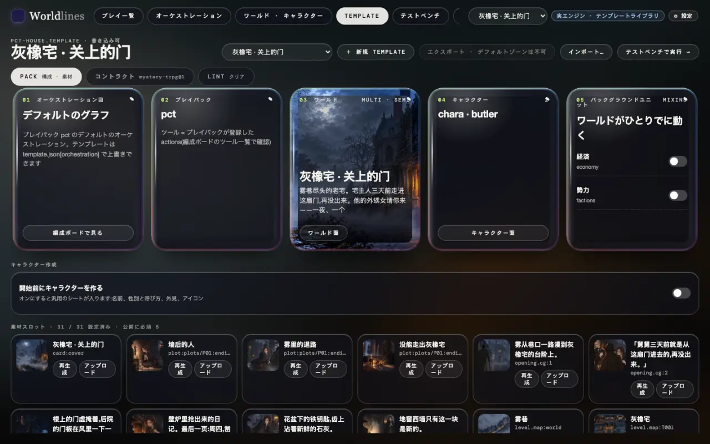
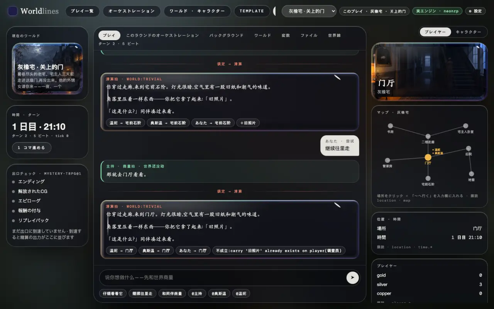
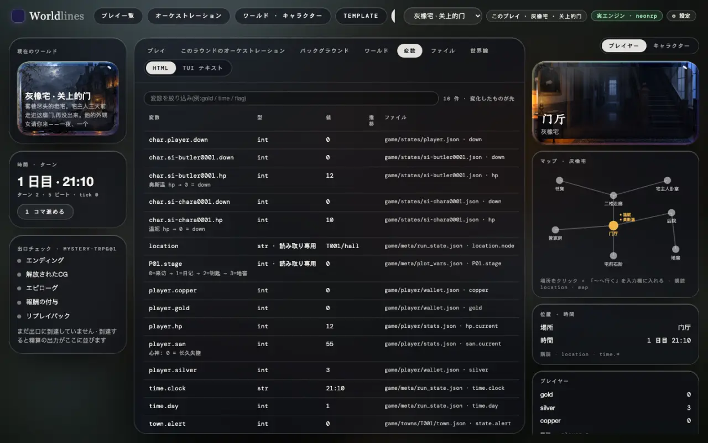
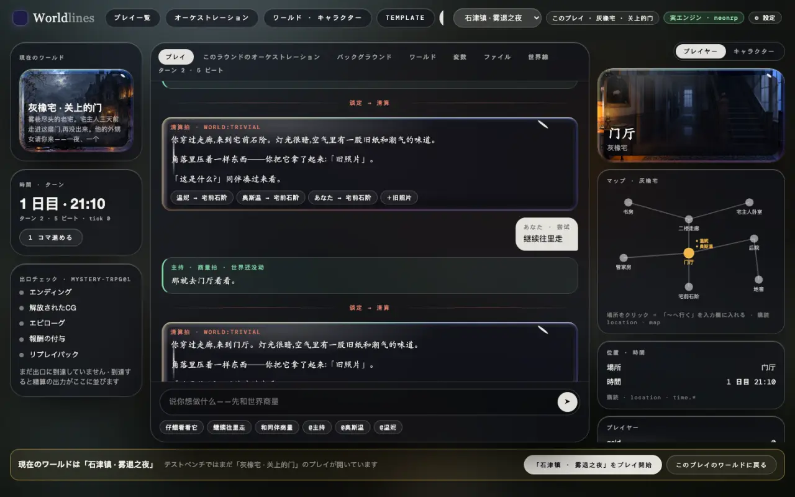
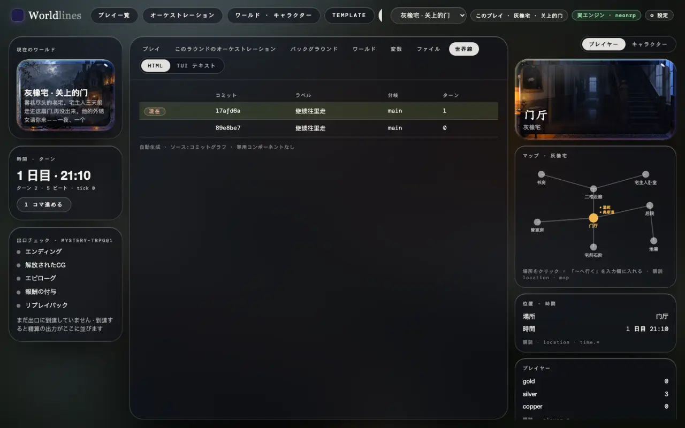

<!-- section: open -->
## ワークベンチを開く

> **状態:1.0 で公開**

```bash
pip install worldlines
worldlines        # ブラウザで http://127.0.0.1:8787/local が開きます
```

上のバーに 6 つの台があります(英語版:[Workbenches](/docs/creators/workbench))。このページで使うのは、プレイ一覧、ワールド · キャラクター、Template、テストベンチの 4 つです。

テストベンチはテンプレートやフロントエンドを作るときの開発ツールです。中央がこのプレイ、両側が状態、タブにはエンジンの生データが出ます。

オープニングの一拍はテンプレートに書かれているので、モデルを呼びません。続けて話すには、先に「⚙ 設定」でモデルをつなぎます([モデルをつなぐ](/docs/players/providers))。

<!-- section: pick -->
## 1. テンプレートを選んで始める

プレイ一覧でテンプレートのカードをクリックすると、右にパネルが開きます。

- ドロップダウンでこのプレイのモデルを選び、「新しく始める」;
- 「セーブ」の「続きから」で、前のプレイを続けます;
- 「コントラクトチェック」は公開までに足りないものを並べます。



始まったら、上のバーの「テストベンチ」がこのプレイです。

<!-- section: world -->
## 2. ワールドとテンプレートを見る

「ワールド · キャラクター」で変えるのはテンプレートで、プレイではありません。ワールド面にはマップ · プロット · Schema · データの 4 ページがあります。マップはレベルごとに分かれています。場所をクリックすると、右にその場所のレベル、他のレベルへの出入口、このレベルのマップ画像とチェック結果が出ます。



「Template」ページは組み立ての単位です。オーケストレーショングラフ、プレイパック、ワールド、キャラクター、ミックスインが並び、下に素材スロットがあります。上部で「コントラクト」「Lint」に切り替えると、コントラクトとチェックが見られます。



内蔵テンプレートは読み取り専用です。変えるときは先に「複製して編集」を押すか、次を実行します。

```bash
neonrp template fork pct-house my-house --store ~/.worldlines/templates
```

<!-- section: bench -->
## 3. テストベンチで遊ぶ

「プレイ」タブがこのプレイです。



- 一拍ごとに 1 枚のカードです。相談の拍は緑、清算の拍は赤です(オープンソースのエンジンは清算の拍だけ)。
- カードの下の小さなラベルは、その拍でワールドに起きた変化です。誰がどこへ行ったか、何を得たか。通らなかった変化には理由が書かれます。
- 左の列:現在のワールド、時刻とターン、出口チェック(このコントラクトが求めるエンディング、CG、エピローグなどに届いたか)。「1 コマ進める」はワールドを一拍だけ自分で進めます。モデルは呼びません。
- 右の列:「プレイヤー」はあなたの状態、マップ、現在地。「キャラクター」はその場にいるキャラクターの態度と意図です。

<!-- section: tabs -->
## 4. エンジンのデータを見る

「プレイ」以外のタブは、エンジンのデータから自動で作られます。

| タブ | 中身 |
|---|---|
| このラウンドのオーケストレーション | この拍が通ったノード、呼んだツール、通った変化と通らなかった変化、ダイス |
| バックグラウンド | ミックスインの tick、トリガーなどのバックグラウンド単位が、拍ごとに変えたもの |
| ワールド | schema のクラスとインスタンス |
| 変数 | クローズド schema の変数:型、現在値、推移、保存先のファイル |
| ファイル | この拍が書いたファイルと内容 |
| 世界線 | このプレイのコミットグラフ:ターンごとに 1 コミット、分岐 |

右上で「HTML / TUI テキスト」を切り替えられます。TUI テキストはターミナルの表示と同じです。



同じデータは直接も読めます。`GET /api/v1/play/schema`(変数)、`GET /api/v1/play/engine/commits`(コミットグラフ)、`GET /traces`(一言ごとの記録)。英語版:[Protocol](/docs/developers/protocol)。

<!-- section: switch -->
## 5. テンプレートを切り替える

上のバーのドロップダウンが「現在のワールド」です。オーケストレーション、ワールド · キャラクター、Template、テストベンチ、フロントエンドはすべてこれに従います。

別の台で現在のワールドを変えてからテストベンチに戻ると、バナーが出ます。

- 「「…」をプレイ開始」:確認すると新しいプレイが始まります。元のプレイはセーブに残ります;
- 「このプレイのワールドに戻る」:現在のワールドを、テストベンチで開いているプレイのワールドに戻します。

テストベンチの上で直接切り替えると、始める前に一度確認されます。



<!-- section: saves -->
## 6. セーブを切り替える

一つのプレイは `~/.worldlines/plays/` の下のフォルダ一つで、拍が確定するたびに自動で保存されます。

- 別のセーブに切り替える:プレイ一覧 → テンプレートのカード → 「セーブ」の「続きから」。
- このプレイの分岐を見る:テストベンチの「世界線」タブ。
- あるターンに戻って新しい線を始める:ターミナルで `/undo <ターン>`、またはプレイのフォルダで `neonrp commit log` / `neonrp commit checkout`。[セーブ · 分岐 · 巻き戻し](/docs/players/saves)を参照。



<!-- section: next -->
## 次へ

- このプレイに自分のフロントエンドをつなぐ:[1 つのテンプレート、複数のフロントエンド](/docs/tutorials/frontend-data)
- テンプレートの絵を差し替える:[外部ツールで素材を作る](/docs/tutorials/external-assets)
