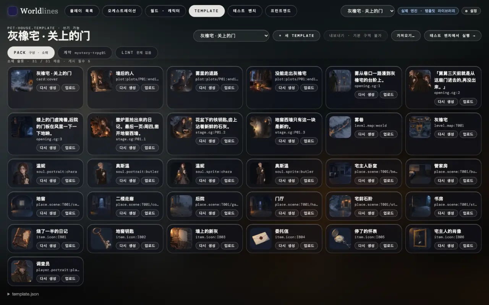

<!-- section: list -->
## 1. 필요한 그림 보기

> **상태: 1.0과 함께 공개**

템플릿에 필요한 그림은 한 장 한 장이 슬롯입니다(영어판: [Assets](/docs/creators/assets)). 보는 곳은 두 군데입니다.

- 워크벤치 Template 페이지의 소재 슬롯: 칸마다 그림 한 장, 슬롯 id가 적혀 있고 "업로드", "다시 생성"을 할 수 있습니다;
- 명령:

```bash
neonrp template slots my-house
# ok       place.scene:T001/hall      门厅
# -        place.scene:T001/study     书房      ← 아직 그림이 없음
```



내장 템플릿은 읽기 전용입니다. 먼저 내 것으로 복사합니다(Template 페이지의 "복사해서 편집", 또는 `neonrp template fork pct-house my-house --store ~/.worldlines/templates`).

<!-- section: size -->
## 2. 크기와 형식

형식: PNG, JPEG, WebP, 한 장 8 MB 이하. 투명 배경은 PNG나 WebP만 됩니다.

| 슬롯 | 비율 | 참고 크기 | 설명 |
|---|---|---|---|
| `card:cover` 커버 | 16:9 | 1920×1080 | 카드와 타이틀 화면 |
| `level.map:<레벨>` 지도 | 3:2 | 1536×1024 | 장소 점이 월드 좌표대로 올라갑니다 |
| `place.scene:<주소>` 배경 | 16:9 | 1344×768 이상 | 장소 배경 |
| `soul.portrait:<캐릭터>` 초상 | 3:4 | 896×1152 이상 | 캐릭터 카드, 대화 아이콘 |
| `soul.sprite:<캐릭터>` 스탠딩 | 세로 | 1024×1536 | **투명 배경**, 전신 |
| `item.icon:<id>` 아이콘 | 1:1 | 1024×1024 | 아이템, 단서 |
| `player.portrait:player` 플레이어 | 1:1 | 1024×1024 | |
| 오프닝 / 플롯 단계 / 엔딩 CG | 가로 | 1536×1024 | 연출과 엔딩 카드 |

프런트엔드는 자기 레이아웃에 맞춰 잘라 냅니다. 주제는 가운데에 두고 네 변에 여백을 조금 남깁니다. 비율은 슬롯이 선언한 것(`ratio`)이며, 맞지 않아도 거부되지는 않지만 화면에서 잘립니다.

<!-- section: make -->
## 3. 외부 도구에서 만들기

도구는 가리지 않습니다. 일반적인 흐름:

1. **프롬프트에서 시작.** 슬롯마다 장소나 캐릭터 설정으로 쓴 프롬프트가 있습니다. Template 페이지의 소재 슬롯에서 봅니다. 이것을 외부 도구의 출발점으로 삼고 내 스타일 단어를 더합니다.
2. **스타일 통일.** 같은 월드의 그림은 같은 스타일 단어, 같은 참고 그림으로 만듭니다. 장면은 바꿔도 화풍은 바꾸지 않습니다.
3. **비율 맞추기.** 위 표의 비율로 뽑습니다. 크기는 작은 것보다 큰 편이 낫고, 내보내기 전에 8 MB 이하로 줄입니다.
4. **스탠딩은 투명 배경.** 도구가 투명 배경을 바로 뽑을 수 있으면 그것을 씁니다. 안 되면 단색 배경으로 뽑아 누끼를 따고 PNG나 WebP로 저장합니다. 초상(`portrait`)은 배경이 있어도 됩니다. 초상이 원래 전신이면 스탠딩은 초상을 그대로 써도 됩니다(영어판: [Assets](/docs/creators/assets#slots)).
5. **지도와 장소 맞추기.** 지도 위의 점은 월드 좌표대로 올라갑니다. 밖에서 그린 지도는 건물 위치가 그 점과 대략 맞아야 합니다. 업로드한 뒤 "월드 · 캐릭터" → 지도에서 "지도" 보기로 바꿔 확인합니다.

<!-- section: put -->
## 4. 템플릿에 넣기

**추천: 워크벤치에서 업로드.** Template 페이지에서 슬롯을 찾아 "업로드"를 누르고 파일을 고릅니다. 엔진이 형식을 확인하고, 슬롯에 맞는 이름으로 맞는 자리에 두고, 출처를 기록합니다.

템플릿 폴더(`~/.worldlines/templates/<id>.template/`)에 직접 넣어도 됩니다. 이름은 다음과 같습니다.

| 슬롯 | 위치 |
|---|---|
| `place.scene:T001/hall` | `world-overlay/assets/places/T001__hall.png`(주소의 `/`는 `__`로) |
| `level.map:T001` | `world-overlay/assets/maps/T001.png` |
| `soul.portrait:<캐릭터>` · `soul.sprite:<캐릭터>` | `world-overlay/souls/<캐릭터 폴더>/assets/portrait.png` · `…/sprite.png` |
| `player.portrait:player` | `world-overlay/game/player/assets/portrait.png` |
| `card:cover` · CG · 엔딩 그림 | `template.json` / `plot.json`에 적힌 경로 |

슬롯 하나에 파일은 하나만 둡니다(`.webp`로 바꾸면 옛 `.png`는 지웁니다). 넣은 뒤 `neonrp template slots <id>`를 실행해 그 줄이 `ok`가 되면 됩니다. 지도는 업로드를 추천합니다. 업로드할 때 엔진이 그 그림에 맞는 장소 배치도 함께 기록합니다.

<!-- section: check -->
## 5. 결과 보기

- **Template 페이지**: 소재 슬롯 썸네일이 새 그림으로 바뀝니다;
- **월드 · 캐릭터**: 지도 페이지의 노드와 지도 그림;
- **테스트 벤치**: 새로 시작하고 그 장소에 가고 그 캐릭터를 만납니다. 판은 시작할 때 템플릿 그림을 복사하므로, 열려 있는 판은 옛 그림 그대로입니다;
- **내 프런트엔드**: 주소로 이 판의 그림을 받는(`/api/v1/play/place-image` 등, [그림](/docs/tutorials/frontend-data#slots)) 프런트엔드는 새로 시작한 판에서 새 그림이 됩니다. 자체 아트 팩을 쓰는 프런트엔드는 그 팩을 바꿉니다.

공개 전에 Lint를 돌립니다. `lint.level: publish`일 때 `required: publish` 슬롯이 비어 있으면 공개가 막힙니다(영어판: [Lint](/docs/creators/lint)).

<!-- section: rights -->
## 주의

- **권리.** 쓸 권리가 있는 그림만 씁니다. 직접 그린 것, 도구 약관이 상업 이용을 허락하는 생성 그림, 라이선스가 재배포를 허락하는 소재. Hub에 공개한 작품은 다른 사람이 내려받고, 그림도 템플릿과 함께 갑니다.
- **그림에 넣지 말 것.** 허락받지 않은 실존 인물의 초상, 남의 상표와 캐릭터, 워터마크가 있는 그림, 개인 정보가 찍힌 스크린샷.
- **글자.** 대사나 설명을 그림에 박아 넣지 않습니다. 프런트엔드가 자기 글자를 겹치고 언어별로 보여 줍니다.
- **크기.** 한 장 8 MB 이하. 그림이 클수록 템플릿 패키지가 커지고 로딩이 느려집니다.
