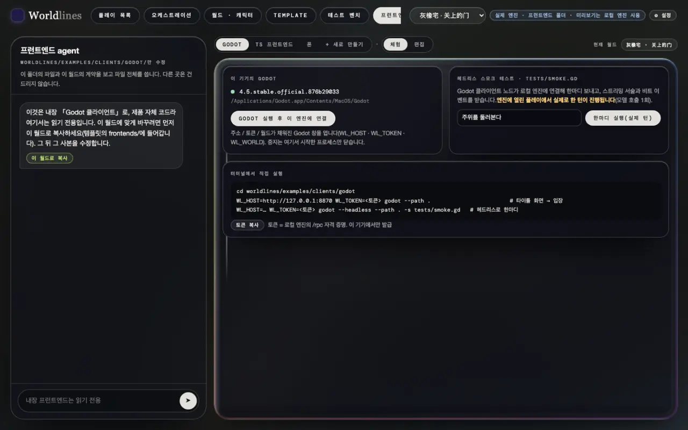

<!-- section: prep -->
## 준비

> **상태: 예제는 오픈 소스 저장소에 공개**

두 예제는 오픈 소스 저장소에 있습니다. PyPI의 `worldlines`에는 소스가 들어 있지 않습니다.

```bash
git clone https://github.com/LudicDynamics/WorldLines
cd WorldLines/worldlines/examples/clients      # godot/ · ts/ · art/
```

실행 중인 엔진과 그 토큰도 필요합니다([하나의 템플릿, 여러 프런트엔드](/docs/tutorials/frontend-data#host)):

- 로컬 워크벤치: `worldlines`를 실행하고 플레이 목록에서 그레이오크 저택을 시작합니다. 토큰은 "프런트엔드" 페이지의 "토큰 복사";
- 또는 월드 폴더 하나: `neonrp serve --project <폴더> --port 8788`이 시작할 때 토큰을 출력합니다.

예제 화면은 그레이오크 저택(`pct-house`)에 맞춰 그렸습니다. 다른 월드도 플레이할 수 있고, 없는 그림은 자리 표시로 나옵니다. 아래 명령은 워크벤치 기본 주소 `http://127.0.0.1:8787`로 썼습니다. `neonrp serve`를 쓸 때는 출력된 주소로 바꿉니다.

<!-- section: godot -->
## Godot: 실행

Godot 4.5가 필요합니다.

```bash
cd godot
WL_HOST=http://127.0.0.1:8787 WL_TOKEN=<토큰> godot --path .
```

타이틀 화면에 주소와 토큰이 채워져 있으니 "进入"(들어가기)를 누릅니다. 환경 변수 없이 타이틀 화면에서 입력해도 됩니다.

오픈 소스 저장소의 소스로 워크벤치를 돌릴 때는 "프런트엔드" 페이지의 Godot 작업대에서 "Godot 실행 후 이 엔진에 연결"을 누를 수 있습니다. 주소, 토큰, 현재 월드가 채워진 채로 열립니다. 오른쪽 "한마디 실행(실제 턴)"은 화면 없는 Godot로 이 판을 한마디 진행합니다.




프로토콜은 노드 하나 `addons/worldlines/client.gd`에 들어 있습니다. 내 프로젝트에 복사해서 씁니다. 시그널과 호출: 영어판 [Godot](/docs/developers/godot).

<!-- section: godot-edit -->
## Godot: 한 곳 고치기

새 장소를 발견하면 알림을 띄웁니다. `main.gd`의 `_on_beat` 맨 앞에 두 줄을 넣습니다.

```gdscript
func _on_beat(event: String, data: Dictionary) -> void:
	if event == "place.discovered":
		_toast("새 장소", str(data.get("name", "")))
	…
```

게임을 다시 시작하고 가 보지 않은 곳으로 걸어갑니다.


이벤트 이름과 필드는 엔진에서 옵니다(영어판: [Live event stream](/docs/developers/events)). 월드와 무관하므로, 다른 템플릿에서도 이 두 줄은 그대로 동작합니다.

<!-- section: godot-check -->
## Godot: 검사

```bash
godot --headless --path . -s tests/scene_check.gd                                       # 컴파일 확인
WL_HOST=http://127.0.0.1:8787 WL_TOKEN=<토큰> godot --headless --path . -s tests/smoke.gd   # 클라이언트 노드로 한마디
```

`smoke.gd`는 이 판에서 실제로 한 턴을 진행하고 시간, 박자 이벤트, 받은 서술을 출력합니다.

```text
turn 1.3 s · success true
beat events: node.enter → plan.beat → node.leave → node.enter → resolve.beat → soul.mind → state.changed → …
```

<!-- section: ts -->
## TS: 실행

Node.js 22.6 이상이 필요합니다.

```bash
cd ts
npm install
WL_HOST=http://127.0.0.1:8787 npm run dev       # → http://localhost:5180
```

페이지를 열고 토큰을 붙여 넣은 뒤 "进入"(들어가기)를 누릅니다. 개발 서버가 `/rpc`, `/api`, `/state`를 엔진으로 넘기므로 페이지와 엔진은 같은 출처입니다. CORS를 다룰 필요가 없고 토큰은 헤더에 실립니다.


페이지 없이 Node로 한마디:

```bash
WL_HOST=http://127.0.0.1:8787 WL_TOKEN=<토큰> npm run smoke -- "주위를 둘러본다"
```

```text
connected · world … · beats: plan, resolve
turn 3.2 s · success true
beat events: node.enter → plan.beat → node.leave → node.enter → resolve.beat → … → state.changed → …
```

오픈 소스 엔진은 박자 모양을 선언하지 않으므로 이 줄은 `beats: (one plain turn)`이 됩니다.

프로토콜은 파일 하나 `src/client.ts`에 들어 있습니다. 내 프로젝트에 복사해서 씁니다.

<!-- section: ts-edit -->
## TS: 한 곳 고치기

예제의 배경은 자체 아트 팩에서 옵니다. 팩에 없는 장소는 타이틀 그림만 보입니다. 이것을 아트 팩을 먼저 쓰고, 없으면 이 판의 배경 그림(`/api/v1/play/place-image`, [그림](/docs/tutorials/frontend-data#slots))을 쓰도록 바꿉니다.

`src/art.ts`: `/`로 시작하는 주소는 그대로 씁니다.

```ts
url(rel?: string): string | null { return rel ? (rel.startsWith('/') ? rel : this.root + rel) : null }
```

`src/game.ts`의 `setScene()` 맨 앞:

```ts
let own = art.scene(place), hasOwn = await art.has(own)
if (!hasOwn && place) { own = `/api/v1/play/place-image?addr=${encodeURIComponent(place)}`; hasOwn = await art.has(own) }
```

페이지를 새로 고치고 다시 들어가면 장소 배경이 템플릿의 배경 그림으로 바뀝니다.


템플릿 그림을 바꿔도([외부 도구로 소재 만들기](/docs/tutorials/external-assets)) 프런트엔드는 고치지 않아도 됩니다. 새로 시작해서 다시 들어가면 새 그림입니다.

<!-- section: ts-build -->
## TS: 빌드

```bash
npm run typecheck
npm run build            # → dist/
```

소스로 워크벤치를 돌릴 때는 "프런트엔드" 페이지의 "TS 프런트엔드 → 프로토콜 예제"에서 "빌드"를 누르면, 빌드된 것을 페이지 안에서 바로 플레이해 볼 수 있습니다.

<!-- section: own -->
## 내 프런트엔드 쓰기

최소한 할 일:

1. `client.ts`나 `client.gd`를 복사하고, `session.hello`로 핸드셰이크하고, `/rpc/events`를 받기 시작한다;
2. `beat-kinds`를 읽고 박자마다 이름과 모양을 그에 맞춘다;
3. `engine/stream` 서술을 오는 대로 그리고, `engine/beat` 박자 이벤트로 [표](/docs/tutorials/frontend-data#events)대로 화면을 갱신한다;
4. 입력창에서 `turn.send`를 부른다.

변수 타입이 필요하면: `neonrp template contract <템플릿> --ts` / `--gd`(영어판: [Code generation](/docs/developers/codegen)). 완성한 프런트엔드는 템플릿의 `frontends/`에 넣을 수 있습니다([프런트엔드를 템플릿에 넣기](/docs/tutorials/frontend-data#own)).
