<!-- section: what -->
## 플레이 프런트엔드란

> **상태: 1.0과 함께 공개**

플레이 프런트엔드는 플레이어가 한 판을 하는 화면입니다. 배경, 초상, 오프닝 연출, 선택지, 패널. Hub와 iOS에서 플레이어가 보는 화면과 같습니다. `worldlines`를 설치하면 워크벤치의 "프런트엔드"에 있습니다.

테스트 벤치는 템플릿을 만들 때 쓰는 개발 도구이며, 다른 화면입니다.

이 페이지의 길은 두 가지입니다.

- **A** 워크벤치에서 월드를 골라 플레이 프런트엔드로 하기;
- **B** 자유 구역에서 작품을 내려받아 플레이 프런트엔드로 하기.

<!-- section: a -->
## A. 워크벤치에서 플레이 프런트엔드로 하기

### 1. 워크벤치 열기

```bash
pip install worldlines
worldlines        # 브라우저에서 http://127.0.0.1:8787/local 이 열립니다
```

열리는 페이지가 워크벤치입니다.

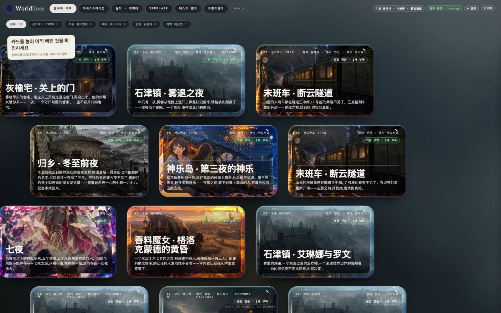

오프닝 한 박자는 템플릿에 쓰여 있어서 모델을 부르지 않습니다. 이어서 말하려면 먼저 워크벤치의 "⚙ 설정"에서 모델을 연결합니다([모델 연결](/docs/players/providers)).

### 2. 위쪽 바의 "프런트엔드" 누르기

위쪽 바는 왼쪽부터: 플레이 목록 · 오케스트레이션 · 월드 · 캐릭터 · Template · 테스트 벤치 · 프런트엔드. "프런트엔드"를 누릅니다. 창이 좁으면 위쪽 바를 옆으로 스크롤하면 보입니다.

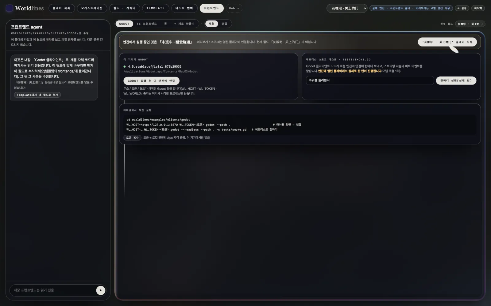

### 3. 월드 고르기

위쪽 바 오른쪽의 드롭다운이 현재 월드입니다. 하나를 고릅니다.

엔진에서 실행 중인 것이 다른 월드라면 위에 "엔진에서 실행 중인 것은 「…」" 바가 나옵니다. 오른쪽의 "‘…’ 플레이 시작"을 누르고 확인합니다. 이전 판은 세이브에 남습니다.

### 4. "TS 프런트엔드" 누르기

페이지 위쪽 줄은 Godot · TS 프런트엔드 · 폰 · + 새로 만들기입니다. "TS 프런트엔드"를 누릅니다. 옆은 "표준 프런트엔드"와 "체험" 그대로 둡니다(기본값).

아래에 나오는 것이 플레이 프런트엔드이며, 엔진에서 실행 중인 판에 연결되어 있습니다. 먼저 타이틀 카드가 나옵니다.

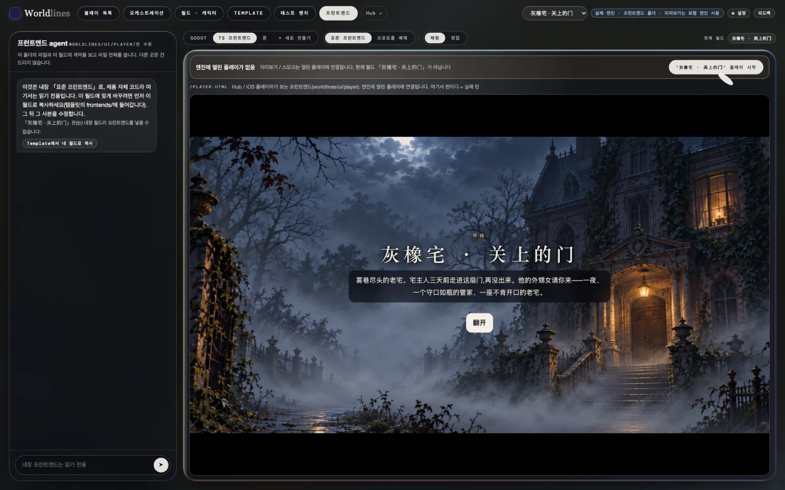

### 5. 플레이

"펼치기"를 누릅니다. 오프닝은 한 단락씩 나옵니다. "탭해서 계속". 처음에는 조작 안내가 이어집니다.

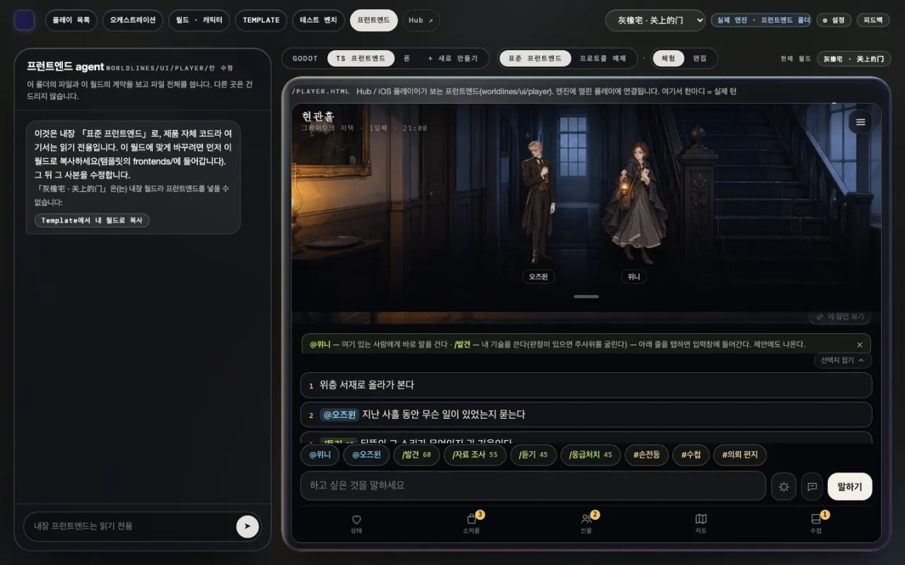

- 아래 입력창에 하고 싶은 것을 쓰고 "말하기"를 누릅니다.
- 입력창 위의 1 · 2 · 3은 추천입니다. 누르면 입력창에 들어갑니다.
- `@이름`은 그 사람에게 바로 말을 걸고, `/기술`은 기술을 씁니다(위험이 있는 것은 주사위를 굴립니다).
- 맨 아래 줄로 패널을 엽니다: 상태, 소지품, 인물, 지도, 수첩. 목표, 단서, 기록은 수첩 안에 있습니다.

여기서 하는 한마디는 진짜 한 턴입니다. 서술이 아래로 이어지고, 입력창 위에 새 추천이 나옵니다.

### 6. 세이브

모든 판은 자동으로 저장됩니다. 다른 월드로 새 판을 시작해도 이전 판은 세이브에 남습니다.

"플레이 목록"에서 템플릿 카드를 누르면 "세이브"에 이 판이 나오고, 이어서 할 수 있습니다([테스트 벤치에서 템플릿 테스트](/docs/tutorials/test-template#saves)).

<!-- section: b -->
## B. 자유 구역에서 월드를 내려받아 플레이 프런트엔드로 하기

### 1. 자유 구역에서 작품 고르기

자유 구역은 온라인 Hub에 있습니다: `https://neonrp.worldlines.gg/free/`. 작가가 바로 공개한 작품이 모여 있습니다.

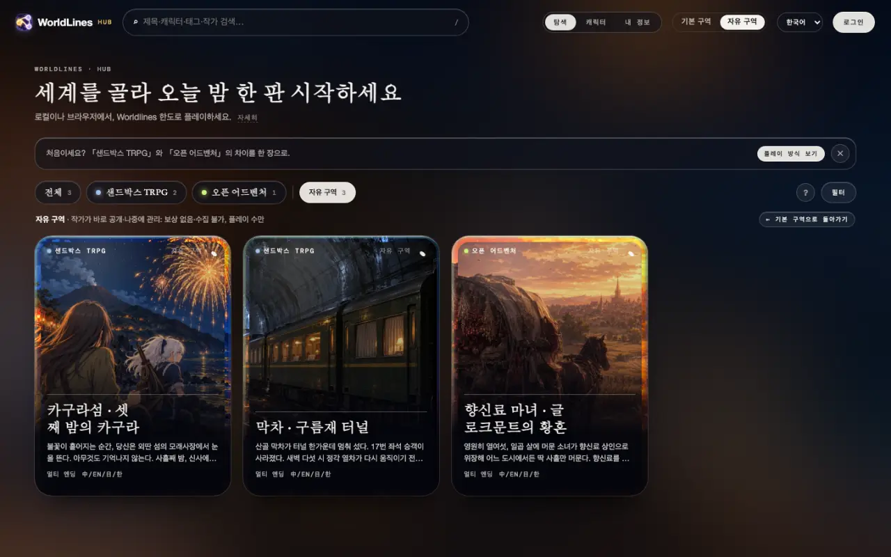

작품을 누르면 상세 페이지로 들어갑니다. 주 버튼은 "⬇ 내려받아 로컬에서 플레이"입니다.

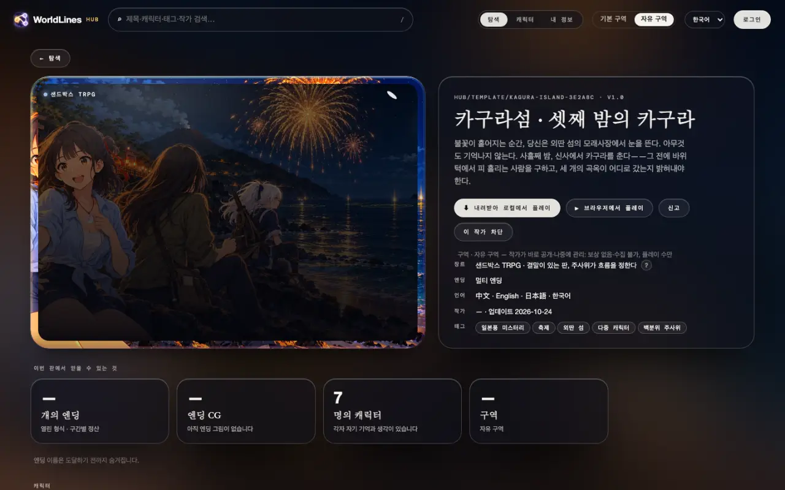

누르면 세 단계가 나옵니다.

1. 로컬 버전을 설치하고 열기;
2. 로컬 Hub에서 "자유 구역"을 열고 이 작품 찾기(작품 ID는 창에 있습니다);
3. "내려받아 로컬에서 플레이"를 누르면 바로 시작.

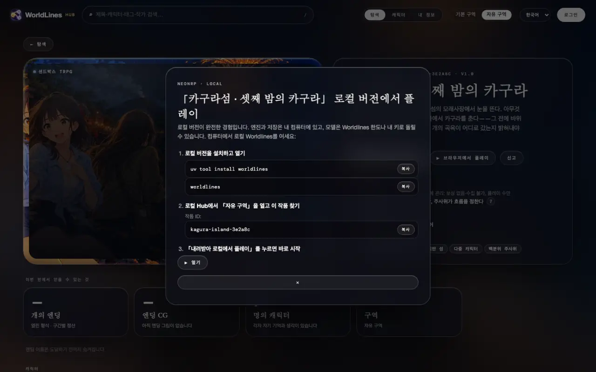

### 2. 내 컴퓨터로 내려받기

워크벤치 위쪽 바의 "Hub ↗"를 눌러 로컬 Hub를 엽니다. "자유 구역" 페이지로 열리고, "이 컴퓨터" 줄 아래에 온라인 자유 구역의 작품이 나옵니다. 카드에 "자유 구역"이 붙어 있습니다. 상세 페이지에서 "⬇ 내려받아 로컬에서 플레이"를 누릅니다.

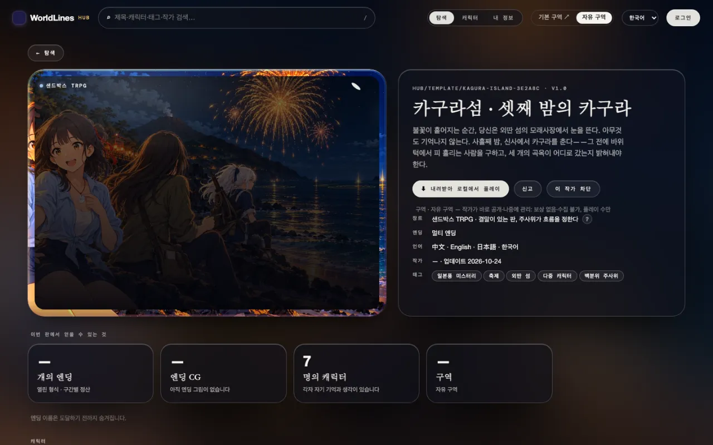

다 받으면 작품은 `~/.worldlines/templates/<작품 ID>.template/`에 들어가고, 상세 페이지에 "⎘ 내 작업대로 복사", "🗑 삭제" 등이 나옵니다.

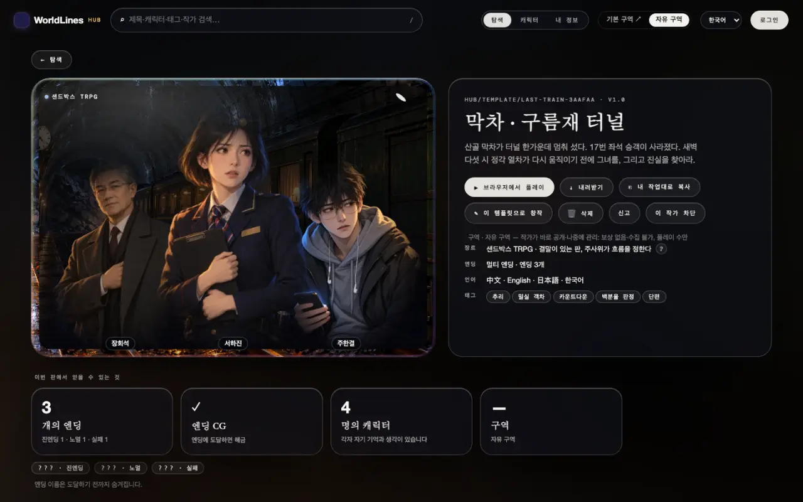

내려받기에는 로그인이 필요 없습니다.

### 3. 워크벤치 "프런트엔드" → 이 월드 고르기 → "TS 프런트엔드"

워크벤치로 돌아가 페이지를 새로 고칩니다. 위쪽 바 드롭다운에 이 작품이 생겼습니다. A와 같습니다.

1. 위쪽 바의 "프런트엔드" 누르기;
2. 드롭다운에서 이 작품 고르기;
3. "TS 프런트엔드" 누르기;
4. 바의 "‘…’ 플레이 시작"을 누르고 확인.

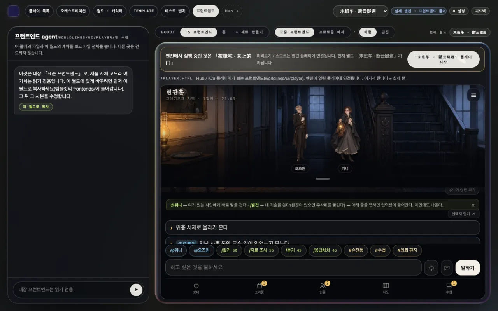

시작되면 플레이 프런트엔드가 이 판에 연결됩니다. 하는 방법은 A의 5단계와 같습니다.

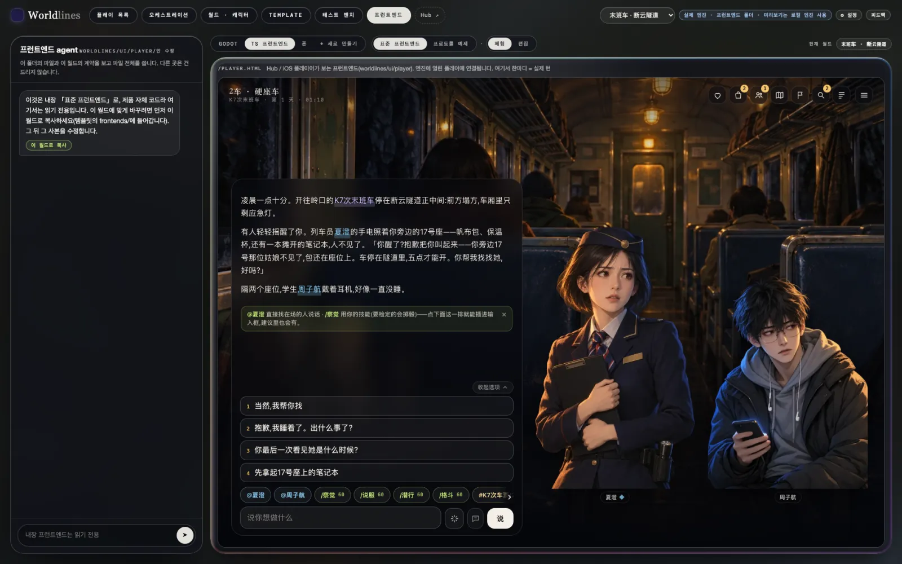

<!-- section: notes -->
## 주의

- 워크벤치에서 시작한 판은 지금은 중국어로 고정되어 있어, 플레이 프런트엔드도 중국어로 표시됩니다.
- 세계를 바꿔 새 판을 시작했는데 플레이 프런트엔드가 이전 판 화면 그대로라면 페이지를 새로고침합니다.
- 플레이 프런트엔드는 내 컴퓨터의 엔진에 연결됩니다. `worldlines`를 닫으면 멈춥니다. 세이브는 컴퓨터에 남습니다.
- 플레이 프런트엔드는 `http://127.0.0.1:8787/player.html`에서 따로 열 수도 있습니다. 엔진에서 실행 중인 판에 연결됩니다.
- 자유 구역 작품은 작가가 바로 공개하고 나중에 관리됩니다. 문제가 있으면 로컬 Hub 상세 페이지의 "신고"를 누릅니다.
- 작품을 바꾸려면 로컬 Hub 상세 페이지의 "⎘ 내 작업대로 복사"로 복사한 뒤 워크벤치에서 편집합니다([테스트 벤치에서 템플릿 테스트](/docs/tutorials/test-template)).
