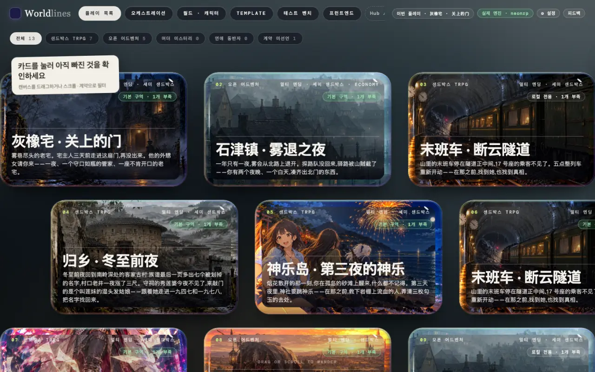
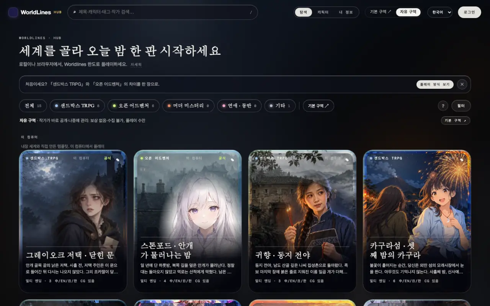
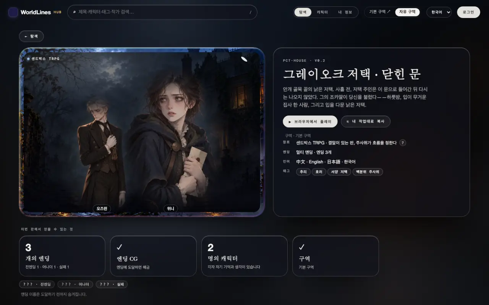
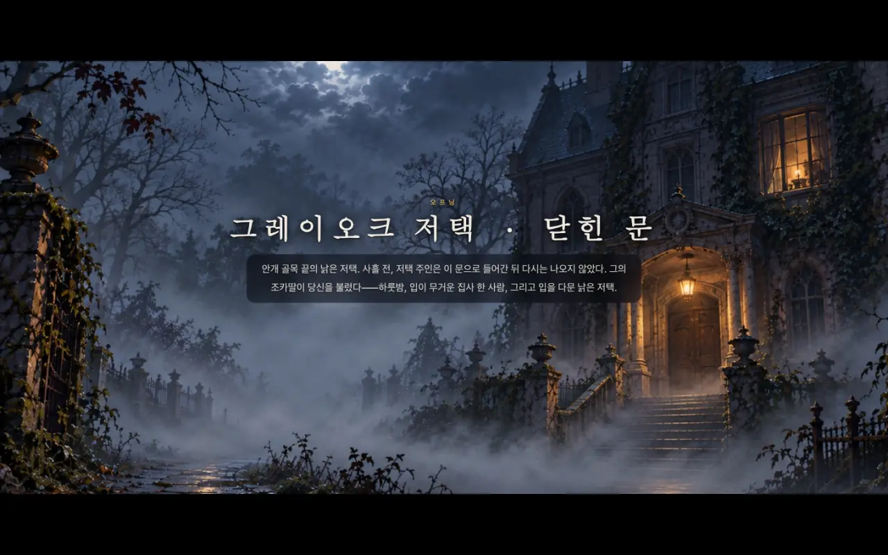
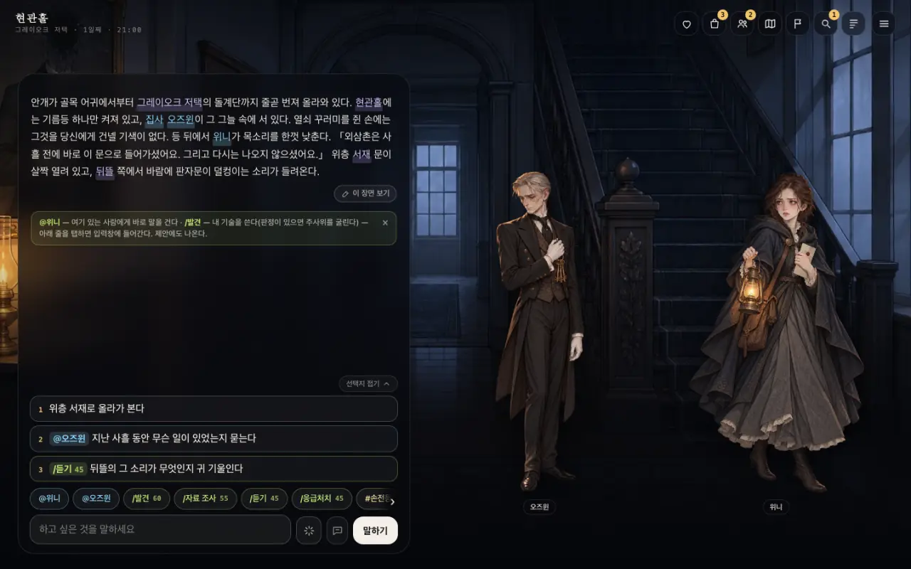

<!-- section: what -->
## 플레이 프런트엔드란

> **상태: 1.0과 함께 공개**

플레이 프런트엔드는 플레이어가 한 판을 하는 화면입니다. 배경, 초상, 오프닝 연출, 선택지, 패널. Hub와 iOS에서 플레이어가 보는 화면과 같습니다. `worldlines`를 설치하면 `http://127.0.0.1:8787/player.html`에서 열립니다.

테스트 벤치는 템플릿을 만들 때 쓰는 개발 도구이며, 다른 화면입니다.

이 페이지의 길은 두 가지입니다.

- **A** 로컬 Hub에서 공식 월드를 골라 플레이 프런트엔드로 하기;
- **B** 온라인 Hub 자유 구역에서 작품을 골라 내려받고 플레이 프런트엔드로 하기.

<!-- section: a -->
## A. 로컬 Hub에서 공식 월드를 골라 플레이 프런트엔드로 하기

### 1. 로컬 Hub 열기

```bash
pip install worldlines
worldlines        # 브라우저에서 http://127.0.0.1:8787/local 이 열립니다
```

열리는 것은 워크벤치입니다. 위쪽 바 오른쪽의 "Hub ↗"를 누르면 로컬 Hub(`http://127.0.0.1:8787/hub.html`)로 들어갑니다.



오프닝 한 박자는 템플릿에 쓰여 있어서 모델을 부르지 않습니다. 이어서 말하려면 먼저 워크벤치의 "⚙ 설정"에서 모델을 연결합니다([모델 연결](/docs/players/providers)).

### 2. 공식 월드 고르기

로컬 Hub는 "자유 구역" 페이지로 열립니다. 맨 위 "이 컴퓨터" 줄이 내장 월드와 내 템플릿입니다. 내장 월드에는 "공식"이 붙어 있습니다.



카드를 누르면 상세 페이지로 들어갑니다. 왼쪽 위가 작품 ID입니다. 예: `PCT-HOUSE`(그레이오크 저택).



상세 페이지의 "▶ 브라우저에서 플레이"는 한 판을 시작하고 워크벤치에서 그 판을 엽니다.

### 3. 플레이 프런트엔드로 들어가기

주소창에서 엽니다.

```text
http://127.0.0.1:8787/player.html?tpl=pct-house
```

`tpl`은 작품 ID(소문자)입니다. 플레이 프런트엔드가 직접 한 판을 시작하고, 주소에 `&save=<세이브>`가 붙습니다.

상세 페이지에서 이미 한 판을 시작했다면 `tpl` 없이 `http://127.0.0.1:8787/player.html`을 엽니다. 엔진에 열려 있는 판에 연결됩니다.

화면 언어는 주소의 `lang`을 따릅니다: `&lang=zh` · `en` · `ja` · `ko`.

### 4. 플레이

먼저 타이틀 카드가 나옵니다. "펼치기"를 누릅니다.



오프닝은 한 단락씩 나옵니다. "탭해서 계속". 처음에는 조작 안내가 이어집니다.



- 아래 입력창에 하고 싶은 것을 쓰고 "말하기"를 누릅니다.
- 입력창 위의 1 · 2 · 3은 추천입니다. 누르면 입력창에 들어갑니다.
- `@이름`은 그 사람에게 바로 말을 걸고, `/기술`은 기술을 씁니다(위험이 있는 것은 주사위를 굴립니다).
- 오른쪽 위 아이콘으로 패널을 엽니다: 상태, 소지품, 인물, 지도, 목표, 단서, 기록.

한 턴이 지나면 서술이 아래로 이어지고, 입력창 위에 새 추천이 나옵니다.

### 5. 세이브

모든 판은 자동으로 저장됩니다. 주소의 `save=`가 이 판입니다. 같은 주소를 열면 이어서 합니다.

워크벤치 "플레이 목록"에서 템플릿 카드를 누르면 "세이브"에도 이 판이 나옵니다([테스트 벤치에서 템플릿 테스트](/docs/tutorials/test-template#saves)).

<!-- section: b -->
## B. 자유 구역에서 내려받아 플레이 프런트엔드로 하기

### 1. 자유 구역에서 작품 고르기

자유 구역은 온라인 Hub에 있습니다: `https://neonrp.worldlines.gg/free/`. 작가가 바로 공개한 작품이 모여 있습니다.


작품을 누르면 상세 페이지로 들어갑니다. 주 버튼은 "⬇ 내려받아 로컬에서 플레이"입니다.


누르면 세 단계가 나옵니다.

1. 로컬 버전을 설치하고 열기;
2. 로컬 Hub에서 "자유 구역"을 열고 이 작품 찾기(작품 ID는 창에 있습니다);
3. "내려받아 로컬에서 플레이"를 누르면 바로 시작.


### 2. 내 컴퓨터로 내려받기

로컬 Hub의 "자유 구역" 페이지에는 "이 컴퓨터" 줄 아래에 온라인 자유 구역의 작품이 나옵니다. 카드에 "자유 구역"이 붙어 있습니다. 상세 페이지에서 "⬇ 내려받아 로컬에서 플레이"를 누릅니다.


다 받으면 상세 페이지의 버튼이 "▶ 브라우저에서 플레이", "↓ 내려받기", "⎘ 내 작업대로 복사" 등으로 바뀝니다. 작품은 `~/.worldlines/templates/<작품 ID>.template/`에 들어갑니다.


내려받기에는 로그인이 필요 없습니다.

### 3. 내려받은 작품 플레이

A의 3단계와 같고, `tpl`을 이 작품의 ID로 바꿉니다.

```text
http://127.0.0.1:8787/player.html?tpl=last-train-3aafaa
```

<!-- section: notes -->
## 주의

- 플레이 프런트엔드는 내 컴퓨터의 엔진에 연결됩니다. `worldlines`를 닫으면 멈춥니다. 세이브는 컴퓨터에 남습니다.
- 자유 구역 작품은 작가가 바로 공개하고 나중에 관리됩니다. 문제가 있으면 상세 페이지의 "신고"를 누릅니다.
- 작품을 바꾸려면 상세 페이지의 "⎘ 내 작업대로 복사"로 복사한 뒤 워크벤치에서 편집합니다([테스트 벤치에서 템플릿 테스트](/docs/tutorials/test-template)).
