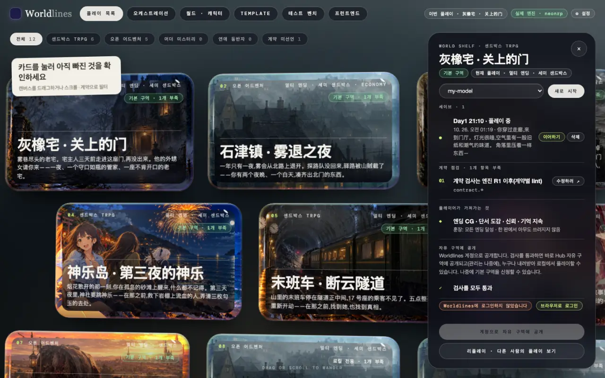
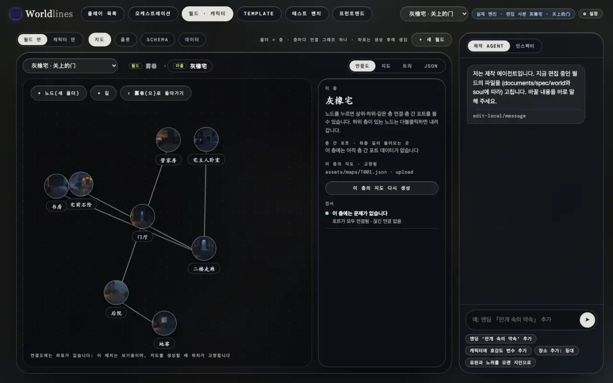
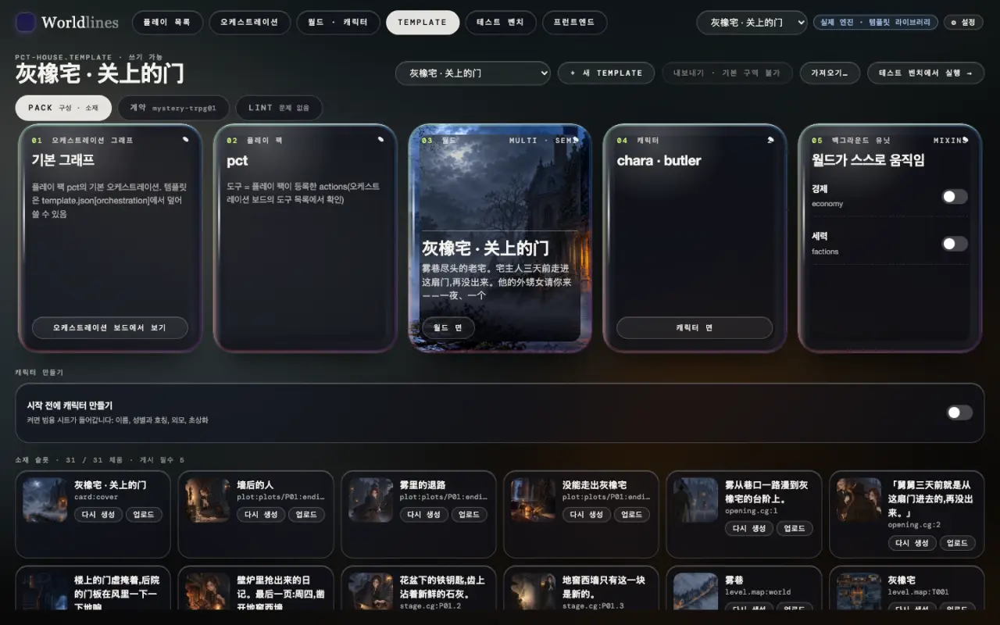
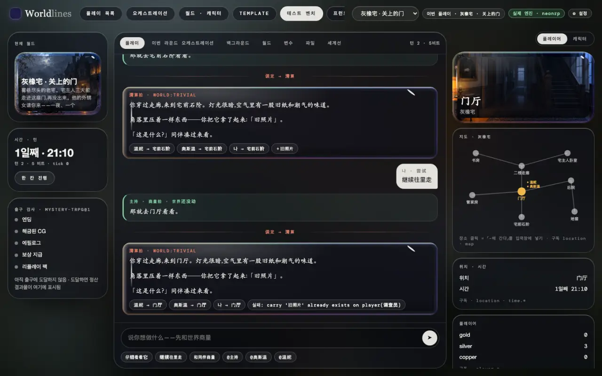
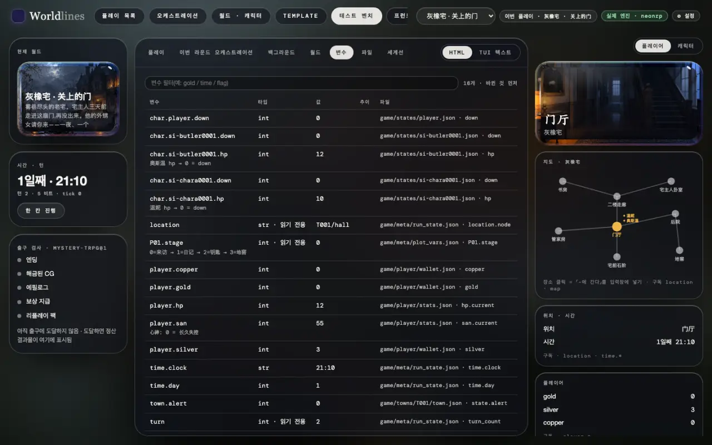
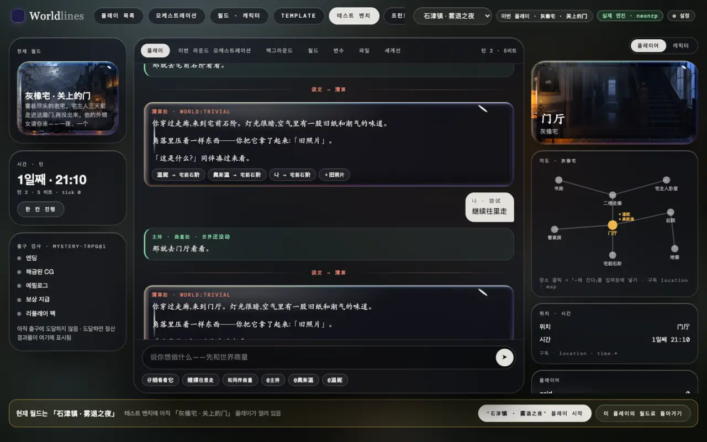
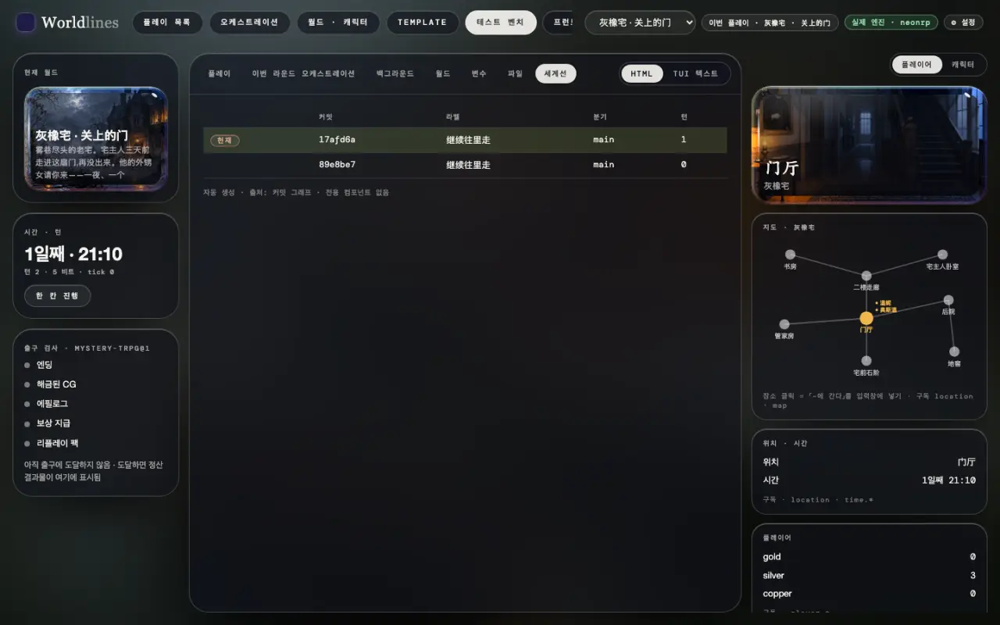

<!-- section: open -->
## 워크벤치 열기

> **상태: 1.0과 함께 공개**

```bash
pip install worldlines
worldlines        # 브라우저에서 http://127.0.0.1:8787/local 이 열립니다
```

위쪽 바에 작업대가 여섯 개 있습니다(영어판: [Workbenches](/docs/creators/workbench)). 이 페이지에서는 플레이 목록, 월드 · 캐릭터, Template, 테스트 벤치 네 개를 씁니다.

테스트 벤치는 템플릿과 프런트엔드를 만들 때 쓰는 개발 도구입니다. 가운데가 이 판, 양쪽이 상태, 탭에는 엔진의 원본 데이터가 나옵니다.

오프닝 한 박자는 템플릿에 쓰여 있어서 모델을 부르지 않습니다. 이어서 말하려면 먼저 "⚙ 설정"에서 모델을 연결합니다([모델 연결](/docs/players/providers)).

<!-- section: pick -->
## 1. 템플릿을 고르고 시작하기

플레이 목록에서 템플릿 카드를 누르면 오른쪽에 패널이 열립니다.

- 드롭다운에서 이 판의 모델을 고르고 "새로 시작";
- "세이브"의 "이어하기"로 이전 판을 이어 합니다;
- "계약 점검"은 공개 전에 빠진 것을 보여 줍니다.



시작하면 위쪽 바의 "테스트 벤치"가 이 판입니다.

<!-- section: world -->
## 2. 월드와 템플릿 보기

"월드 · 캐릭터"에서 바꾸는 것은 템플릿이지 판이 아닙니다. 월드 면에는 지도 · 플롯 · Schema · 데이터 네 페이지가 있습니다. 지도는 레벨별로 나뉩니다. 장소를 누르면 오른쪽에 그 장소의 레벨, 다른 레벨로 가는 출입구, 이 레벨의 지도 그림과 검사 결과가 나옵니다.



"Template" 페이지는 조립 단위입니다. 오케스트레이션 그래프, 플레이 팩, 월드, 캐릭터, 믹스인이 있고 아래에 소재 슬롯이 있습니다. 위에서 "계약", "Lint"로 바꾸면 계약과 검사를 볼 수 있습니다.



내장 템플릿은 읽기 전용입니다. 바꾸려면 먼저 "복사해서 편집"을 누르거나 다음을 실행합니다.

```bash
neonrp template fork pct-house my-house --store ~/.worldlines/templates
```

<!-- section: bench -->
## 3. 테스트 벤치에서 플레이

"플레이" 탭이 이 판입니다.



- 박자마다 카드 한 장입니다. 상의 박자는 초록, 정산 박자는 빨강입니다(오픈 소스 엔진은 정산 박자만 있습니다).
- 카드 아래의 작은 라벨은 그 박자에서 월드에 생긴 변화입니다. 누가 어디로 갔는지, 무엇을 얻었는지. 반영되지 않은 변화에는 이유가 적힙니다.
- 왼쪽 열: 현재 월드, 시간과 턴, 출구 검사(이 계약이 요구하는 엔딩, CG, 에필로그 등에 도달했는지). "한 칸 진행"은 월드를 한 박자만 스스로 움직입니다. 모델은 부르지 않습니다.
- 오른쪽 열: "플레이어"는 내 상태, 지도, 현재 위치. "캐릭터"는 그 자리에 있는 캐릭터의 태도와 의도입니다.

<!-- section: tabs -->
## 4. 엔진 데이터 보기

"플레이"를 뺀 탭은 모두 엔진 데이터로 자동 생성됩니다.

| 탭 | 내용 |
|---|---|
| 이번 라운드 오케스트레이션 | 이 박자가 지난 노드, 부른 도구, 반영된 변화와 반영되지 않은 변화, 주사위 |
| 백그라운드 | 믹스인 tick, 트리거 같은 백그라운드 단위가 박자마다 바꾼 것 |
| 월드 | schema의 클래스와 인스턴스 |
| 변수 | 닫힌 schema의 변수: 타입, 현재 값, 추이, 저장된 파일 |
| 파일 | 이 박자가 쓴 파일과 내용 |
| 세계선 | 이 판의 커밋 그래프: 턴마다 커밋 하나, 분기 |

오른쪽 위에서 "HTML / TUI 텍스트"를 바꿀 수 있습니다. TUI 텍스트는 터미널에 나오는 것과 같습니다.



같은 데이터는 직접 읽을 수도 있습니다. `GET /api/v1/play/schema`(변수), `GET /api/v1/play/engine/commits`(커밋 그래프), `GET /traces`(한마디마다의 기록). 영어판: [Protocol](/docs/developers/protocol).

<!-- section: switch -->
## 5. 템플릿 바꾸기

위쪽 바의 드롭다운이 "현재 월드"입니다. 오케스트레이션, 월드 · 캐릭터, Template, 테스트 벤치, 프런트엔드가 모두 이것을 따릅니다.

다른 작업대에서 현재 월드를 바꾸고 테스트 벤치로 돌아오면 배너가 나옵니다.

- "「…」 시작": 확인하면 새 판이 시작됩니다. 이전 판은 세이브에 남습니다;
- "이 판의 월드로 돌아가기": 현재 월드를 테스트 벤치에 열린 판의 월드로 되돌립니다.

테스트 벤치에서 직접 바꾸면 시작하기 전에 한 번 확인합니다.



<!-- section: saves -->
## 6. 세이브 바꾸기

판 하나는 `~/.worldlines/plays/` 아래 폴더 하나이며, 박자가 확정될 때마다 저장됩니다.

- 다른 세이브로 바꾸기: 플레이 목록 → 템플릿 카드 → "세이브"의 "이어하기".
- 이 판의 분기 보기: 테스트 벤치의 "세계선" 탭.
- 어떤 턴으로 돌아가 새 줄기 시작하기: 터미널에서 `/undo <턴>`, 또는 판 폴더에서 `neonrp commit log` / `neonrp commit checkout`. [저장 · 분기 · 되돌리기](/docs/players/saves)를 보세요.



<!-- section: next -->
## 다음

- 이 판에 내 프런트엔드 붙이기: [하나의 템플릿, 여러 프런트엔드](/docs/tutorials/frontend-data)
- 템플릿 그림 바꾸기: [외부 도구로 소재 만들기](/docs/tutorials/external-assets)
