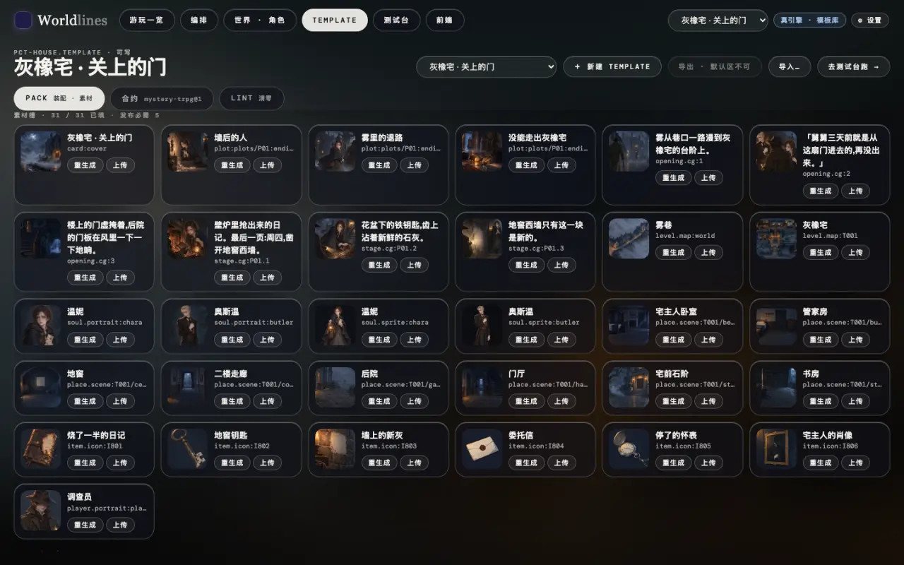

<!-- section: list -->
## 1. 看要哪些图

> **状态:随 1.0 发布**

模板要的每张图都是一个槽位(见[素材:槽位 · 配方 · 视图](/docs/creators/assets))。两处能看:

- 工作台 Template 页的素材槽:每格一张图,写着槽位 id,能「上传」「重生成」;
- 命令行:

```bash
neonrp template slots my-house
# ok       place.scene:T001/hall      门厅
# -        place.scene:T001/study     书房      ← 还没有图
```



内置模板只读,先复制一份成你自己的(Template 页「复制一份来改」,或 `neonrp template fork pct-house my-house --store ~/.worldlines/templates`)。

<!-- section: size -->
## 2. 尺寸和格式

格式:PNG、JPEG、WebP,单张不超过 8 MB。要透明底只能用 PNG 或 WebP。

| 槽位 | 比例 | 参考尺寸 | 说明 |
|---|---|---|---|
| `card:cover` 封面 | 16:9 | 1920×1080 | 卡片和标题画面 |
| `level.map:<关卡>` 地图 | 3:2 | 1536×1024 | 地点的点按世界坐标标在图上 |
| `place.scene:<地址>` 场景 | 16:9 | 1344×768 以上 | 地点的背景 |
| `soul.portrait:<角色>` 立绘 | 3:4 | 896×1152 以上 | 角色卡、对话头像 |
| `soul.sprite:<角色>` 站姿 | 竖图 | 1024×1536 | **透明底**,全身 |
| `item.icon:<id>` 图标 | 1:1 | 1024×1024 | 物品、线索 |
| `player.portrait:player` 玩家头像 | 1:1 | 1024×1024 | |
| 开场 / 剧情阶段 / 结局 CG | 横图 | 1536×1024 | 过场和结局卡 |

前端会按自己的版面裁切:主体放在画面中间,四边留一点余量。比例是槽位声明的(`ratio`),不对时不会被拒,但显示会被裁。

<!-- section: make -->
## 3. 在外部工具里做

不限定工具。通用流程:

1. **拿提示词起步。** 每个槽位都带一条提示词(按地点、角色的设定写好):在 Template 页的素材槽里看。拿它当外部工具的起点,再加你的风格词。
2. **统一风格。** 同一个世界的图用同一组风格词、同一张参考图,换场景不换画风。
3. **按比例出图。** 按上表选比例,尺寸宁大勿小;导出前压到 8 MB 以内。
4. **站姿做透明底。** 工具能直接出透明底就用;不能就出纯色背景,再抠图,存成 PNG 或 WebP。立绘(`portrait`)可以带背景。立绘本身是全身像时,站姿可以直接用立绘(见[素材](/docs/creators/assets#slots))。
5. **地图对齐地点。** 地图上的点按世界里的坐标叠上去。外面画的地图,建筑的位置要和这些点大致对上:上传后到「世界 · 角色」→ 地图,切到「地图」视图检查。

<!-- section: put -->
## 4. 放进模板

**推荐:在工作台上传。** Template 页找到槽位,点「上传」,选文件。引擎检查格式,按槽位命名、放到对的位置,记下来源。

也可以直接把文件放进模板文件夹(`~/.worldlines/templates/<id>.template/`),按下表命名:

| 槽位 | 放在 |
|---|---|
| `place.scene:T001/hall` | `world-overlay/assets/places/T001__hall.png`(地址里的 `/` 换成 `__`) |
| `level.map:T001` | `world-overlay/assets/maps/T001.png` |
| `soul.portrait:<角色>` · `soul.sprite:<角色>` | `world-overlay/souls/<角色文件夹>/assets/portrait.png` · `…/sprite.png` |
| `player.portrait:player` | `world-overlay/game/player/assets/portrait.png` |
| `card:cover` · CG · 结局图 | `template.json` / `plot.json` 里写的路径 |

同一个槽位只留一个文件(换成 `.webp` 就删掉旧的 `.png`)。放好后跑一次 `neonrp template slots <id>`,对应的行变成 `ok` 就对了。地图建议走上传:上传时引擎会同时记下这一张图对应的地点布局。

<!-- section: check -->
## 5. 看效果

- **Template 页**:素材槽的缩略图换成新图;
- **世界 · 角色**:地图页的节点和地图图片;
- **测试台**:新开一局,走到那个地点、碰到那个角色。一局在开局时拷一份模板的图,开着的局还是旧图;
- **你的前端**:按地址取这一局的图(`/api/v1/play/place-image` 等,见[素材](/docs/tutorials/frontend-data#slots))的前端,新开一局后就是新图;用自带美术包的前端,要换的是它自己的包。

发布前跑 Lint:`required: publish` 的槽位没填,`lint.level: publish` 时拦下发布(见 [Lint](/docs/creators/lint))。

<!-- section: rights -->
## 注意

- **版权。** 只用你有权使用的图:自己画的、工具条款允许商用的生成图、授权允许再发布的素材。发布到 Hub 的作品会被别人下载,图跟着模板一起走。
- **别放进图里的东西。** 没有授权的真人肖像、他人的商标和角色、带水印的图、含个人信息的截图。
- **文字。** 图上不要写死台词或说明:前端会叠自己的文字,还要分语言显示。
- **大小。** 每张不超过 8 MB;图越大,模板包越大,加载越慢。
