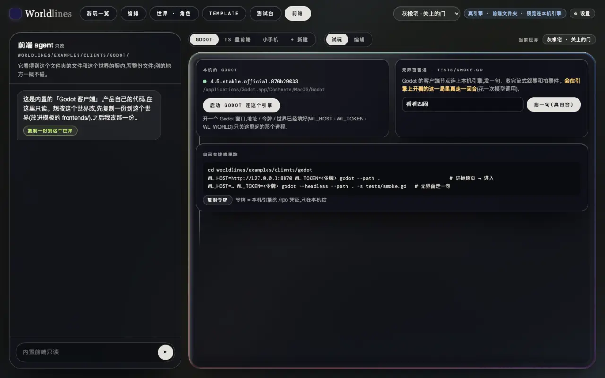

<!-- section: prep -->
## 准备

> **状态:示例随开源仓发布**

两个示例在开源仓里,PyPI 装的 `worldlines` 不带它们的源码:

```bash
git clone https://github.com/LudicDynamics/WorldLines
cd WorldLines/worldlines/examples/clients      # godot/ · ts/ · art/
```

还需要一个开着的引擎和它的令牌(见[一份模板,多个重前端](/docs/tutorials/frontend-data#host)):

- 本机工作台:`worldlines`,在「游玩一览」开一局灰橡宅;令牌在「前端」页点「复制令牌」。
- 或者单个世界文件夹:`neonrp serve --project <文件夹> --port 8788`,启动时打印令牌。

示例的画面按灰橡宅(`pct-house`)做。别的世界也能玩,没有的图用占位。下面的命令按本机工作台的默认地址 `http://127.0.0.1:8787` 写;用 `neonrp serve` 时换成它打印的地址。

<!-- section: godot -->
## Godot:跑起来

需要 Godot 4.5。

```bash
cd godot
WL_HOST=http://127.0.0.1:8787 WL_TOKEN=<令牌> godot --path .
```

标题画面里地址和令牌已经填好,点「进入」。不设环境变量也行,在标题画面里填。

从开源仓源码运行工作台时,「前端」页的 Godot 台能直接点「启动 Godot 连这个引擎」,地址、令牌和当前世界都会填好;右边「跑一句(真回合)」用无界面的 Godot 在这一局上走一句。




协议都在 `addons/worldlines/client.gd` 一个节点里,拷进你的项目就能用。信号和调用见[接入 Godot](/docs/developers/godot)。

<!-- section: godot-edit -->
## Godot:改一处

让玩家发现新地点时弹一条提示。`main.gd` 的 `_on_beat` 开头加两行:

```gdscript
func _on_beat(event: String, data: Dictionary) -> void:
	if event == "place.discovered":
		_toast("新地点", str(data.get("name", "")))
	…
```

重开游戏,走到一个没去过的地方:


事件名和字段来自引擎(见[实时事件流](/docs/developers/events)),和世界无关:换一个模板,这两行照样有效。

<!-- section: godot-check -->
## Godot:检查

```bash
godot --headless --path . -s tests/scene_check.gd                                    # 能编译
WL_HOST=http://127.0.0.1:8787 WL_TOKEN=<令牌> godot --headless --path . -s tests/smoke.gd   # 经客户端节点走一句
```

`smoke.gd` 会在这一局上真的走一回合,打印用时、拍事件和收到的叙事:

```text
turn 1.3 s · success true
beat events: node.enter → plan.beat → node.leave → node.enter → resolve.beat → soul.mind → state.changed → …
```

<!-- section: ts -->
## TS:跑起来

需要 Node.js 22.6 或更高。

```bash
cd ts
npm install
WL_HOST=http://127.0.0.1:8787 npm run dev       # → http://localhost:5180
```

打开页面,粘贴令牌,点「进入」。开发服务器把 `/rpc`、`/api`、`/state` 转给引擎:页面和引擎同源,不用处理 CORS,令牌放在请求头里。


不开页面,用 Node 走一句:

```bash
WL_HOST=http://127.0.0.1:8787 WL_TOKEN=<令牌> npm run smoke -- "看看四周"
```

```text
connected · world … · beats: plan, resolve
turn 3.2 s · success true
beat events: node.enter → plan.beat → node.leave → node.enter → resolve.beat → … → state.changed → …
```

开源引擎没有声明拍的样式,这里显示 `beats: (one plain turn)`。

协议在 `src/client.ts` 一个文件里,拷进你的项目就能用。

<!-- section: ts-edit -->
## TS:改一处

示例的场景图来自自带的美术包;包里没有的地点只显示标题图。改成先用美术包,没有就用这一局的场景图(`/api/v1/play/place-image`,见[素材](/docs/tutorials/frontend-data#slots))。

`src/art.ts`:以 `/` 开头的地址原样用。

```ts
url(rel?: string): string | null { return rel ? (rel.startsWith('/') ? rel : this.root + rel) : null }
```

`src/game.ts` 的 `setScene()` 开头:

```ts
let own = art.scene(place), hasOwn = await art.has(own)
if (!hasOwn && place) { own = `/api/v1/play/place-image?addr=${encodeURIComponent(place)}`; hasOwn = await art.has(own) }
```

刷新页面重新进入,地点的背景换成了模板里的场景图:


模板换了图(见[用外部工具做素材](/docs/tutorials/external-assets)),前端不用改:新开一局再进入,就是新图。

<!-- section: ts-build -->
## TS:构建

```bash
npm run typecheck
npm run build            # → dist/
```

从开源仓源码运行工作台时,「前端」页的「TS 重前端 → 协议示例」点「构建」,构建好后在页里直接试玩。

<!-- section: own -->
## 写自己的前端

最少要做的:

1. 拷 `client.ts` 或 `client.gd`,`session.hello` 握手,开始收 `/rpc/events`;
2. 读 `beat-kinds`,按它显示每一拍的名字和样式;
3. `engine/stream` 的叙事逐字画出来,`engine/beat` 的拍事件按[表](/docs/tutorials/frontend-data#events)更新画面;
4. 输入框调 `turn.send`。

要变量的类型:`neonrp template contract <模板> --ts` / `--gd`(见[代码生成](/docs/developers/codegen))。做好的前端可以放进模板的 `frontends/`(见[把前端放进模板](/docs/tutorials/frontend-data#own))。
