<!-- section: what -->
## 重前端是什么

> **状态:随 1.0 发布**

重前端是玩家玩一局用的界面:场景图、立绘、开场演出、选项、面板。Hub 和 iOS 上玩家看到的就是它。本机装好 `worldlines` 后,它在工作台的「前端」里。

测试台是做模板用的开发工具,和重前端是两个界面。

本页有两条路:

- **A** 在工作台里选一个世界,用重前端玩;
- **B** 从自由区下载一个作品,再用重前端玩。

<!-- section: a -->
## A. 在工作台玩重前端

先在右上角「⚙ 设置」里接好模型(Worldlines 账号或自己的 key),见[接模型](/docs/players/providers)。

### 1. 打开工作台

```bash
pip install worldlines
worldlines        # 浏览器打开 http://127.0.0.1:8787/local
```

打开的就是工作台。

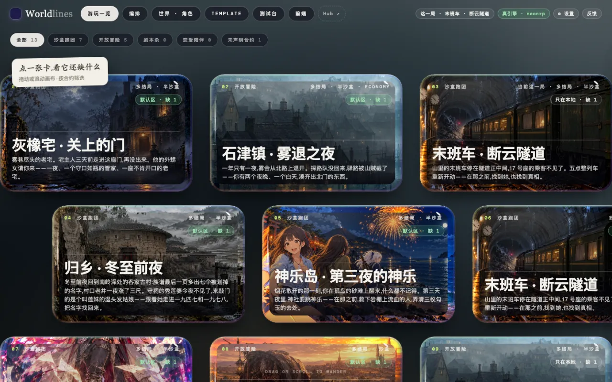

### 2. 点顶栏「前端」

顶栏从左到右:游玩一览 · 编排 · 世界 · 角色 · Template · 测试台 · 前端。点「前端」。

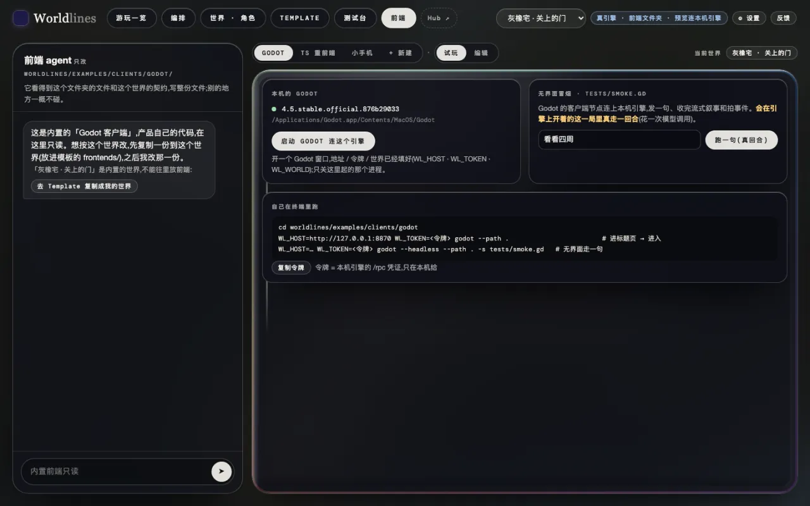

### 3. 选一个世界

顶栏右边的下拉框是当前世界。选一个,例如「灰橡宅 · 关上的门」。

引擎上开着的不是这个世界时,页面上方会出一条提示:「引擎上开着的是「…」」。点右边的「开「…」的一局」,确认后开一局。原来那一局留在存档里。

### 4. 点「TS 重前端」

前端台上方一排是 Godot · TS 重前端 · 小手机 · + 新建。点「TS 重前端」,旁边选「标准前端」和「试玩」(默认就是)。

下面显示的就是重前端,接的是引擎上开着的这一局。先是标题卡。

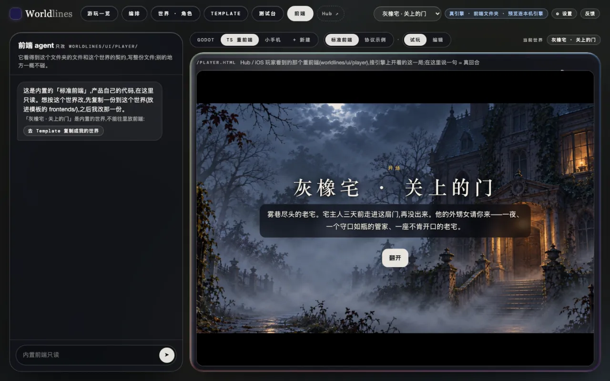

### 5. 在重前端里玩

点「翻开」。开场演出一段一段放,「点一下继续」。第一次玩会有一段操作说明。

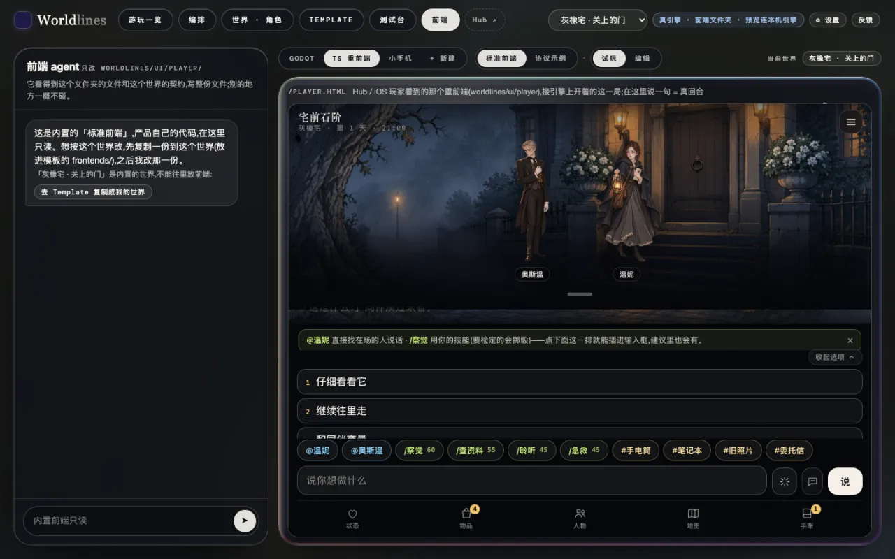

- 下方输入框写你想做的事,点「说」。
- 输入框上面的 1 · 2 · 3 是建议,点一下就填进去。
- `@名字` 是直接对某个人说话,`/技能` 是用技能(带风险的会掷骰)。
- 最下面一排打开面板:状态、物品、人物、地图、手账。手账里还有任务、线索、记录。

在这里说一句就是真的一回合。叙事接在下面,新的建议出现在输入框上面:

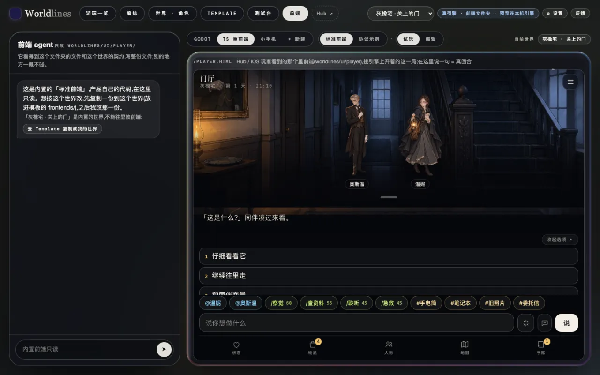

### 6. 存档

每一局都自动存。换世界开新的一局时,原来那一局留在存档里。

在「游玩一览」里点模板卡片,「存档」下能看到这一局,可以接着玩(见[在测试台测模板](/docs/tutorials/test-template#saves))。

<!-- section: b -->
## B. 从自由区下载一个世界,再用重前端玩

### 1. 在自由区挑一个作品

自由区在线上 Hub:`https://neonrp.worldlines.gg/free/`。作者直接公开的作品都在这里。

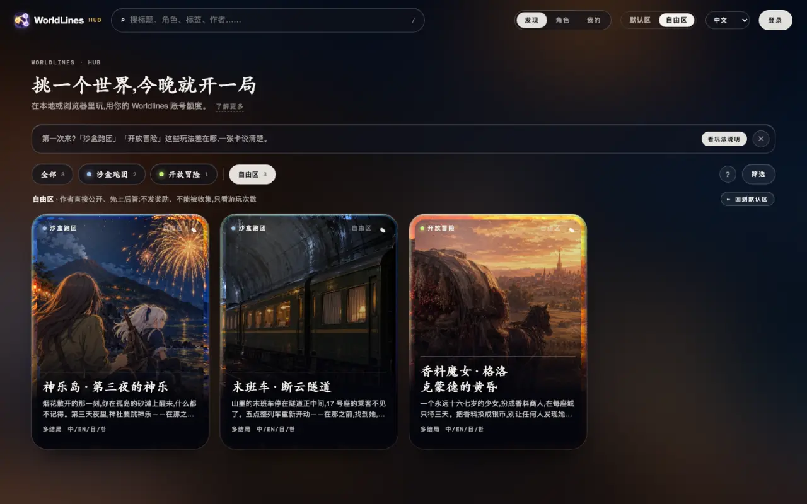

点一个作品,进详情页。主按钮是「⬇ 下载到本地玩」。

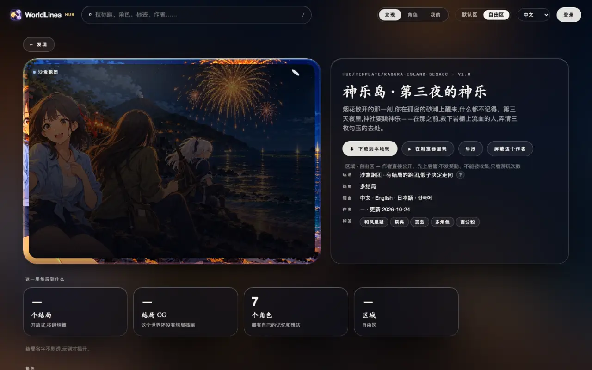

点它,弹出三步:

1. 装好并打开本地版;
2. 在本地版的 Hub 里点「自由区」,找到这个作品(弹窗里有作品编号);
3. 点「下载到本地玩」,下完就能开局。

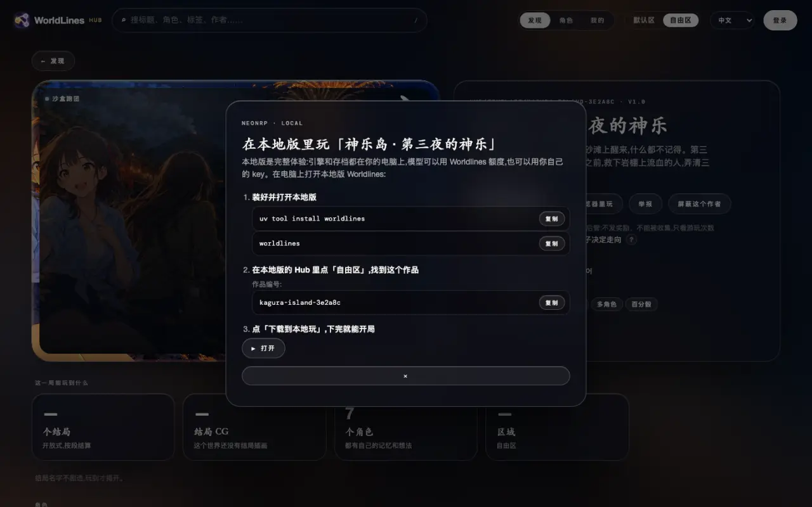

### 2. 下载到本机

在工作台点顶栏的「Hub ↗」,打开本机 Hub。它打开在「自由区」页:「本机」一栏下面列着线上自由区的作品,卡片上标着「自由区」。点进详情页,点「⬇ 下载到本地玩」。

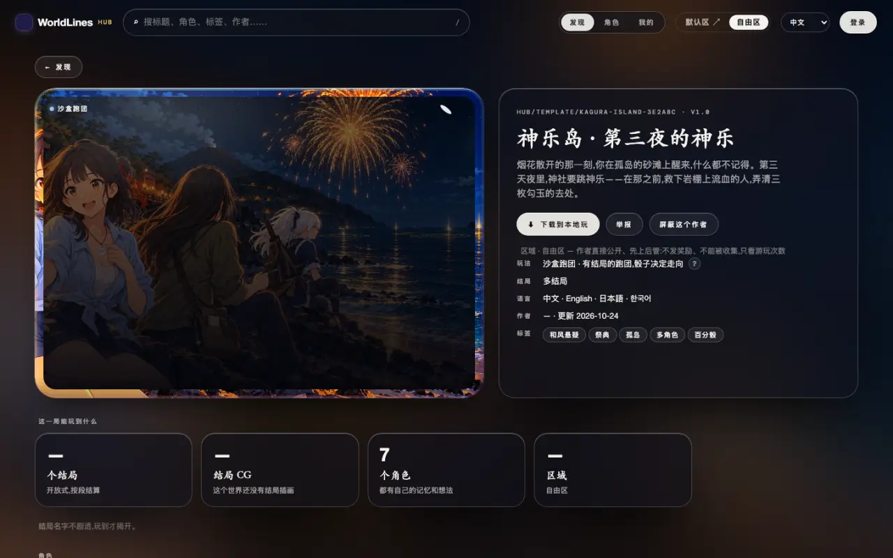

下完,作品放进 `~/.worldlines/templates/<作品编号>.template/`,详情页的按钮变成「⎘ 复制到我的工作台」「🗑 删除」等。

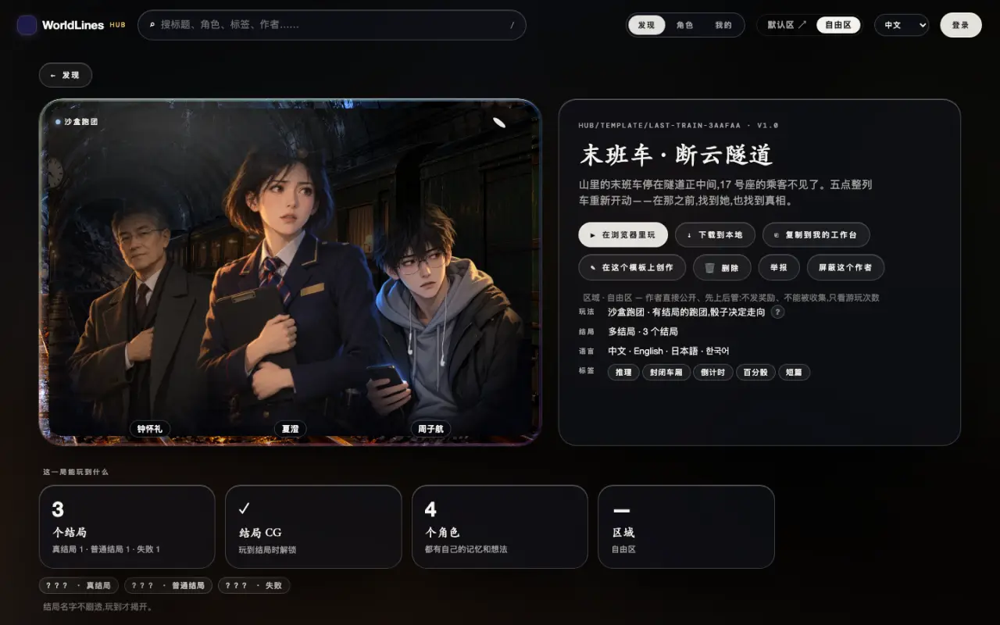

下载不需要登录。

### 3. 回到工作台「前端」→ 选这个世界 →「TS 重前端」

回到工作台,刷新页面。顶栏下拉框里多了这个作品。和 A 一样:

1. 点顶栏「前端」;
2. 下拉框里选这个作品;
3. 点「TS 重前端」;
4. 提示条上点「开「…」的一局」,确认。

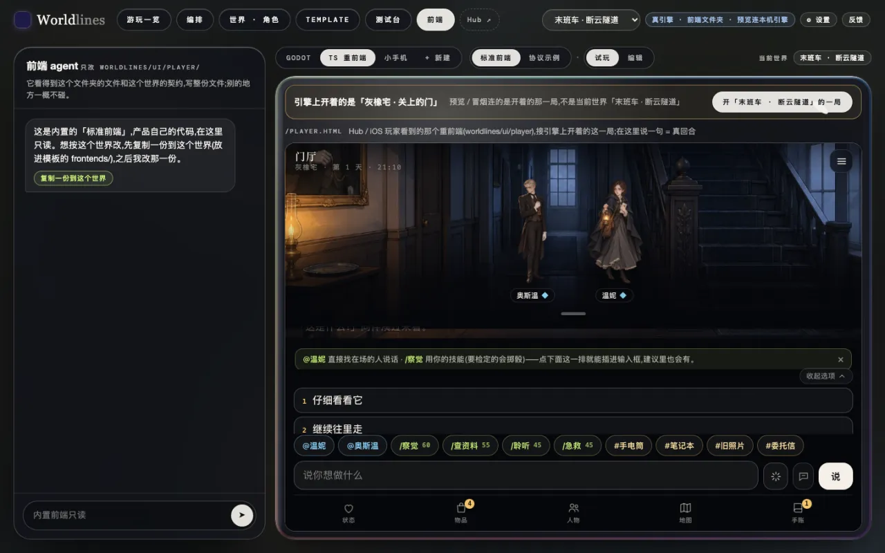

开好之后,重前端接上这一局,玩法和 A 的第 5 步一样。

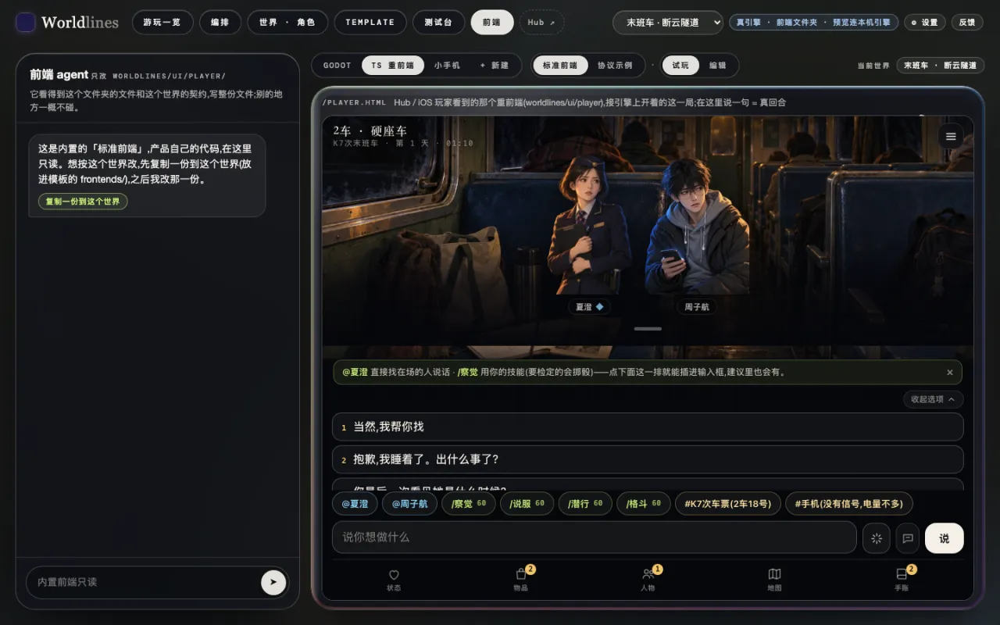

<!-- section: notes -->
## 注意

- 在工作台开的局目前固定用中文,重前端也显示中文。
- 换了世界、开了新的一局后,如果重前端还是上一局的画面,刷新一下页面。
- 重前端连的是本机引擎。`worldlines` 关掉,重前端就停了;存档留在本机。
- 重前端也能单独开:`http://127.0.0.1:8787/player.html`,接引擎上开着的这一局。
- 自由区作品是作者直接公开的,先上后管。有问题点本机 Hub 详情页的「举报」。
- 想改作品,用本机 Hub 详情页的「⎘ 复制到我的工作台」,在工作台里改(见[在测试台测模板](/docs/tutorials/test-template))。
