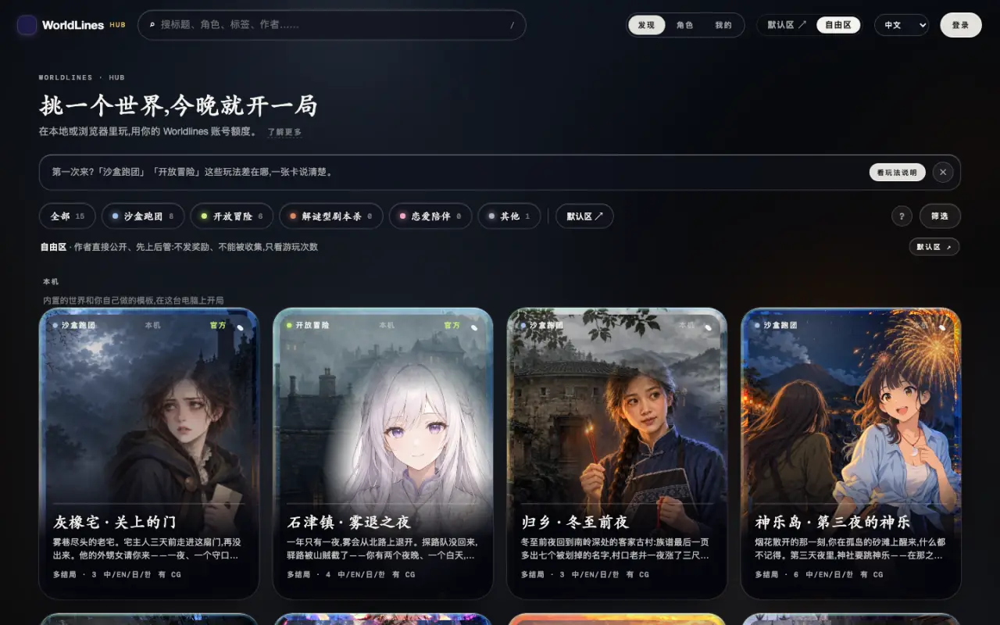
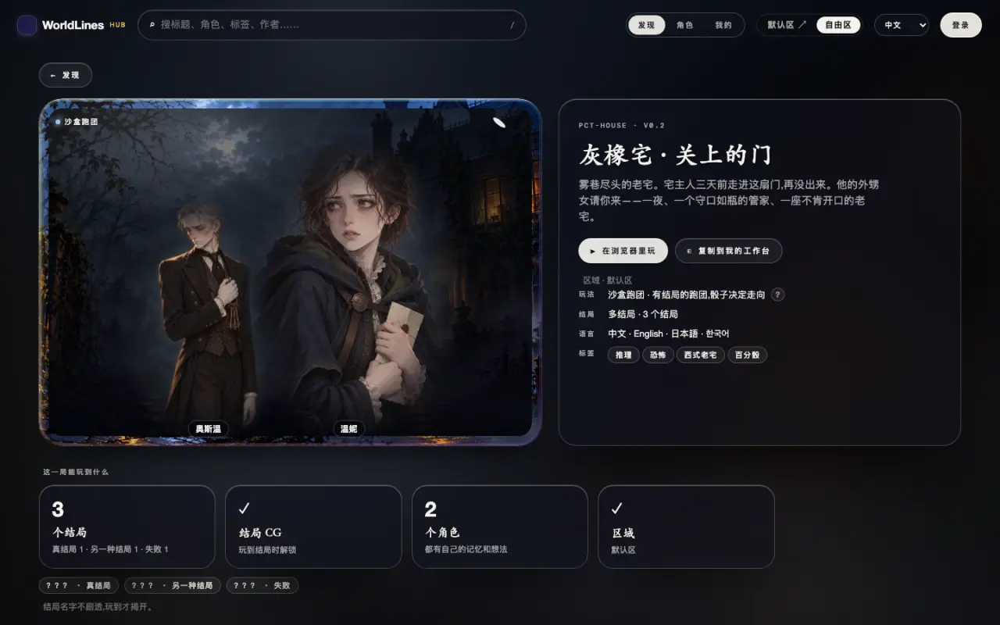
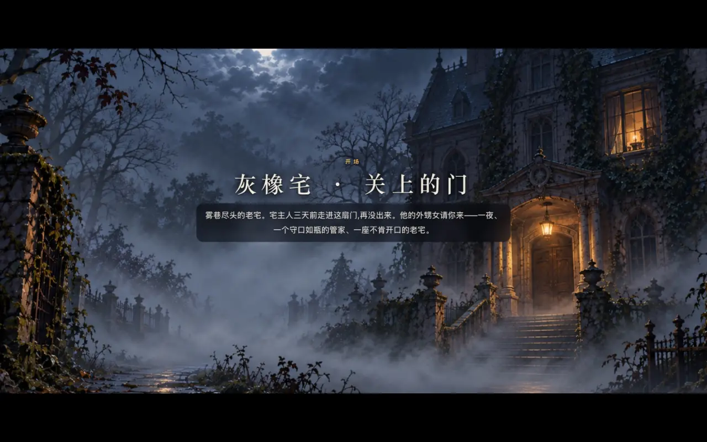
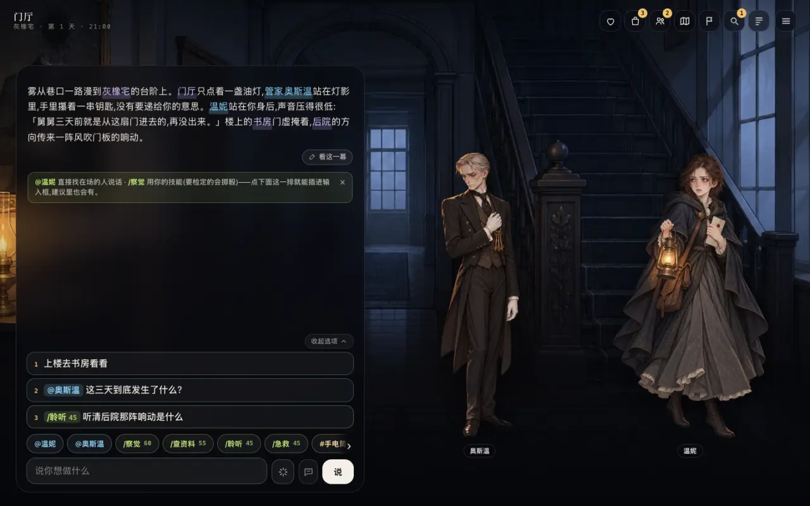
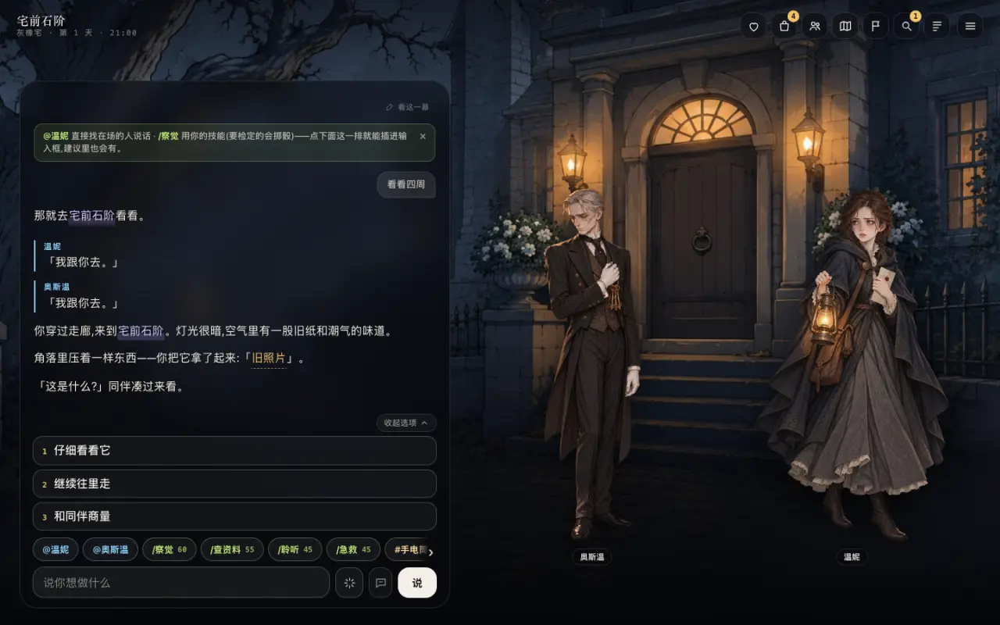

<!-- section: what -->
## 重前端是什么

> **状态:随 1.0 发布**

重前端是玩家玩一局用的界面:场景图、立绘、开场演出、选项、面板。Hub 和 iOS 上玩家看到的就是它。本机装好 `worldlines` 后,它在 `http://127.0.0.1:8787/player.html`。

测试台是做模板用的开发工具,和重前端是两个界面。

本页有两条路:

- **A** 在本机 Hub 里挑一个官方世界,用重前端玩;
- **B** 在线上 Hub 的自由区挑一个作品,下载到本机,用重前端玩。

<!-- section: a -->
## A. 本机 Hub 挑官方世界,用重前端玩

### 1. 打开本机 Hub

```bash
pip install worldlines
worldlines        # 浏览器打开 http://127.0.0.1:8787/local
```

打开的是工作台。点顶栏右边的「Hub ↗」,进本机 Hub(`http://127.0.0.1:8787/hub.html`)。


开场那一拍是模板里写好的,不调模型。要接着说话,先在工作台的「⚙ 设置」里接一个模型(见[接模型](/docs/players/providers))。

### 2. 挑一个官方世界

本机 Hub 打开在「自由区」页。最上面一栏「本机」是内置的世界和你自己的模板,内置的标着「官方」。



点一张卡片,进详情页。详情页左上角是作品编号,例如 `PCT-HOUSE`(灰橡宅)。



详情页的「▶ 在浏览器里玩」开一局,打开的是工作台里的这一局。

### 3. 进重前端

在地址栏打开:

```text
http://127.0.0.1:8787/player.html?tpl=pct-house
```

`tpl` 是作品编号(小写)。重前端自己开一局,地址后面会多出 `&save=<存档>`。

已经从详情页开了一局时,只打开 `http://127.0.0.1:8787/player.html`(不带 `tpl`),重前端接上引擎上开着的那一局。

界面语言跟着地址里的 `lang`:`&lang=zh` · `en` · `ja` · `ko`。

### 4. 在重前端里玩

先是标题卡,点「翻开」。



开场演出一段一段放,「点一下继续」。第一次玩会有一段操作说明。



- 下方输入框写你想做的事,点「说」。
- 输入框上面的 1 · 2 · 3 是建议,点一下就填进去。
- `@名字` 是直接对某个人说话,`/技能` 是用技能(带风险的会掷骰)。
- 右上角的图标打开面板:状态、物品、人物、地图、任务、线索、记录。

一回合之后,叙事接在下面,新的建议出现在输入框上面:



### 5. 存档

每一局都自动存。地址栏里的 `save=` 就是这一局:回到这个地址就接着玩。

在工作台的「游玩一览」里点模板卡片,「存档」下也能看到这一局(见[在测试台测模板](/docs/tutorials/test-template#saves))。

<!-- section: b -->
## B. 从自由区下载到本地,用重前端玩

### 1. 从自由区挑一个作品

自由区在线上 Hub:`https://neonrp.worldlines.gg/free/`。作者直接公开的作品都在这里。


点一个作品,进详情页。主按钮是「⬇ 下载到本地玩」。


点它,弹出三步:

1. 装好并打开本地版;
2. 在本地版的 Hub 里点「自由区」,找到这个作品(弹窗里有作品编号);
3. 点「下载到本地玩」,下完就能开局。


### 2. 下载到本机

在本机 Hub 的「自由区」页,「本机」一栏下面列着线上自由区的作品,卡片上标着「自由区」。点进详情页,点「⬇ 下载到本地玩」。


下完,详情页的按钮变成「▶ 在浏览器里玩」「↓ 下载到本地」「⎘ 复制到我的工作台」等。作品放进 `~/.worldlines/templates/<作品编号>.template/`。


下载不需要登录。

### 3. 用重前端玩下载的作品

和 A 的第 3 步一样,`tpl` 换成这个作品的编号:

```text
http://127.0.0.1:8787/player.html?tpl=last-train-3aafaa
```

<!-- section: notes -->
## 注意

- 重前端连的是本机引擎。`worldlines` 关掉,重前端就停了;存档留在本机。
- 自由区作品是作者直接公开的,先上后管。有问题点详情页的「举报」。
- 想改作品,用详情页的「⎘ 复制到我的工作台」,在工作台里改(见[在测试台测模板](/docs/tutorials/test-template))。
