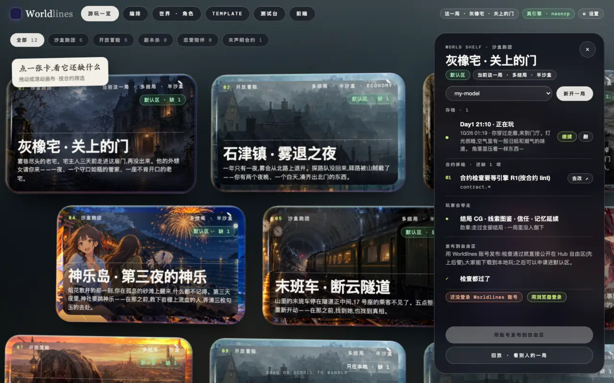
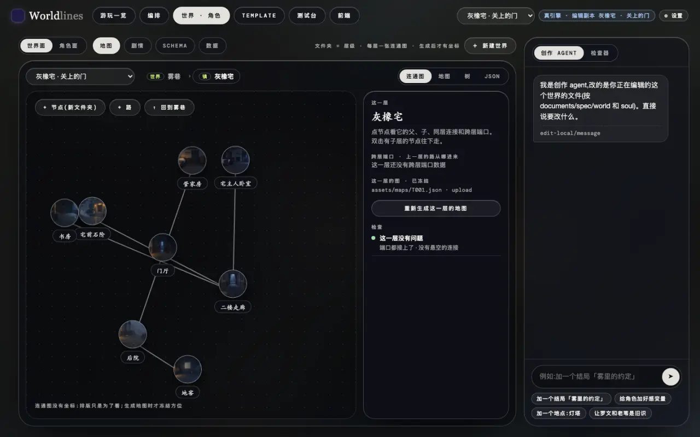
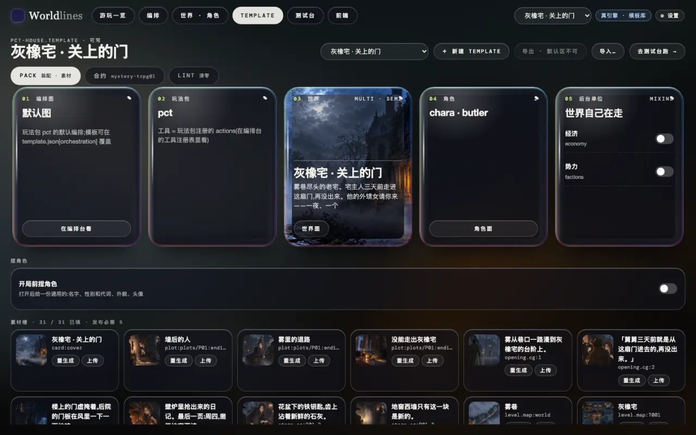
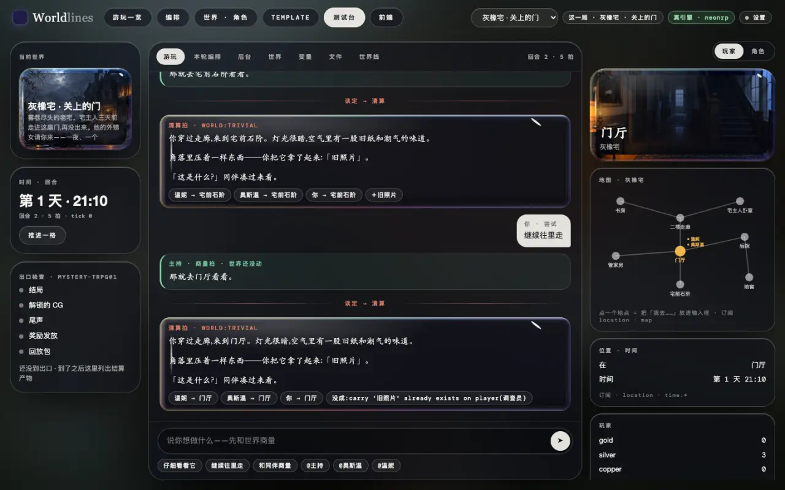
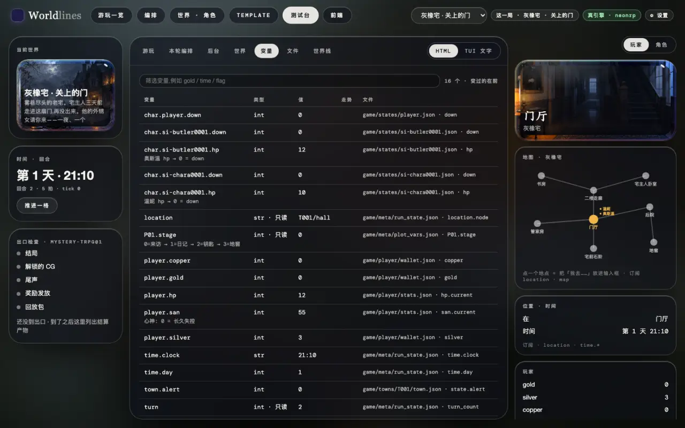
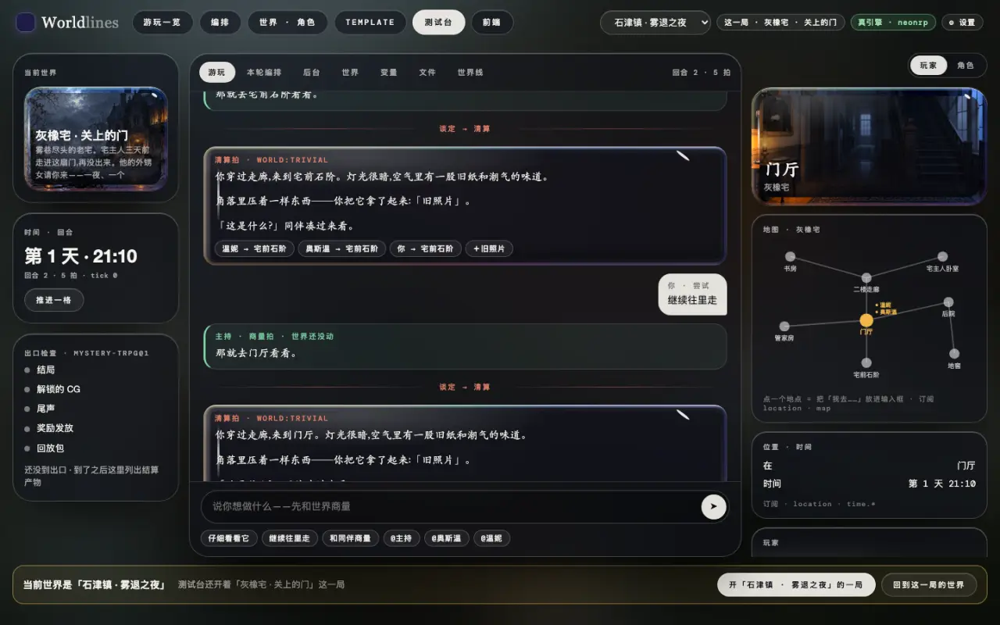
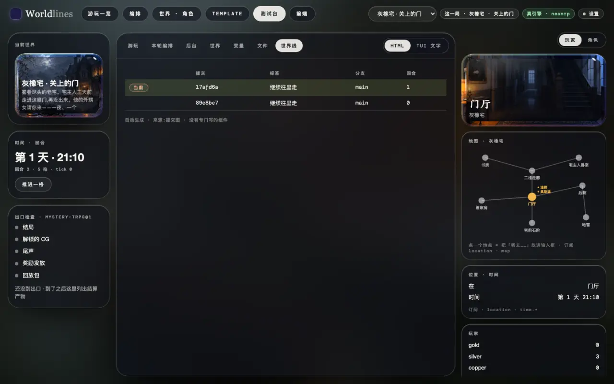

<!-- section: open -->
## 打开工作台

> **状态:随 1.0 发布**

```bash
pip install worldlines
worldlines        # 浏览器打开 http://127.0.0.1:8787/local
```

顶栏有六个台子(见[工作台](/docs/creators/workbench))。本页用四个:游玩一览、世界 · 角色、Template、测试台。

测试台是做模板和前端时用的开发工具:中间是这一局,两边是状态,页签里是引擎的原始数据。

开场那一拍是模板里写好的,不调模型。要接着说话,先在「⚙ 设置」里接一个模型(见[接模型](/docs/players/providers))。

<!-- section: pick -->
## 1. 选模板、开局

在「游玩一览」点一张模板卡,右边拉出卡片:

- 下拉框选这一局用的模型,点「新开一局」;
- 「存档」里点「继续」,接着玩之前的一局;
- 「合约体检」列出发布前还差什么。



开局后,导航栏的「测试台」就是这一局。

<!-- section: world -->
## 2. 看世界和模板

「世界 · 角色」改的是模板,不是某一局。世界面有地图 · 剧情 · Schema · 数据四页。地图按关卡分层:点一个地点,右边显示它所在的关卡、跨层出入口、这一层的地图图片和检查结果。



「Template」页是组装单位:编排图、玩法包、世界、角色、可叠加片段,下面是素材槽;顶部切到「合约」「Lint」看合约和检查。



内置模板只读。要改,先点「复制一份来改」,或者:

```bash
neonrp template fork pct-house my-house --store ~/.worldlines/templates
```

<!-- section: bench -->
## 3. 在测试台里玩

「游玩」页签就是这一局。



- 每一拍一张卡:商量拍是绿色,清算拍是红色(开源引擎只有清算拍)。
- 卡下的小标签是这一拍落到世界上的改动:谁去了哪、拿到什么;被拒的改动写着原因。
- 左栏:当前世界、时间与回合、出口检查(这份合约要求的结局、CG、尾声等到了没有)。「推进一格」让世界自己走一拍,不调模型。
- 右栏:「玩家」看你的状态、地图、位置;「角色」看在场角色的态度和打算。

<!-- section: tabs -->
## 4. 看引擎的数据

「游玩」以外的页签都由引擎的数据自动生成:

| 页签 | 内容 |
|---|---|
| 本轮编排 | 这一拍经过的节点、调用的工具、落地和被拒的改动、骰子 |
| 后台 | 片段的 tick、触发器等后台单位,每一拍各改了什么 |
| 世界 | schema 的类和实例 |
| 变量 | 闭 schema 变量:类型、当前值、走势、存在哪个文件 |
| 文件 | 这一拍写了哪些文件、写了什么 |
| 世界线 | 这一局的提交图:每回合一次提交,分支 |

右上角可以切「HTML / TUI 文字」;TUI 文字和终端里显示的一样。



同样的数据也能直接读:`GET /api/v1/play/schema`(变量)、`GET /api/v1/play/engine/commits`(提交图)、`GET /traces`(每一句的记录)。见[协议](/docs/developers/protocol)。

<!-- section: switch -->
## 5. 换模板

顶栏的下拉框是「当前世界」,编排、世界 · 角色、Template、测试台、前端都跟着它。

在别的台子换了当前世界,回到测试台会出现一条横幅:

- 「开「…」的一局」:确认后开一局新的,原来那局留在存档里;
- 「回到这一局的世界」:当前世界换回测试台开着的那一局。

在测试台上直接换,会先问一次再开局。



<!-- section: saves -->
## 6. 换存档

每一局是 `~/.worldlines/plays/` 下的一个文件夹,每一拍落定后自动保存。

- 换到另一个存档:「游玩一览」→ 点模板卡 →「存档」里点「继续」。
- 看这一局的分支:测试台「世界线」页签。
- 回到某一回合另起一条线:终端里 `/undo <回合>`,或者在这一局的文件夹里用 `neonrp commit log` / `neonrp commit checkout`。见[存档 · 分支 · 撤销](/docs/players/saves)。



<!-- section: next -->
## 下一步

- 给这一局写一个自己的前端:[一份模板,多个重前端](/docs/tutorials/frontend-data)
- 给模板换图:[用外部工具做素材](/docs/tutorials/external-assets)
